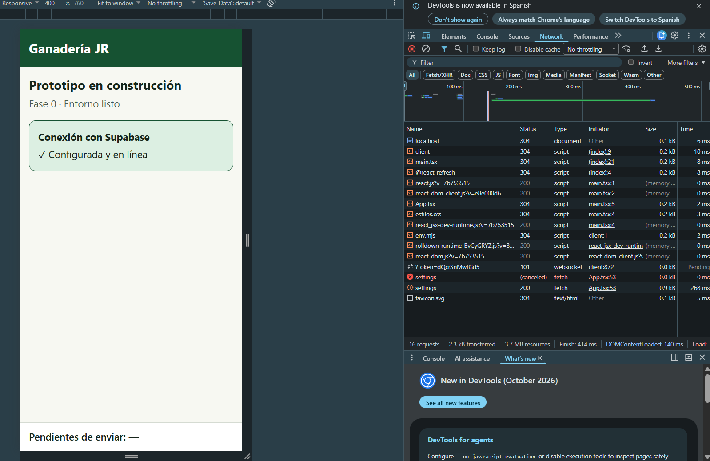
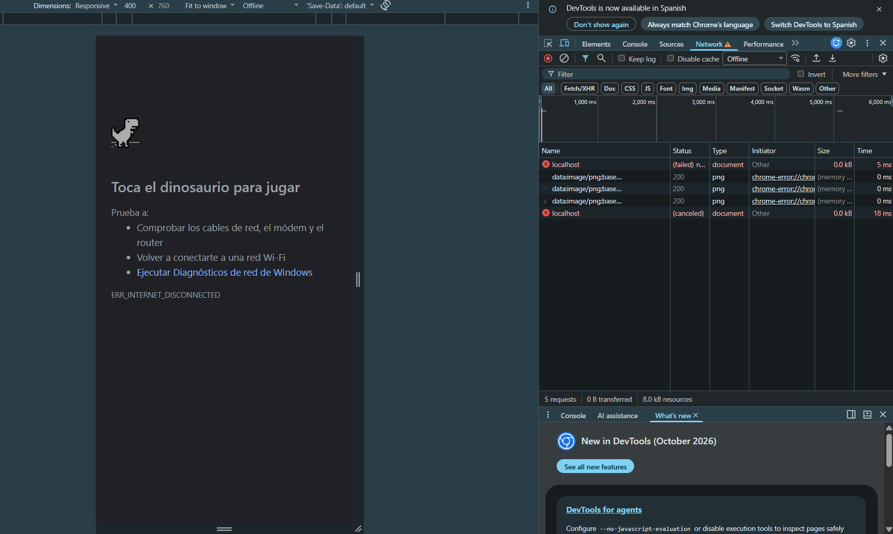
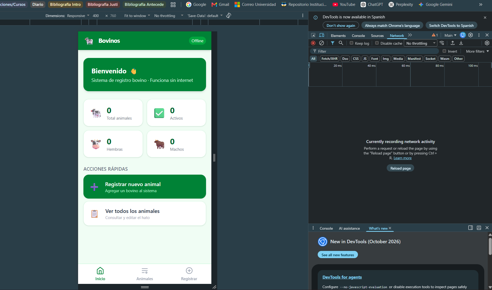
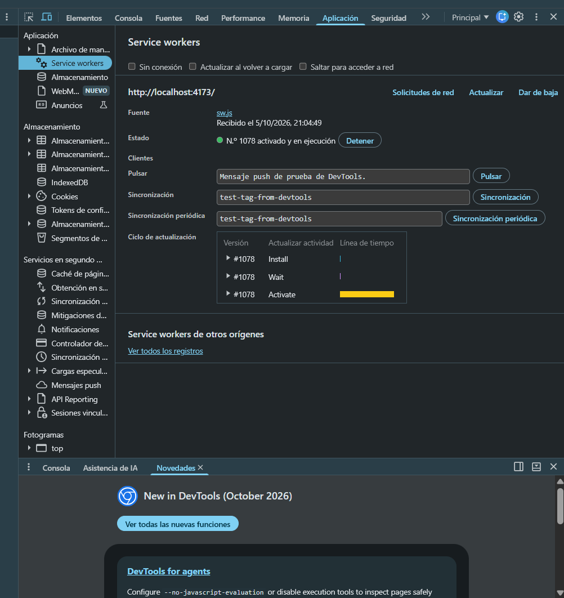
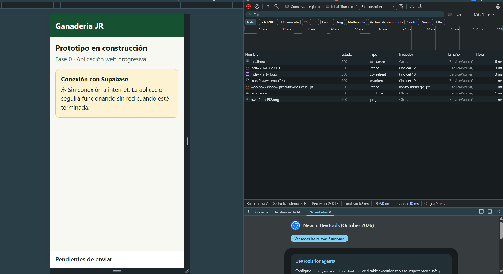
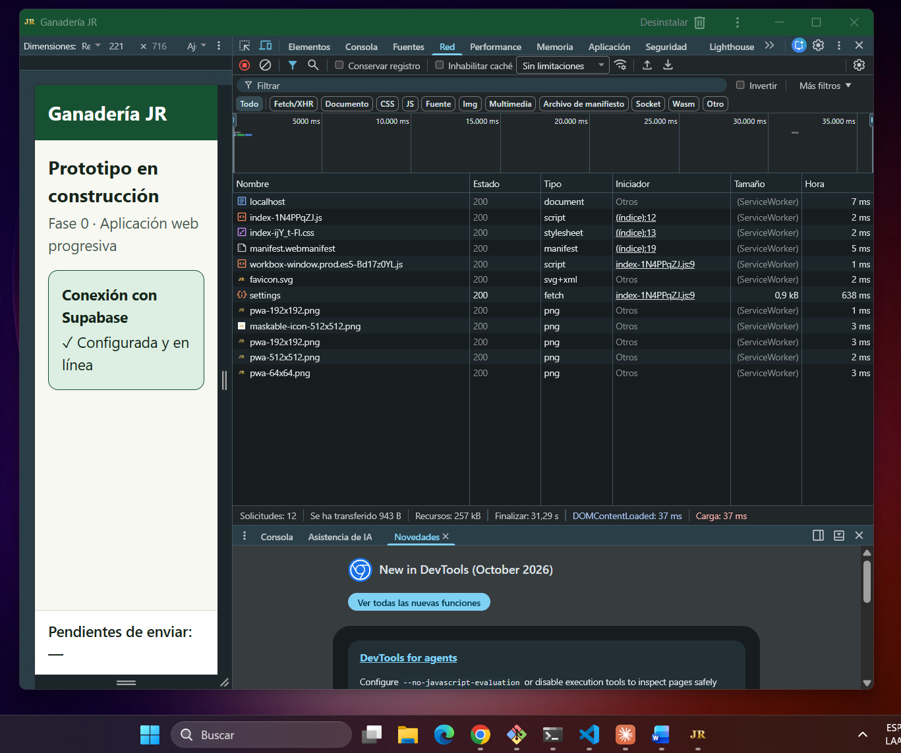

# Pruebas de la Fase 0 — Preparación del entorno

Verificaciones ejecutadas al preparar el entorno de desarrollo (apartado 1.6.3.2, pasos 0.1 a 0.8
del [plan](../../PLAN.md)). Su propósito es comprobar que la base sobre la que se construirán las
cinco iteraciones funciona antes de empezar a construir sobre ella.

**Responsable:** Daniel Santiago Ramos Pintor
**Periodo de ejecución:** 3 al 5 de octubre de 2026
**Equipo:** Windows 11 Home · Google Chrome con herramientas de desarrollador

## Resumen de resultados

| Id | Prueba | Requerimiento | Estado |
|---|---|---|---|
| PE-01 | Herramientas de desarrollo instaladas | Paso 0.1 | ✅ |
| PE-02 | Dependencias con las versiones de la Tabla 19 y estructura por capas | Paso 0.2, 0.3 · RNF-13 | ✅ |
| PE-03 | Conexión con el servicio remoto | Paso 0.5 | ✅ |
| PE-04 | Registro abierto de usuarios deshabilitado | RNF-07 · 3.9.1 | ⚠️ Aprobada tras corrección |
| PE-05 | Compilación de TypeScript sin errores | Paso 0.2 | ✅ |
| PE-06 | Arranque en desarrollo y presentación en pantalla de teléfono | Paso 0.6 · RNF-10 | ✅ |
| PE-07 | Línea base: comportamiento sin Service Worker | RF-28 · RD-01 | ✅ (falla esperada) |
| PE-08 | La compilación de producción genera el Service Worker y el manifiesto | Paso 0.7 · RNF-11 | ✅ |
| PE-09 | Service Worker registrado y activo | Paso 0.7 · RF-28 | ⚠️ Aprobada con observaciones |
| PE-10 | La aplicación abre sin conexión | RF-28 · RD-01 | ✅ |
| PE-11 | Instalación sin tienda de aplicaciones | RNF-11 · RNF-10 | ✅ |
| PU-01 | Contraste del sistema de color (prueba automática) | 3.10.4.1 · RNF-01 | ⚠️ Aprobada tras corrección |

**Total:** 12 pruebas (11 manuales y 1 automática con 16 verificaciones) · 12 aprobadas · 0 fallidas · 3 con observaciones.

## Versiones del código evaluadas

| Commit | Contenido |
|---|---|
| `0d0c18a` | Pasos 0.1 a 0.3: entorno, dependencias y estructura |
| `ca3a7d8` | Paso 0.5: cliente de Supabase y verificación de conexión |
| `6977393` | Paso 0.6: punto de entrada, estructura general y sistema de color |
| `ac421ce` | Paso 0.7: PWA instalable, íconos y aviso de actualización. *El mensaje del commit dice «Paso 0.6» por error de digitación; su contenido corresponde al paso 0.7. No se reescribió el historial porque ya estaba publicado en el repositorio remoto.* |

---

## PE-01 · Herramientas de desarrollo instaladas

| Campo | Contenido |
|---|---|
| Objetivo | Comprobar que el equipo dispone de las herramientas que exige el desarrollo y que sus versiones son compatibles con las tecnologías de la Tabla 19 |
| Requerimiento | Paso 0.1 del plan |
| Condiciones iniciales | Equipo de desarrollo con Windows 11 |
| Datos de entrada | — |
| Pasos | 1. Ejecutar `node -v`, `npm -v`, `git --version` y `code --version`. 2. Comparar con los requisitos de las herramientas |
| Resultado esperado | Node.js ≥ 20.19 o ≥ 22.12 (requisito de Vite 8); Git y VS Code instalados |
| Resultado obtenido | Node.js 22.14.0 · npm 10.9.2 · Git 2.56.0 · VS Code 1.131.0. Extensiones instaladas: ESLint 3.0.34, Prettier 12.4.0, Vitest 1.52.2 |
| Estado | ✅ Aprobada |
| Fecha | 2026-10-03 · verificación repetida el 2026-10-05 |
| Observaciones | react-router 8 exige Node.js ≥ 22.22, superior a la instalada. Se adoptó react-router 7.18.4, compatible, y se registró la decisión en el plan |

**Evidencia (salida de comandos, 2026-10-05):**
```
v22.14.0
10.9.2
git version 2.56.0.windows.1
1.131.0
```

## PE-02 · Dependencias con las versiones de la Tabla 19 y estructura por capas

| Campo | Contenido |
|---|---|
| Objetivo | Comprobar que las dependencias instaladas corresponden exactamente a las versiones declaradas en la Tabla 19 y que la estructura del proyecto refleja las capas y los módulos del diseño |
| Requerimiento | Pasos 0.2 y 0.3 · RNF-13 (modularidad) |
| Condiciones iniciales | `npm install` ejecutado |
| Datos de entrada | Tabla 19 del documento |
| Pasos | 1. Ejecutar `npm ls --depth=0`. 2. Comparar cada versión con la Tabla 19. 3. Revisar que existan las carpetas de las capas de la Figura 10 y de los módulos de la Tabla 8 |
| Resultado esperado | Versiones idénticas a la Tabla 19, sin paquetes sobrantes; una carpeta por capa y por módulo funcional |
| Resultado obtenido | Las seis tecnologías con versión en la Tabla 19 coinciden: React 19.3.0, Vite 8.2.2, Dexie 4.4.5, vite-plugin-pwa 1.3.0, Workbox 7.4.1, supabase-js 2.116.0. Estructura: `ui/` y `app/` (presentación), `modulos/` con diez módulos y `sesion/` (lógica), `datos/`, `sync/` y `servicios/` (acceso a datos), `supabase/migrations/` (servicio remoto) |
| Estado | ✅ Aprobada |
| Fecha | 2026-10-03 · verificación repetida el 2026-10-05 |
| Observaciones | En la repetición aparecieron dos paquetes sobrantes (`@emnapi/runtime`, `@img/sharp-wasm32`), residuos de un intento de instalación de `@vite-pwa/assets-generator` 2.0.0 que npm rechazó por incompatibilidad con vite-plugin-pwa 1.3.0. Se eliminaron y la verificación posterior no reportó sobrantes |

**Evidencia (salida de `npm ls --depth=0`, 2026-10-05, tras la limpieza):**
```
ganaderia-jr-pwa@0.1.0
+-- @supabase/supabase-js@2.116.0
+-- @types/node@24.19.1
+-- @types/react-dom@19.3.0
+-- @types/react@19.3.0
+-- @vite-pwa/assets-generator@1.0.4
+-- @vitejs/plugin-react@6.1.1
+-- dexie-react-hooks@4.4.0
+-- dexie@4.4.5
+-- fake-indexeddb@6.2.5
+-- react-dom@19.3.0
+-- react-router@7.18.4
+-- react@19.3.0
+-- typescript@7.0.2
+-- vite-plugin-pwa@1.3.0
+-- vite@8.2.2
+-- vitest@5.0.3
`-- workbox-window@7.4.1
```

## PE-03 · Conexión con el servicio remoto

| Campo | Contenido |
|---|---|
| Objetivo | Comprobar que la aplicación puede comunicarse con el proyecto de Supabase con los valores configurados en `.env.local` |
| Requerimiento | Paso 0.5 del plan |
| Condiciones iniciales | Proyecto creado en Supabase (región São Paulo, plan gratuito). Archivo `.env.local` con la URL y la clave publicable |
| Datos de entrada | URL del proyecto y clave `sb_publishable_…` |
| Pasos | 1. Ejecutar `npm run verificar:supabase`. 2. Confirmar que `.env.local` no figura en `git status` |
| Resultado esperado | El servicio responde correctamente; la clave empleada no es la secreta; el archivo de configuración no se versiona |
| Resultado obtenido | Conexión correcta con `adspgywoxykzkjvsppxy.supabase.co`. `.env.local` ignorado por Git (regla `.env.*` del `.gitignore`) |
| Estado | ✅ Aprobada |
| Fecha | 2026-10-03 · verificación repetida el 2026-10-05 |
| Observaciones | La verificación detectó que el registro abierto de usuarios estaba habilitado; se trata en PE-04 |

## PE-04 · Registro abierto de usuarios deshabilitado

| Campo | Contenido |
|---|---|
| Objetivo | Comprobar que nadie puede crearse una cuenta en el servicio por su cuenta, ya que los tres usuarios del predio los crea el propietario (apartado 3.9.1) |
| Requerimiento | RNF-07 · apartado 3.9.1 |
| Condiciones iniciales | Proyecto de Supabase recién creado, con la configuración predeterminada |
| Datos de entrada | — |
| Pasos | 1. Ejecutar `npm run verificar:supabase` y leer «Registro abierto de usuarios». 2. Si está abierto, desactivar *Allow new users to sign up* en *Authentication → Sign In / Providers*. 3. Repetir la verificación |
| Resultado esperado | «Registro abierto de usuarios: no» |
| Resultado obtenido | **Primera ejecución: «sí» (falla).** La configuración predeterminada de Supabase permite el registro abierto, de modo que cualquier persona con la URL y la clave publicable, ambas visibles en el navegador, podía crear una cuenta. Se deshabilitó el registro desde el panel. **Segunda ejecución: «no» (aprobada)** |
| Estado | ⚠️ Aprobada tras corrección |
| Fecha | 2026-10-03 |
| Observaciones | El hallazgo confirma lo que establece el apartado 3.9.3: la seguridad no puede depender de que la clave publicable sea secreta, sino de la configuración del servicio y de las reglas a nivel de fila |

**Evidencia (salida tras la corrección):**
```
✓ Conexión con Supabase correcta
  Proyecto: adspgywoxykzkjvsppxy.supabase.co
  Ingreso con correo habilitado: sí
  Registro abierto de usuarios: no
```

## PE-05 · Compilación de TypeScript sin errores

| Campo | Contenido |
|---|---|
| Objetivo | Comprobar que el código no contiene errores de tipos |
| Requerimiento | Paso 0.2 del plan |
| Condiciones iniciales | Dependencias instaladas |
| Datos de entrada | Código fuente del commit `ac421ce` |
| Pasos | Ejecutar `npx tsc --noEmit` |
| Resultado esperado | Finaliza sin errores |
| Resultado obtenido | Finaliza sin errores |
| Estado | ✅ Aprobada |
| Fecha | 2026-10-05 |
| Observaciones | Esta verificación forma parte de `npm run build`, de modo que se repite en cada compilación de producción |

## PE-06 · Arranque en desarrollo y presentación en pantalla de teléfono

| Campo | Contenido |
|---|---|
| Objetivo | Comprobar que la aplicación arranca, se conecta al servicio remoto y se presenta correctamente en el ancho de un teléfono |
| Requerimiento | Paso 0.6 · RNF-10 (adaptación al tamaño de pantalla) |
| Condiciones iniciales | Servidor de desarrollo en ejecución con `npm run dev` |
| Datos de entrada | Vista de dispositivo de Chrome a 400 × 760 px |
| Pasos | 1. Abrir `http://localhost:5173`. 2. Activar la vista de dispositivo (Ctrl+Shift+M). 3. Revisar el encabezado, la tarjeta de conexión y la barra inferior |
| Resultado esperado | Encabezado verde «Ganadería JR», tarjeta «Configurada y en línea» y barra inferior visible, sin desbordes horizontales |
| Resultado obtenido | Se presenta como se esperaba. La red registra 16 solicitudes, carga completa en 414 ms |
| Estado | ✅ Aprobada |
| Fecha | 2026-10-05 |
| Observaciones | Aparecen dos solicitudes al servicio de autenticación, una cancelada y otra exitosa. Se debe al modo estricto de React, que en desarrollo ejecuta cada efecto dos veces para detectar errores; en producción ocurre una sola |



## PE-07 · Línea base: comportamiento sin Service Worker

| Campo | Contenido |
|---|---|
| Objetivo | Documentar el comportamiento de la aplicación **antes** de incorporar el Service Worker, como punto de comparación para PE-10 |
| Requerimiento | RF-28 · RD-01 |
| Condiciones iniciales | Servidor de desarrollo en ejecución (sin Service Worker) |
| Datos de entrada | Red del navegador en modo *Offline* |
| Pasos | 1. Abrir la aplicación con red. 2. Cambiar la red a *Offline*. 3. Recargar |
| Resultado esperado | La aplicación **no** carga: sin Service Worker se comporta como una aplicación web tradicional, la alternativa que la Tabla 17 descartó con una calificación de 0 en operación sin conexión |
| Resultado obtenido | El navegador muestra `ERR_INTERNET_DISCONNECTED` y la solicitud del documento falla |
| Estado | ✅ Aprobada (la falla era el resultado esperado) |
| Fecha | 2026-10-05 |
| Observaciones | Esta prueba no verifica una capacidad del prototipo sino la ausencia de ella, y justifica empíricamente la elección de la arquitectura web progresiva |



## PE-08 · La compilación de producción genera el Service Worker y el manifiesto

| Campo | Contenido |
|---|---|
| Objetivo | Comprobar que la compilación produce los artefactos que hacen de la aplicación una PWA |
| Requerimiento | Paso 0.7 · RNF-11 |
| Condiciones iniciales | Íconos generados con `npm run iconos` |
| Datos de entrada | Código fuente del commit `ac421ce` |
| Pasos | Ejecutar `npm run build` |
| Resultado esperado | Se generan `manifest.webmanifest` y `sw.js`, y el Service Worker incluye en su caché todos los recursos de la aplicación |
| Resultado obtenido | Se generan ambos archivos. El Service Worker guarda 20 recursos (251 KB) |
| Estado | ✅ Aprobada |
| Fecha | 2026-10-05 |
| Observaciones | Tamaño de la aplicación comprimida: 70,6 KB de JavaScript y 0,8 KB de estilos |

**Evidencia (salida de `npm run build`):**
```
dist/manifest.webmanifest                          0.58 kB
dist/index.html                                    0.82 kB │ gzip:  0.43 kB
dist/assets/index-ijY_t-Fl.css                     2.25 kB │ gzip:  0.81 kB
dist/assets/workbox-window.prod.es5-Bd17z0YL.js    5.65 kB │ gzip:  2.20 kB
dist/assets/index-R0IeBHO5.js                    224.73 kB │ gzip: 70.61 kB

PWA v1.3.0
mode      generateSW
precache  20 entries (250.99 KiB)
files generated
  dist/sw.js
  dist/workbox-2fbc6a65.js
```

## PE-09 · Service Worker registrado y activo

| Campo | Contenido |
|---|---|
| Objetivo | Comprobar que el navegador registra y activa el Service Worker de la aplicación |
| Requerimiento | Paso 0.7 · RF-28 |
| Condiciones iniciales | Versión de producción servida con `npm run preview` |
| Datos de entrada | — |
| Pasos | 1. Abrir `http://localhost:4173`. 2. En las herramientas de desarrollador, abrir *Aplicación → Service workers* |
| Resultado esperado | `sw.js` con estado «activado y en ejecución» |
| Resultado obtenido | `sw.js` activado y en ejecución, recibido el 5/10/2026 a las 21:04:49 |
| Estado | ⚠️ Aprobada con observaciones |
| Fecha | 2026-10-05 |
| Observaciones | **Incidente.** En el primer intento el navegador mostró una aplicación distinta («Bovinos»), perteneciente a otro proyecto servido antes en la misma dirección. Su Service Worker seguía registrado para `localhost:4173` y respondía con la versión que tenía guardada, sin consultar el servidor. Se resolvió con *Aplicación → Almacenamiento → Borrar datos del sitio* y la prueba se repitió con éxito. El incidente ilustra por qué la aplicación avisa al usuario de las versiones nuevas: un Service Worker sigue sirviendo su versión guardada hasta que se le indica lo contrario |





## PE-10 · La aplicación abre sin conexión

| Campo | Contenido |
|---|---|
| Objetivo | Comprobar que, tras la primera visita, la aplicación abre sin red porque sus recursos se sirven desde el dispositivo |
| Requerimiento | RF-28 · RD-01 |
| Condiciones iniciales | PE-09 aprobada: Service Worker activo |
| Datos de entrada | Red del navegador en modo *Sin conexión* |
| Pasos | 1. Cambiar la red a *Sin conexión*. 2. Recargar la aplicación |
| Resultado esperado | La aplicación carga completa y la tarjeta de conexión indica que no hay red |
| Resultado obtenido | La aplicación carga completa en 40 ms. Las 7 solicitudes las atiende el Service Worker y se transfieren 0 bytes por la red. La tarjeta muestra «Sin conexión a internet» |
| Estado | ✅ Aprobada |
| Fecha | 2026-10-05 |
| Observaciones | Comparada con PE-07, demuestra el efecto del Service Worker en la misma condición de red. La operación sin conexión de los **datos** (registrar y consultar) se verificará en la Iteración 1 |



## PE-11 · Instalación sin tienda de aplicaciones

| Campo | Contenido |
|---|---|
| Objetivo | Comprobar que la aplicación puede instalarse desde el navegador, sin tienda de aplicaciones |
| Requerimiento | RNF-11 · RNF-10 |
| Condiciones iniciales | PE-09 aprobada |
| Datos de entrada | — |
| Pasos | 1. Pulsar el ícono de instalación de la barra de direcciones de Chrome. 2. Confirmar la instalación. 3. Abrir la aplicación instalada |
| Resultado esperado | La aplicación se instala, abre en su propia ventana sin barra de direcciones y muestra su ícono en el sistema operativo |
| Resultado obtenido | Se instala y abre en ventana propia titulada «Ganadería JR», con el logo JR en la barra de título y en la barra de tareas de Windows, y la opción de desinstalar |
| Estado | ✅ Aprobada |
| Fecha | 2026-10-05 |
| Observaciones | Verificado en computador de escritorio. La instalación en un teléfono Android real queda pendiente para cuando la aplicación esté desplegada con HTTPS (paso 6.5), ya que fuera de `localhost` los navegadores exigen conexión segura para registrar un Service Worker |



## PU-01 · Contraste del sistema de color

Primera prueba automática del proyecto (paso 0.8). Verifica con Vitest las cifras de contraste que
afirma el apartado 3.10.4.1 y que todas las combinaciones de texto del sistema de color alcanzan el
nivel reforzado de WCAG 2.2.

| Campo | Contenido |
|---|---|
| Objetivo | Comprobar que (a) la función de contraste calcula conforme a WCAG 2.2, (b) las cifras declaradas en el documento son correctas y (c) toda combinación de texto y fondo empleada alcanza 7:1 |
| Requerimiento | Apartado 3.10.4.1 (Tabla 29) · RNF-01 (operación en condiciones de campo) |
| Tipo | Unitaria, automática |
| Código | [`src/ui/contraste.ts`](../../src/ui/contraste.ts) · prueba [`src/ui/contraste.test.ts`](../../src/ui/contraste.test.ts) |
| Condiciones iniciales | Hoja de estilos `src/ui/estilos.css` con las variables de color. La prueba lee los colores de ese archivo, de modo que verifica los que usa la aplicación y no una copia |
| Datos de entrada | Nueve combinaciones de texto y fondo, más casos de referencia: negro sobre blanco (21:1) y un color sobre sí mismo (1:1) |
| Pasos | Ejecutar `npm run test:informe` |
| Resultado esperado | 16 verificaciones aprobadas. Las cifras 9,18:1 y 14,92:1 del documento se reproducen |
| Resultado obtenido | **Primera ejecución: 14 aprobadas, 2 fallidas** ([informe](resultados/2026-10-05_215341_18596d8.md)). Las cifras del documento se reproducen exactamente, pero dos combinaciones agregadas en la implementación no alcanzaban 7:1: rojo oscuro sobre fondo rojizo, 6,60:1, en las **advertencias sanitarias**, y texto secundario sobre fondo claro, 6,85:1. **Tras la corrección: 16 de 16 aprobadas** ([informe](resultados/2026-10-05_215417_18596d8.md)) |
| Estado | ⚠️ Aprobada tras corrección |
| Fecha | 2026-10-05 |
| Corrección aplicada | Fondo rojizo de #F9E3E0 a **#FBECEA** (7,06:1). Se aclaró el fondo y no se oscureció el rojo, porque #922B21 está declarado en la Tabla 29 y el fondo rojizo no tenía un valor fijado en el documento. Texto secundario de #4A5A50 a **#49584E** (7,05:1). En ambos casos se buscó el ajuste mínimo que alcanza el umbral, para no alterar la apariencia |
| Observaciones | Ambas combinaciones cumplían ya el nivel mínimo AA (4,5:1). Se exigió el reforzado (7:1) porque es el que el documento adopta y por las condiciones de luz del potrero. La prueba queda en el conjunto automático: si un cambio futuro de colores rompe el contraste, fallará |
