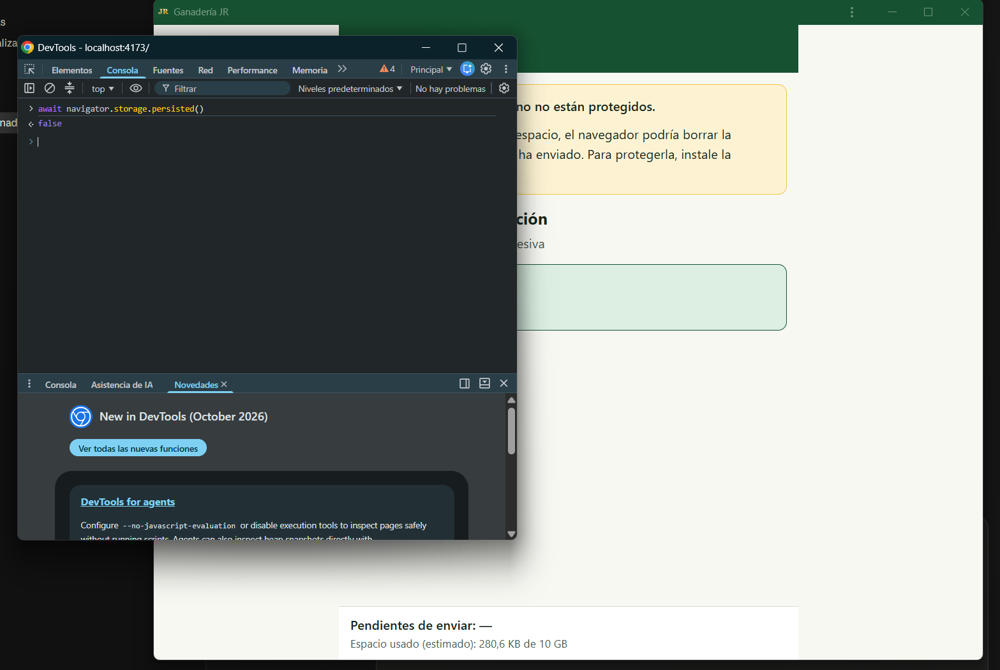

# Pruebas de la Iteración 1 — Fundación técnica

Historias de usuario: HU-08 (autenticación), HU-06 (registro por el trabajador), HU-07 (operación
sin conexión). Pasos 1.1 a 1.13 del [plan](../../PLAN.md). Rama `iteracion-1`.

**Responsable:** Daniel Santiago Ramos Pintor

## Resumen de resultados

| Id | Prueba | Paso | Requerimiento | Estado |
|---|---|---|---|---|
| PU-02 | Tipos del dominio frente al modelo lógico | 1.1 | Tablas 23 y 24 · RD-02, RD-04, RNF-08 | ✅ |
| PU-03 | Identificador UUID versión 7 | 1.2 | 3.7.1 · RD-02 · RF-29 | ✅ |
| PU-04 | Esquema local | 1.3 | RD-01 · RNF-09 · 3.8.4 · 3.7.3 | ⚠️ Aprobada tras ajuste de la prueba |
| PU-05 | Repositorio local y cola de operaciones | 1.4 | 3.7.2 · RNF-04 · RD-04 · RF-27 · RNF-13 | ✅ |
| PU-06 | Almacenamiento persistente | 1.5 | RNF-15 · 3.8.7 | ✅ |
| PE-12 | Almacenamiento persistente en el navegador real | 1.5 | RNF-15 | ⚠️ Aprobada con observaciones |
| PI-01 | Esquema remoto contra la base de datos real | 1.6 | RNF-05 · RNF-06 · RNF-08 · RD-04 · 3.7.3 · 3.7.8 | ⚠️ Aprobada tras corrección |
| PU-07 | Verificación del token sin conexión y sesión local | 1.7 | 3.9.1 · RD-03 · RF-24 · RF-25 | ✅ |
| PI-02 | Gancho de token de acceso contra el servicio real | 1.7 | 3.9.1 · RF-25 | ✅ |
| PE-13 | Ingreso con conexión y apertura sin conexión | 1.7 | RF-24 · RD-03 · RNF-07 · CU-01 | ⚠️ Aprobada con observaciones |
| PU-08 | Código de desbloqueo | 1.8 | 3.9.1 · RD-05 · RNF-07 · Tabla 31 | ✅ |
| PE-14 | Código de desbloqueo en el navegador real | 1.8 | 3.9.1 · Tabla 31 | ✅ |
| PU-09 | Gestor de permisos del teléfono | 1.9 | 3.9.2 · 3.9.3 · 3.9.5 · Tabla 27 | ✅ |
| PI-03 | Políticas de seguridad a nivel de fila contra el servicio real | 1.9 | 3.9.2 · 3.9.3 · 3.9.5 · RF-27 · RD-05 · RNF-06 | ⚠️ Aprobada con observaciones |
| PU-10 | Sincronización: subida y conflictos | 1.10 | 3.7.2 – 3.7.8 · 3.8.6 · RF-29 · RF-30 | ✅ |
| PU-11 | Sincronización: bajada y carga inicial | 1.10 | 3.7.5 – 3.7.8 · RF-29 · RNF-05 | ✅ |
| PI-04 | Sincronización de extremo a extremo contra el servicio real | 1.10 | RF-29 · RNF-05 · RD-04 | ✅ |
| PU-12 | Indicador de sincronización | 1.11 | RF-30 · 3.10.4.5 · Tablas 22 y 31 | ✅ |
| PE-15 | Indicador de sincronización en el navegador real | 1.11 | RF-30 · 3.10.4.5 | ⚠️ Aprobada con observaciones |
| PU-13 | Cierre de sesión con la cola vacía | 1.12 | 3.9.1 · Tabla 31 · RNF-04 | ✅ |
| PE-16 | Cierre de sesión en el navegador real | 1.12 | 3.9.1 | ✅ |

---

## PU-02 · Tipos del dominio frente al modelo lógico

| Campo | Contenido |
|---|---|
| Objetivo | Comprobar que los valores admitidos de cada entidad coinciden con los del modelo lógico y que los tipos auxiliares impiden, al compilar, las operaciones que el diseño prohíbe |
| Requerimiento | Tablas 23 y 24 · RD-02 y RD-04 (identificador, autor y fecha los fija el dispositivo) · RNF-08 (autoría inalterable) · 3.9.5 (qué entidades admiten corrección) |
| Tipo | Unitaria, automática. Combina verificaciones en ejecución (Vitest) y afirmaciones de tipos evaluadas por el compilador (`expectTypeOf` con `tsc`) |
| Código | [`src/dominio/tipos.ts`](../../src/dominio/tipos.ts) · prueba [`src/dominio/tipos.test.ts`](../../src/dominio/tipos.test.ts) |
| Condiciones iniciales | Ninguna; los tipos no dependen de otros módulos |
| Datos de entrada | Los 15 conjuntos de valores admitidos, contrastados con el apartado del documento que los define |
| Pasos | Ejecutar `npm run test:informe` |
| Resultado esperado | Los 15 conjuntos coinciden con el documento y no tienen repetidos; el compilador acepta las cuatro afirmaciones de tipos |
| Resultado obtenido | 20 verificaciones aprobadas y verificación de tipos sin errores ([informe](resultados/2026-10-06_194946_95cac2c.md)). Total del conjunto automático: 36 de 36 |
| Estado | ✅ Aprobada |
| Fecha | 2026-10-06 |
| Observaciones | **Valores validados con el propietario del proyecto.** El documento no enumera los tipos de evento sanitario, las unidades de dosis ni los sexos. Se propusieron y el 2026-10-06 se validaron: tipos de evento `vacuna, purga, vitamina, tratamiento, otro`; unidades `ml, cc, mg, dosis` (se retiraron `g` y `tableta` de la propuesta inicial; ml y cc se conservan ambas aunque son equivalentes, porque las dos se emplean en campo); sexos `macho, hembra`. **Verificación del mecanismo de prueba.** Las afirmaciones de tipos no se evalúan al ejecutar Vitest sino al compilar. Para comprobar que realmente detectan un error se invirtió de forma deliberada una de ellas (afirmar que una corrección puede corregirse) y el compilador la rechazó con el error TS2344; después se restauró. A raíz de ello, `npm run test:informe` ejecuta primero la verificación de tipos y la incluye en el informe |

## PU-03 · Identificador UUID versión 7

| Campo | Contenido |
|---|---|
| Objetivo | Comprobar que cada dispositivo genera identificadores con el formato de la RFC 9562, únicos, ordenados por fecha de creación y sin coincidencias entre dispositivos que no se comunican |
| Requerimiento | Apartado 3.7.1 · RD-02 · RF-29 (base de la deduplicación del 3.7.8) |
| Tipo | Unitaria, automática |
| Especificación | [docs/tecnica/01-identificador-uuidv7.md](../tecnica/01-identificador-uuidv7.md) |
| Código | [`src/datos/uuidv7.ts`](../../src/datos/uuidv7.ts) · prueba [`src/datos/uuidv7.test.ts`](../../src/datos/uuidv7.test.ts) |
| Condiciones iniciales | Cada prueba carga una instancia nueva del generador, sin estado previo |
| Datos de entrada | Marca temporal fija del 6 de octubre de 2026, 2:15:00 a. m. (hora de Colombia), la del ejemplo resuelto del documento técnico, y la hora real del equipo |
| Pasos | Ejecutar `npm run test:informe` |
| Resultado esperado | Se cumplen los siete criterios de la sección 9 del documento técnico |
| Resultado obtenido | 11 verificaciones aprobadas ([informe](resultados/2026-10-06_211630_9b5012c.md)). Total del conjunto automático: 47 de 47 |
| Estado | ✅ Aprobada |
| Fecha | 2026-10-06 |

**Detalle de los siete criterios:**

| # | Criterio | Datos | Resultado |
|---|---|---|---|
| 1 | Formato | 1.000 identificadores contra el patrón de la RFC; el ejemplo resuelto produce `01a11010-d120-7000-…` | ✅ |
| 2 | Marca temporal | La marca recuperada es exactamente 2026-10-06T07:15:00.000Z; sin argumento cae entre la hora anterior y la posterior a la generación | ✅ |
| 3 | Unicidad | 100.000 identificadores, 0 repetidos | ✅ |
| 4 | Orden | 10.000 identificadores consecutivos ya están en orden alfabético; dentro del mismo milisegundo el contador produce `7000`, `7001`, `7002` y vuelve a `7000` en el milisegundo siguiente | ✅ |
| 5 | Reloj que retrocede | Con el reloj atrasado un minuto, el identificador siguiente queda después del anterior y conserva la marca previa | ✅ |
| 6 | Contador lleno | 5.000 identificadores en el mismo milisegundo: ordenados, sin repetidos, y la marca avanza 1 ms exactamente en el identificador 4.097 | ✅ |
| 7 | Dos dispositivos | Dos generadores independientes, 1.000 identificadores cada uno con la misma marca y los mismos contadores: comparten los primeros 18 caracteres y ninguno coincide | ✅ |

**Verificación del mecanismo de prueba (prueba de mutación).** Para comprobar que las pruebas
detectan un error real se dañó de forma deliberada el generador, reemplazando el incremento del
contador por un reinicio a cero. Fallaron 4 de las 11 verificaciones, exactamente las de orden
(criterios 4, 5 y 6), mientras que las de formato, unicidad y dos dispositivos siguieron
aprobando, como corresponde, porque esas propiedades las sostienen los 62 bits aleatorios y no
el contador. Se restauró el código y volvieron a aprobar las 11.

## PU-04 · Esquema local

| Campo | Contenido |
|---|---|
| Objetivo | Comprobar que la base de datos del dispositivo tiene las tablas e índices especificados y que responde las consultas que la aplicación necesita sin conexión |
| Requerimiento | RD-01 · RF-28 · RNF-09 · apartado 3.8.4 (Tabla 25) · 3.7.3, tercera regla |
| Tipo | Integración, automática: el esquema contra una base IndexedDB real simulada en memoria (`fake-indexeddb`, misma especificación W3C) |
| Especificación | [docs/tecnica/02-esquema-local.md](../tecnica/02-esquema-local.md) |
| Código | [`src/datos/db.ts`](../../src/datos/db.ts) · prueba [`src/datos/db.test.ts`](../../src/datos/db.test.ts) |
| Condiciones iniciales | Cada prueba abre una base de datos propia y vacía, y la elimina al terminar |
| Datos de entrada | Animales, eventos sanitarios, ordeños, pesajes y una imagen de 100 KB, con valores del predio (chapetas 012, 027, 031 y 045) |
| Pasos | Ejecutar `npm run test:informe` |
| Resultado esperado | Se cumplen los nueve criterios de la sección 12 del documento técnico |
| Resultado obtenido | 51 verificaciones aprobadas ([informe](resultados/2026-10-06_222303_3372bed.md)). Total del conjunto automático: 98 de 98 |
| Estado | ⚠️ Aprobada tras ajuste de la prueba |
| Fecha | 2026-10-06 |

**Detalle de los nueve criterios:**

| # | Criterio | Resultado |
|---|---|---|
| 1 | Estructura: 18 tablas con su clave primaria; las colas con clave autoincremental | ✅ |
| 2 | Índices: cada tabla tiene exactamente los índices justificados en la sección 5, ni uno más ni uno menos, y ninguno es único | ✅ |
| 3 | Índice simple: el historial sanitario del animal 027 no trae los eventos del 031 | ✅ |
| 4 | Índices compuestos: `[animal_id+fecha]` encuentra el ordeño de la vaca 012 en un día; `[animal_id+medicamento_id]` encuentra la aplicación previa de un medicamento al 027 (base de RF-09) | ✅ |
| 5 | Fechas: cinco ordeños insertados desordenados, cruzando cambio de mes y de año, salen en orden cronológico; un rango semanal devuelve solo los días del periodo | ✅ |
| 6 | Unicidad no local: dos animales con chapeta 045 coexisten; la consulta por código permite advertir la coincidencia; el registro en conflicto se localiza por su estado | ✅ |
| 7 | Cola: cuatro operaciones se recorren en el orden en que se agregaron, con `seq` creciente y sin repetidos | ✅ |
| 8 | Campos no indexados: un pesaje recuperado es idéntico al guardado, incluidos `peso` y `metodo` | ✅ |
| 9 | Binarios: una imagen de 100 KB se recupera con el mismo tamaño, tipo y contenido byte a byte | ✅ |

**Verificación del mecanismo de prueba (prueba de mutación) y ajuste.** Se declaró de forma
deliberada el índice `codigo_chapeta` como único, que es exactamente lo que la sección 6 del
documento técnico prohíbe. Fallaron las dos pruebas de coexistencia con `ConstraintError`, el
mismo error que en operación bloquearía la sincronización. Sin embargo, la prueba de índices
**siguió aprobando**, porque comparaba solo los nombres de los índices y no si eran únicos. Se
agregó la verificación explícita «ningún índice es único», y al repetir la mutación fallaron tres
pruebas, la nueva señalando directamente `animal.codigo_chapeta`. Se restauró el esquema y las 51
verificaciones aprobaron. El hallazgo mejoró la prueba: ahora detecta la regresión en la propia
declaración del esquema, sin depender de que haya datos que la pongan en evidencia.

## PU-05 · Repositorio local y cola de operaciones

| Campo | Contenido |
|---|---|
| Objetivo | Comprobar que todo registro se guarda junto con su entrada en la cola en una sola transacción, que una falla en cualquier punto no deja registros sin enviar ni entradas huérfanas, y que ningún componente puede escribir esquivando al repositorio |
| Requerimiento | Apartado 3.7.2 · RNF-04 · RD-04 · RF-27 · RNF-08 · RNF-13 · Tabla 21 (fila «El dispositivo se apaga durante el registro») |
| Tipo | Integración, automática, contra IndexedDB simulada en memoria; incluye una prueba de arquitectura sobre el código fuente |
| Especificación | [docs/tecnica/03-repositorio-y-cola.md](../tecnica/03-repositorio-y-cola.md) |
| Código | [`src/datos/repositorio.ts`](../../src/datos/repositorio.ts) · prueba [`src/datos/repositorio.test.ts`](../../src/datos/repositorio.test.ts) |
| Condiciones iniciales | Base de datos de la aplicación vacía al iniciar cada prueba |
| Datos de entrada | Pesajes de 287 a 320 kg, una cría con chapeta 058 nacida el 2026-10-07 y su parto |
| Pasos | Ejecutar `npm run test:informe` |
| Resultado esperado | Se cumplen los nueve criterios de la sección 9 del documento técnico |
| Resultado obtenido | 14 verificaciones aprobadas ([informe](resultados/2026-10-06_223258_d3453ae.md)). Total del conjunto automático: 112 de 112 |
| Estado | ✅ Aprobada |
| Fecha | 2026-10-06 |

**Detalle de los nueve criterios:**

| # | Criterio | Resultado |
|---|---|---|
| 1 | El repositorio fija id UUID v7, autor, hora de creación y estado pendiente; conserva los datos aportados; y sus campos prevalecen aunque lleguen valores falsos mezclados en los datos | ✅ |
| 2 | Tras crear existe exactamente una entrada en la cola que apunta al registro, con tipo `insertar` y cero intentos | ✅ |
| 3 | **Atomicidad.** Con una falla simulada entre la escritura del registro y la de la cola (equivalente a un apagado en ese instante) no queda ni el pesaje ni la entrada; con una falla posterior a la escritura, la transacción se descarta completa | ✅ |
| 4 | **Unidad de trabajo.** La cría 058 y su parto generan dos registros y dos entradas en orden; si el parto falla, no queda la cría ni ninguna entrada | ✅ |
| 5 | Al terminar `crear`, el registro ya es legible desde una segunda conexión a la base de datos | ✅ |
| 6 | Tras cerrar y reabrir la base de datos, el registro y su entrada siguen presentes | ✅ |
| 7 | Cinco pesajes se leen de la cola en el orden en que se crearon y `contarPendientes` devuelve 5 | ✅ |
| 8 | Las tablas de consulta permiten consultar por índice y no tienen `add`, `put`, `update`, `delete`, `bulkAdd` ni `clear` (verificado por el compilador) | ✅ |
| 9 | **Arquitectura.** Ningún archivo fuera de `src/datos/` importa `db.ts` | ✅ |

**Verificación del mecanismo de prueba (dos pruebas de mutación).**

1. *Sin transacción.* Se reemplazó la transacción por la ejecución directa de las escrituras. Fallaron
   las tres pruebas de atomicidad (criterios 3 y 4): en la primera quedó el pesaje sin su entrada en
   la cola, que es exactamente la pérdida silenciosa que describe la sección 1 del documento técnico.
   Las demás pruebas siguieron aprobando, porque sin fallas las escrituras se completan igual. Esto
   confirma que solo las pruebas de falla distinguen un guardado atómico de uno que no lo es.
2. *Acceso prohibido.* Se agregó a `src/app/App.tsx` una importación directa de la base de datos. La
   prueba de arquitectura falló señalando ese archivo.

En ambos casos se restauró el código y las 14 verificaciones aprobaron.

**Ajuste durante la implementación.** En la primera ejecución la prueba de falla del parto no
logró simular la falla, porque el repositorio accedía a las tablas por su nombre con
`db.table()` y la simulación reemplazaba el método de la propiedad `db.parto`. Se cambió el
repositorio para acceder siempre por la propiedad de la tabla, que es la misma instancia en ambos
casos, y la prueba pasó a ejercer la falla. El hallazgo se corrigió antes de dar por aprobada la
prueba.

## Cambio de diseño posterior: estado del animal deducido

| Campo | Contenido |
|---|---|
| Fecha | 2026-10-06 |
| Cambio | Se retiró el campo `estado` de la entidad `animal` y su índice del esquema local. El estado activo o retirado se deduce de la existencia de una salida vigente |
| Motivo | Evita modificar registros (RNF-06), no exige permiso de modificación en el servidor (3.7.8) y la anulación de una salida restituye el estado sin intervención. Justificación completa en [docs/tecnica/02-esquema-local.md](../tecnica/02-esquema-local.md), sección 6.1 |
| Pruebas afectadas | **PU-02:** se agregó la afirmación de tipos «el animal no almacena su estado» (21 verificaciones). **PU-04:** la lista de índices esperados de `animal` ya no incluye `estado`; la prueba «cada tabla tiene exactamente los índices justificados» confirma que el índice se retiró. **PU-05:** los datos de prueba de la cría ya no llevan estado |
| Resultado | 113 de 113 aprobadas y verificación de tipos sin errores ([informe](resultados/2026-10-06_224050_6aee657.md)) |
| Impacto en dispositivos | Ninguno: el cambio se hizo antes de que el esquema guardara datos en algún dispositivo, por lo que se ajustó la versión 1 sin necesidad de migración |

## PU-06 · Almacenamiento persistente

| Campo | Contenido |
|---|---|
| Objetivo | Comprobar que la aplicación solicita el almacenamiento persistente cuando no lo tiene, no lo vuelve a solicitar cuando ya lo tiene, informa correctamente cada respuesta posible del navegador sin fallar, y presenta el espacio en unidades legibles |
| Requerimiento | RNF-15 · apartado 3.8.7 |
| Tipo | Unitaria, automática. La interfaz de almacenamiento del navegador se simula con cada respuesta posible |
| Especificación | [docs/tecnica/04-almacenamiento-persistente.md](../tecnica/04-almacenamiento-persistente.md) |
| Código | [`src/datos/almacenamiento.ts`](../../src/datos/almacenamiento.ts) · prueba [`src/datos/almacenamiento.test.ts`](../../src/datos/almacenamiento.test.ts) |
| Pasos | Ejecutar `npm run test:informe` |
| Resultado esperado | Se cumplen los ocho criterios de la sección 8 del documento técnico |
| Resultado obtenido | 12 verificaciones aprobadas ([informe](resultados/2026-10-06_224751_43cefd6.md)). Tras PE-12 se agregaron 7 verificaciones del texto del aviso y de la detección de la aplicación instalada (criterios 9 y 10), en [`src/ui/componentes/AvisoAlmacenamiento.test.ts`](../../src/ui/componentes/AvisoAlmacenamiento.test.ts): 19 en total ([informe](resultados/2026-10-06_232311_43cefd6.md)). Total del conjunto automático: 132 de 132 |
| Estado | ✅ Aprobada |
| Fecha | 2026-10-06 |

| # | Situación simulada | Resultado |
|---|---|---|
| 1 | Datos ya persistentes: estado `persistente` sin volver a solicitar | ✅ |
| 2 | No persistentes y el navegador concede: una sola solicitud, estado `persistente` | ✅ |
| 3 | El navegador niega: estado `negado` | ✅ |
| 4 | Sin interfaz de almacenamiento, o con la interfaz incompleta: estado `no_disponible` sin errores | ✅ |
| 5 | La solicitud falla con un error: estado `negado`, sin propagar el error | ✅ |
| 6 | Estimación disponible: devuelve bytes ocupados y cuota | ✅ |
| 7 | Estimación ausente, vacía o con error: devuelve vacío sin errores | ✅ |
| 8 | Formato: 0 B, 512 B, 1,5 KB, 4,2 MB y 6,1 GB, con coma decimal | ✅ |
| 9 | Texto del aviso: sin aviso si es persistente; sin instalar recomienda instalar; instalada recomienda espacio libre y sincronizar, sin pedir que instale | ✅ |
| 10 | Detección de la aplicación instalada: pestaña normal, `display-mode: standalone` y `navigator.standalone` de iOS | ✅ |

**Verificación visual.** Con el servidor de desarrollo y una pantalla de teléfono, en un navegador
sin la aplicación instalada, se observó el aviso amarillo «Los datos de este teléfono no están
protegidos» en la parte superior del contenido y el espacio estimado en la barra inferior. La
verificación con Chrome instalado y sin instalar se registra en PE-12.

## PE-12 · Almacenamiento persistente en el navegador real

| Campo | Contenido |
|---|---|
| Objetivo | Comprobar en Chrome que el aviso aparece cuando el navegador niega la persistencia, y verificar la suposición del documento técnico de que instalar la aplicación la concede |
| Requerimiento | RNF-15 |
| Tipo | Verificación manual en el navegador |
| Condiciones iniciales | Versión de producción servida con `npm run build` y `npm run preview`. Aplicación instalada desde PE-11 |
| Pasos | 1. Abrir `http://localhost:4173` en una pestaña normal de Chrome, observar el aviso y ejecutar `await navigator.storage.persisted()` en la consola. 2. Repetir en la aplicación instalada. 3. Agregar el sitio a marcadores (Ctrl+D), recargar y repetir la consulta |
| Resultado esperado | (a) El aviso aparece si y solo si `persisted()` devuelve `false`. (b) Con la aplicación instalada, Chrome concede la persistencia |
| Resultado obtenido | (a) **Se cumple.** En los tres casos `persisted()` devolvió `false` y el aviso apareció. (b) **No se cumple.** Con la aplicación instalada, y también con el sitio en marcadores, Chrome para Windows siguió negando la persistencia |
| Estado | ⚠️ Aprobada con observaciones |
| Fecha | 2026-10-06 |
| Observaciones | El requerimiento RNF-15 se cumple: la aplicación advierte cuando el navegador niega la condición en lugar de continuar en silencio. La suposición (b) del documento técnico no se confirmó en escritorio. Chrome no publica una regla exacta para conceder la persistencia, y la instalación figura entre sus criterios sobre todo en Android. **Acciones:** se corrigió la sección 3 del documento técnico 04; se agregó una segunda variante del aviso para la aplicación ya instalada, que no pide instalarla y recomienda mantener espacio libre y sincronizar con frecuencia; se agregaron las verificaciones 9 y 10 a PU-06. Queda pendiente verificar el comportamiento en un teléfono Android con la aplicación servida por HTTPS (paso 6.4) |

| Caso | Aviso | `persisted()` | Evidencia |
|---|---|---|---|
| Pestaña normal | Aparece | `false` | [captura del aviso](evidencias/iteracion-1/PE-12-1-pestana-normal-aviso.png) · [captura de la consola](evidencias/iteracion-1/PE-12-2-pestana-normal-persisted-false.png) |
| Aplicación instalada | Aparece | `false` | [captura del aviso](evidencias/iteracion-1/PE-12-3-app-instalada-aviso.png) · [captura de la consola](evidencias/iteracion-1/PE-12-4-app-instalada-persisted-false.png) |
| Pestaña normal con el sitio en marcadores | Aparece | `false` | [captura](evidencias/iteracion-1/PE-12-5-con-marcador-persisted-false.png) |
| Aplicación instalada, tras el ajuste del aviso | Aparece la variante para aplicación instalada, sin pedir instalarla | `false` | [captura](evidencias/iteracion-1/PE-12-6-app-instalada-aviso-ajustado.png) |

**Verificación del ajuste (2026-10-06).** Tras compilar la versión con el aviso adaptable y
actualizar la aplicación instalada, el aviso mostró la variante «Mantenga espacio libre en el
teléfono y abra la aplicación con señal con frecuencia para que la información se envíe», sin
pedir instalar la aplicación.

## PI-01 · Esquema remoto contra la base de datos real

| Campo | Contenido |
|---|---|
| Objetivo | Comprobar en la base de datos real de Supabase que el esquema tiene las tablas, restricciones y privilegios especificados: solo inserción y consulta, `recibido_en` fijada por el servicio, unicidad de la chapeta y del ordeño diario, y rechazo de valores fuera del dominio |
| Requerimiento | RNF-05 · RNF-06 · RNF-08 · RD-04 · RD-05 · 3.7.3 (tercera regla) · 3.7.7 · 3.7.8 · Tabla 24 |
| Tipo | Integración, contra el servicio real. Script SQL que inserta datos de apoyo y los revierte al terminar |
| Especificación | [docs/tecnica/05-esquema-remoto.md](../tecnica/05-esquema-remoto.md), sección 10 |
| Código | Migraciones en [`supabase/migrations/`](../../supabase/migrations/) · prueba [`supabase/pruebas/pi-01-esquema.sql`](../../supabase/pruebas/pi-01-esquema.sql) |
| Condiciones iniciales | Proyecto de Supabase vinculado con la CLI (`supabase link`) y migraciones aplicadas con `npm run db:push` |
| Pasos | Ejecutar `npm run prueba:pi-01` y, después, el revisor de seguridad `npx supabase db advisors --linked` |
| Resultado esperado | Todas las verificaciones aprobadas; el revisor de seguridad sin hallazgos; ningún dato residual |
| Resultado obtenido | **11 de 11 aprobadas** y revisor de seguridad sin hallazgos, tras una corrección (ver abajo) |
| Estado | ⚠️ Aprobada tras corrección |
| Fecha | 2026-10-06 |

**Detalle de las verificaciones (ejecución final):**

| # | Verificación | Resultado | Detalle |
|---|---|---|---|
| 1 | 14 tablas con RLS activada | ✅ | 14 de 14 |
| 2 | `authenticated`: solo `SELECT` e `INSERT` en el predio y `SELECT` en referencia; `anon`: ninguno; nadie `UPDATE` ni `DELETE` | ✅ | 14 tablas |
| 3 | `recibido_en` la fija el servicio | ✅ | Enviado 2000-01-01, guardado con la hora del servicio |
| 4 | Mismo `id` rechazado; con `ON CONFLICT DO NOTHING` ignorado sin error | ✅ | 23505 · OK · 1 fila |
| 5 | Chapeta única | ✅ | 23505 |
| 6 | Un ordeño por vaca y fecha | ✅ | 23505 |
| 7 | Ocho valores fuera del dominio rechazados: litros negativos, peso cero, sexo inválido, padre doble, cría viva sin cría, venta sin valor, anulación con valores, «otro» sin nota | ✅ | 8 × 23514 |
| 8 | «ivermectina» rechazada si existe «Ivermectina» | ✅ | 23505 |
| 9 | Segunda compra rechazada; segunda alimentación admitida | ✅ | 23505 · OK |
| 10 | Seis parámetros de la Tabla 30 | ✅ | 6 de 6 |
| 11 | Ninguna función `SECURITY DEFINER` de `public` ejecutable por `anon` ni `authenticated` | ✅ | Ninguna expuesta |

**Ciclo de la prueba.**

1. *Primera ejecución:* 10 de 10 aprobadas. Se comprobó además con una consulta que la prueba no
   dejó datos: 0 usuarios, 0 animales, 0 ordeños y 0 cuentas de prueba; solo los 6 parámetros y las
   2 migraciones registradas. [Evidencia](evidencias/iteracion-1/PI-01-1-primera-ejecucion.txt)
2. *Revisor de seguridad de Supabase:* dos advertencias sobre la función `public.rls_auto_enable()`,
   ejecutable por `anon` y `authenticated` mediante la API con privilegios de su dueño
   (`SECURITY DEFINER`). No pertenece al esquema del prototipo: la crea la opción «Habilitar RLS
   automático» elegida al crear el proyecto. La migración inicial retiró los privilegios de las
   tablas y de la función propia, pero no de esta, cuya existencia se desconocía.
   [Evidencia](evidencias/iteracion-1/PI-01-3-revisor-de-seguridad-antes.txt)
3. *Ampliación de la prueba:* se agregó la verificación 11 y se ejecutó antes de corregir: **falló
   señalando `rls_auto_enable`**, lo que confirma que detecta el problema.
   [Evidencia](evidencias/iteracion-1/PI-01-2-antes-de-la-correccion.txt)
4. *Corrección:* migración `20261006000300_revocar_rls_auto_enable.sql`, que retira el privilegio de
   ejecución. La función sigue actuando como disparador de eventos al crear tablas, porque el sistema
   la invoca sin requerir ese privilegio.
5. *Ejecución final:* 11 de 11 aprobadas y el revisor de seguridad responde «No issues found».
   [Evidencia](evidencias/iteracion-1/PI-01-4-despues-de-la-correccion.txt)

**Observación.** No se hizo prueba de mutación sobre el esquema remoto porque implicaría alterar a
propósito la base de datos real del proyecto. El paso 3 cumple una función equivalente: la
verificación 11 se ejecutó contra un estado con el defecto presente y lo detectó.

**Conjunto automático local** tras los cambios de este paso (retiro de `ruta_remota` de la
fotografía): 133 de 133 ([informe](resultados/2026-10-06_235142_36c8303.md)).

## PU-07 · Verificación del token sin conexión y sesión local

| Campo | Contenido |
|---|---|
| Objetivo | Comprobar que el teléfono acepta solo tokens firmados por el servicio, extrae de ellos el usuario y el perfil sin red, acepta tokens vencidos y descarta una sesión guardada que haya sido alterada |
| Requerimiento | Apartado 3.9.1 · RD-03 · RF-24 · RF-25 |
| Tipo | Unitaria y de integración con IndexedDB simulada, automática. La prueba genera su propio par de claves ES256: la privada hace el papel del servicio y la pública el de la clave guardada en el teléfono |
| Especificación | [docs/tecnica/06-autenticacion.md](../tecnica/06-autenticacion.md), sección 11 |
| Código | [`src/sesion/token.ts`](../../src/sesion/token.ts), [`src/sesion/sesionLocal.ts`](../../src/sesion/sesionLocal.ts) · prueba [`src/sesion/token.test.ts`](../../src/sesion/token.test.ts) |
| Pasos | Ejecutar `npm run test:informe` |
| Resultado obtenido | 15 verificaciones aprobadas ([informe](resultados/2026-10-07_003732_0a6e6f0.md)). Total del conjunto automático: 148 de 148 |
| Estado | ✅ Aprobada |
| Fecha | 2026-10-07 |

| # | Verificación | Resultado |
|---|---|---|
| 1 | Token válido: entrega usuario, perfil y nombre | ✅ |
| 2 | Token vencido hace un día: se acepta | ✅ |
| 3 | Perfil cambiado de trabajador a propietario sin volver a firmar: se rechaza por firma | ✅ |
| 4 | Token firmado con otra clave: se rechaza; con otro identificador de clave: se rechaza antes de verificar | ✅ |
| 5 | Token sin perfil: se rechaza | ✅ |
| 6 | Perfil «administrador»: se rechaza | ✅ |
| 7 | Algoritmos `none` y `HS256`: se rechazan; otro emisor: se rechaza; texto que no es token: se rechaza sin errores | ✅ |
| 8 | Sesión local: se guarda y se recupera; un token inválido no se guarda; la sesión no contiene contraseña ni datos derivados de ella (solo los campos `identidad`, `token`, `clave_publica`, `emisor` y `verificada_en`); una sesión alterada directamente en la base de datos se descarta al abrir | ✅ |

**Prueba de mutación.** Se reemplazó la verificación de la firma por una simple lectura del
contenido del token. Fallaron 4 verificaciones: el token con el perfil cambiado, el firmado con
otra clave, el guardado de un token inválido y la sesión alterada. Se restauró el código y las 15
aprobaron.

**Ajuste de la prueba de arquitectura de PU-05.** La primera ejecución del conjunto completo dio
147 de 148: la prueba de arquitectura de PU-05 señaló `src/sesion/token.test.ts`, que importa la
base de datos directamente para reiniciarla y para simular la manipulación de la sesión guardada.
La regla existe para el código de la aplicación, no para las pruebas, que necesitan manipular la
base de datos para simular fallas y ataques. Se excluyeron de la regla los archivos `*.test.ts`,
con el motivo escrito en la propia prueba, y se repitió la mutación de PU-05 (una pantalla que
importa `db.ts`): la prueba siguió detectándola. El informe de esa primera ejecución no se
conservó; el hecho queda registrado aquí.

## PI-02 · Gancho de token de acceso contra el servicio real

| Campo | Contenido |
|---|---|
| Objetivo | Comprobar que la función del gancho agrega perfil y nombre al token solo para usuarios con fila en `usuario`, y que solo el servicio de autenticación puede ejecutarla |
| Requerimiento | Apartado 3.9.1 · RF-25 |
| Tipo | Integración contra el servicio real. Script SQL que se revierte al terminar |
| Código | [`20261007000100_gancho_perfil_token.sql`](../../supabase/migrations/20261007000100_gancho_perfil_token.sql) · prueba [`supabase/pruebas/pi-02-gancho-token.sql`](../../supabase/pruebas/pi-02-gancho-token.sql) |
| Condiciones iniciales | Migración aplicada con `npm run db:push` y gancho activado en *Authentication → Auth Hooks* ([captura](evidencias/iteracion-1/PI-02-0-gancho-activado.png)) |
| Pasos | Ejecutar `npm run prueba:pi-02` y repetir `npm run prueba:pi-01` |
| Resultado obtenido | 5 de 5 aprobadas; PI-01 repetida: 11 de 11 ([evidencia](evidencias/iteracion-1/PI-02-1-ejecucion.txt)) |
| Estado | ✅ Aprobada |
| Fecha | 2026-10-07 |

| # | Verificación | Resultado |
|---|---|---|
| 1 | Con fila en `usuario`: el token incluye perfil y nombre | ✅ |
| 2 | Sin fila: el token sale sin perfil ni nombre, aunque llegara uno en las declaraciones originales | ✅ |
| 3 | Solo `supabase_auth_admin` puede ejecutar la función | ✅ |
| 4 | `supabase_auth_admin` puede leer `usuario` (privilegio y política de RLS) | ✅ |
| 5 | La función no es `SECURITY DEFINER` | ✅ |

## PE-13 · Ingreso con conexión y apertura sin conexión

| Campo | Contenido |
|---|---|
| Objetivo | Comprobar con el servicio real y los usuarios reales del predio que el ingreso entrega el perfil firmado, que la identidad se conserva sin red y que el primer ingreso exige conexión |
| Requerimiento | RF-24 · RD-03 · RNF-07 · CU-01 (flujo principal y precondición) · Tabla 31 |
| Tipo | Verificación manual en Chrome, con la versión de producción (`npm run build` y `npm run preview`) |
| Condiciones iniciales | Tres cuentas creadas en el servicio (un propietario y dos trabajadores) con su fila en `usuario`. Las contraseñas y los correos no se registran en este documento |
| Resultado obtenido | Los cinco pasos se comportaron como se esperaba (tabla siguiente) |
| Estado | ⚠️ Aprobada con observaciones |
| Fecha | 2026-10-07 |

| # | Acción | Resultado | Evidencia |
|---|---|---|---|
| 1 | Ingreso como el propietario | El encabezado muestra su nombre y «Propietario» | [captura](evidencias/iteracion-1/PE-13-1-ingreso-propietario.png) |
| 2 | Red en «Sin conexión» y recarga | **Sigue identificado como propietario, sin pedir credenciales**; 0 kB transferidos | [captura](evidencias/iteracion-1/PE-13-2-recarga-sin-conexion-sigue-identificado.png) |
| 3 | Revisión de `meta` en IndexedDB | Existe la entrada `sesion` | captura del paso 4 |
| 4 | Sin conexión: cerrar sesión e intentar ingresar | «El primer ingreso en este teléfono requiere conexión a internet» | [captura, con el correo omitido](evidencias/iteracion-1/PE-13-4-ingreso-sin-conexion-rechazado.png) |
| 5 | Con conexión: ingreso como un trabajador | El encabezado muestra su nombre y «Trabajador» | [captura](evidencias/iteracion-1/PE-13-5-ingreso-trabajador.png) |

**Observaciones.**

1. En la captura del paso 4 el valor de la entrada `sesion` aparece contraído, de modo que la
   captura no permite ver su contenido. La ausencia de contraseña en la sesión guardada la verifica
   PU-07 (criterio 8), que comprueba los campos exactos que se guardan.
2. En esa misma captura la tabla `meta` todavía muestra la entrada `sesion` después de cerrar la
   sesión. Las herramientas de desarrollador no actualizan la vista de IndexedDB por sí solas. La
   aplicación sí la borró: solo muestra la pantalla de ingreso cuando el cierre terminó con éxito,
   y el borrado de la sesión local lo verifica PU-07.
3. Una de las cuentas se creó inicialmente con una dirección de `gmail.com` inexistente. El
   2026-10-07 se cambió por una del dominio reservado `.test` (RFC 2606), que no puede pertenecer a
   nadie, para que un eventual correo del servicio no llegue a un tercero. El cambio se hizo en
   `auth.users` y `auth.identities`; el identificador, la contraseña y el perfil del usuario se
   conservaron.

## PU-08 · Código de desbloqueo

| Campo | Contenido |
|---|---|
| Objetivo | Comprobar que el código se valida, se guarda derivado y nunca en claro, desbloquea solo con el valor correcto, bloquea al quinto error y que, con pendientes, solo el mismo usuario puede volver a ingresar, con un aviso que explica el motivo |
| Requerimiento | Apartado 3.9.1 (segunda capa) · RD-05 · RNF-07 · Tabla 31 |
| Tipo | Unitaria y de integración con IndexedDB simulada, automática |
| Especificación | [docs/tecnica/07-codigo-de-desbloqueo.md](../tecnica/07-codigo-de-desbloqueo.md), sección 9 |
| Código | [`src/sesion/desbloqueo.ts`](../../src/sesion/desbloqueo.ts) · pruebas [`src/sesion/desbloqueo.test.ts`](../../src/sesion/desbloqueo.test.ts) y [`src/ui/pantallas/PantallaInicioSesion.test.ts`](../../src/ui/pantallas/PantallaInicioSesion.test.ts) |
| Pasos | Ejecutar `npm run test:informe` |
| Resultado obtenido | 31 verificaciones aprobadas ([informe](resultados/2026-10-07_215005_3c351fe.md)). Total del conjunto automático: 179 de 179 |
| Estado | ✅ Aprobada |
| Fecha | 2026-10-07 |

| # | Verificación | Resultado |
|---|---|---|
| 1 | Formato: se aceptan 4, 5 y 6 dígitos; se rechazan 3 y 7 dígitos, letras, espacios y el texto vacío | ✅ |
| 2 | Triviales: se rechazan `0000`, `11111`, `999999`, `1234`, `23456`, `6543` y `987654`; no se puede definir un código inválido | ✅ |
| 3 | Guardado: lo guardado no contiene el código (solo `sal`, `iteraciones`, `derivado` e `intentos_fallidos`), y dos definiciones del mismo código producen sales y derivados distintos | ✅ |
| 4 | El código correcto desbloquea | ✅ |
| 5 | Cada error suma un intento e informa cuántos quedan; un acierto reinicia el contador | ✅ |
| 6 | Al quinto error se borran el código y la sesión local, y el código correcto deja de servir; con pendientes se conserva el usuario anterior, sin pendientes no | ✅ |
| 7 | Reingreso: con pendientes, otro usuario es rechazado con el nombre del anterior y la cantidad de pendientes; el mismo usuario es admitido; sin pendientes, cualquiera es admitido y se descarta el usuario anterior | ✅ |
| 7b | El aviso de rechazo dice: «Este teléfono tiene 3 registros de Daniel Ramos que aún no se han enviado. Solo Daniel Ramos puede ingresar hasta que se envíen, para que no se pierdan. Pídale que ingrese con su cuenta y sincronice.», con singular para un solo registro | ✅ |
| 8 | La aplicación define el código con 600.000 iteraciones y lo verifica correctamente (alrededor de medio segundo en el equipo de desarrollo) | ✅ |

**Pruebas de mutación.**

| Mutación | Pruebas que fallaron |
|---|---|
| Guardar el código en claro junto al derivado | 5, entre ellas «lo guardado no contiene el código» |
| No bloquear nunca | 1: «se borran el código y la sesión local» |
| Permitir el reingreso de cualquier usuario | 1: «con pendientes, otro usuario no puede ingresar» |

En los tres casos se restauró el código y las 28 verificaciones del módulo aprobaron.

## PE-14 · Código de desbloqueo en el navegador real

| Campo | Contenido |
|---|---|
| Objetivo | Comprobar en Chrome, con la versión de producción y un usuario real, la definición del código, el desbloqueo sin conexión, el contador de intentos, el bloqueo al quinto error y «Olvidé mi código» |
| Requerimiento | Apartado 3.9.1 (segunda capa) · Tabla 31 · RD-03 |
| Tipo | Verificación manual en Chrome (`npm run build` y `npm run preview`) |
| Condiciones iniciales | Sesión local del trabajador abierta en PE-13, sin código definido |
| Resultado obtenido | Los ocho pasos se comportaron como se esperaba |
| Estado | ✅ Aprobada |
| Fecha | 2026-10-07 |

| # | Acción | Resultado | Evidencia |
|---|---|---|---|
| 1 | Al abrir, la aplicación pide elegir un código; se escribe `1234` | «Ese código es muy fácil de adivinar…» | [captura](evidencias/iteracion-1/PE-14-1-codigo-trivial-rechazado.png) |
| 2 | Se elige un código válido y se repite uno distinto | «Los códigos no coinciden. Elija el código de nuevo.» | [captura](evidencias/iteracion-1/PE-14-2-codigos-no-coinciden.png) |
| 3 | Se define el código correctamente | La aplicación se abre con el nombre y el perfil en el encabezado | captura del paso 4 |
| 4 | Red en «Sin conexión», recarga y código correcto | **Se desbloquea sin red**: 0 kB transferidos | [captura](evidencias/iteracion-1/PE-14-4-desbloqueo-sin-conexion.png) |
| 5 | Con red, recarga y dos códigos incorrectos | «Código incorrecto. Le quedan 3 intentos.» | [captura](evidencias/iteracion-1/PE-14-5-intentos-restantes.png) |
| 6 | Quinto código incorrecto | Vuelve al ingreso: «Se superaron los 5 intentos del código. Ingrese con su correo y contraseña.» | [captura](evidencias/iteracion-1/PE-14-6-bloqueo-quinto-intento.png) |
| 7 | Ingreso con la cuenta del mismo trabajador | Pide definir un código nuevo | Confirmado por el responsable de la prueba, sin captura |
| 8 | Recarga y «Olvidé mi código» | Vuelve al ingreso: «Ingrese con su correo y contraseña para definir un código nuevo.» | [captura](evidencias/iteracion-1/PE-14-8-olvide-mi-codigo.png) |

**Pendiente.** El rechazo del reingreso de otro usuario con pendientes no puede probarse a mano
todavía, porque ninguna pantalla crea registros. Lo verifica PU-08 (criterios 7 y 7b) y se probará
a mano en la Iteración 2, cuando exista el registro de animales.

## PU-09 · Gestor de permisos del teléfono

| Campo | Contenido |
|---|---|
| Objetivo | Comprobar que el teléfono muestra a cada perfil exactamente las funciones de la Tabla 27, que solo permite escribir en las tablas autorizadas y que aplica la regla de corrección del trabajador |
| Requerimiento | Apartados 3.9.2 (Tabla 27), 3.9.3 y 3.9.5 · RF-25 · RF-26 · RD-05 · Tabla 31 |
| Tipo | Unitaria y de integración con IndexedDB simulada, automática |
| Especificación | [docs/tecnica/08-permisos.md](../tecnica/08-permisos.md), sección 10 |
| Código | [`src/sesion/permisos.ts`](../../src/sesion/permisos.ts), [`src/dominio/fechas.ts`](../../src/dominio/fechas.ts) · prueba [`src/sesion/permisos.test.ts`](../../src/sesion/permisos.test.ts) |
| Pasos | Ejecutar `npm run test:informe` |
| Resultado obtenido | 39 verificaciones aprobadas ([informe](resultados/2026-10-07_234900_7ef3b89.md)). Total del conjunto automático: 218 de 218 |
| Estado | ✅ Aprobada |
| Fecha | 2026-10-07 |

| # | Verificación | Resultado |
|---|---|---|
| 1 | Los 18 casos de uso de la Tabla 27, transcritos uno por uno: el propietario los tiene todos; el trabajador, los 12 que la tabla le habilita | ✅ |
| 2 | Las 12 tablas: ambos perfiles escriben en 8; solo el propietario en destino, salida, movimiento económico y recordatorio | ✅ |
| 3 | El propietario corrige cualquier registro, de cualquier autor y fecha | ✅ |
| 4 | El trabajador corrige uno de un trabajador del mismo día; no uno del propietario; no uno de otro día; no uno de autor desconocido. Un registro de las 11 p. m. y una corrección de la 1 a. m. son días distintos en la fecha del predio | ✅ |
| 5 | `crearAutorizado` rechaza una salida del trabajador sin escribir nada; admite su pesaje con su autoría; admite la salida del propietario | ✅ |

**Pruebas de mutación.**

| Mutación | Pruebas que fallaron |
|---|---|
| Habilitar al trabajador «Comparar producción» (CU-07) | 1: la fila CU-07 de la Tabla 27 |
| Quitar la condición del mismo día | 2: otro día y el cambio de día en la fecha del predio |
| Escribir sin verificar el permiso | 1: la salida del trabajador |

## PI-03 · Políticas de seguridad a nivel de fila contra el servicio real

| Campo | Contenido |
|---|---|
| Objetivo | Comprobar en el servicio real que las políticas aplican la Tabla 27, la regla del autor y la regla de corrección, también frente a lo que intentaría un teléfono manipulado |
| Requerimiento | Apartados 3.9.2, 3.9.3 y 3.9.5 · RF-25 · RF-26 · RF-27 · RD-05 · RNF-06 · RNF-08 |
| Tipo | Integración contra el servicio real. El script simula, dentro de la base de datos, las sesiones de un propietario, dos trabajadores, una cuenta sin perfil y un visitante sin sesión, y se revierte al terminar |
| Código | [`20261007000200_politicas_rls.sql`](../../supabase/migrations/20261007000200_politicas_rls.sql) · prueba [`supabase/pruebas/pi-03-politicas.sql`](../../supabase/pruebas/pi-03-politicas.sql) |
| Pasos | `npm run db:push`, `npm run prueba:pi-03`, repetir PI-01 y PI-02, y ejecutar el revisor de seguridad |
| Resultado obtenido | 11 de 11 aprobadas; PI-01 11 de 11; PI-02 5 de 5 ([evidencia](evidencias/iteracion-1/PI-03-1-ejecucion.txt)) |
| Estado | ⚠️ Aprobada con observaciones |
| Fecha | 2026-10-07 |

| # | Verificación | Resultado |
|---|---|---|
| 1 | Cada perfil registra con su autoría; un trabajador que registra a nombre del propietario es rechazado (42501) | ✅ |
| 2 | El trabajador no registra destino, salida, movimiento económico ni posposición | ✅ |
| 3 | El propietario registra los cuatro | ✅ |
| 4 | El trabajador ve 0 movimientos económicos; el propietario los ve | ✅ |
| 5 | El trabajador lee pesajes, salidas, destinos, al propietario en `usuario` y los 7 parámetros | ✅ |
| 6 | El trabajador corrige un registro de otro trabajador del mismo día, también si la corrección llega 3 días después | ✅ |
| 7 | El trabajador no corrige un registro del propietario, ni de otro día, ni con el reloj del teléfono atrasado 30 días | ✅ |
| 8 | El propietario corrige un registro de hace 30 días y uno de hoy | ✅ |
| 9 | Una cuenta sin perfil no registra ni ve animales | ✅ |
| 10 | Sin sesión no se lee ni se registra | ✅ |
| 11 | Ni el propietario puede modificar ni eliminar un registro | ✅ |

**Hallazgo durante la implementación.** La primera versión de la migración condicionaba la
lectura de `usuario` al perfil de quien consulta, que se obtiene de la misma tabla: la política se
habría invocado a sí misma sin fin. Se detectó al revisar la migración antes de aplicarla, y la
lectura de `usuario` se abrió a cualquier usuario autenticado, con el motivo documentado en el
documento técnico 08 (sección 5).

**Observación: revisor de seguridad.** Tras aplicar las políticas, el revisor no reportó hallazgos
sobre el esquema, las funciones ni las políticas. Reportó una advertencia de configuración de la
autenticación, ajena al código: la protección contra contraseñas filtradas (verificación contra
HaveIBeenPwned) está desactivada. Esa protección solo está disponible en los planes de pago de
Supabase. Se aceptó como limitación del plan gratuito y se mitigó endureciendo los requisitos de
contraseña: longitud mínima de 10 caracteres (antes 6) y obligación de incluir minúsculas,
mayúsculas y dígitos ([captura](evidencias/iteracion-1/PI-03-2-requisitos-de-contrasena.png)). Los
requisitos se aplican a las contraseñas nuevas y a los cambios; las existentes siguen siendo válidas.

## PU-10 · Sincronización: subida y conflictos

| Campo | Contenido |
|---|---|
| Objetivo | Comprobar que la subida envía la cola en orden, clasifica cada respuesta del servicio y aplica la acción que corresponde, incluidos los conflictos de chapeta y de ordeño duplicado |
| Requerimiento | Apartados 3.7.2 a 3.7.8 y 3.8.6 · RF-29 · RF-30 · RNF-04 · Tablas 21 y 22 |
| Tipo | Integración con IndexedDB simulada y un servicio remoto simulado en memoria, automática |
| Especificación | [docs/tecnica/09-sincronizacion-subida.md](../tecnica/09-sincronizacion-subida.md), sección 9 |
| Código | [`src/sync/subida.ts`](../../src/sync/subida.ts), [`src/sync/motor.ts`](../../src/sync/motor.ts), [`src/datos/sincronizacionLocal.ts`](../../src/datos/sincronizacionLocal.ts) · prueba [`src/sync/subida.test.ts`](../../src/sync/subida.test.ts) · servicio simulado [`src/test/servicioSimulado.ts`](../../src/test/servicioSimulado.ts) |
| Resultado obtenido | 13 verificaciones aprobadas ([informe](resultados/2026-10-12_143803_248e738.md)) |
| Estado | ✅ Aprobada |
| Fecha | 2026-10-08 · informe del 2026-10-12 |

| # | Verificación | Resultado |
|---|---|---|
| 1 | Un animal y dos pesajes se envían en el orden de la cola, salen de ella y quedan sincronizados con el `recibido_en` del servicio | ✅ |
| 2 | Lo que viaja no lleva atributos locales y conserva el autor y la fecha de creación | ✅ |
| 3 | Un identificador que el servicio ya tenía se trata como aceptado, sin duplicar | ✅ |
| 4 | Ante una falla de red la subida se detiene, la operación suma un intento y el registro vuelve a pendiente; un error 5xx es transitorio | ✅ |
| 5 | Un pesaje cuyo animal no está en el servicio queda pendiente y la subida continúa con el siguiente registro | ✅ |
| 6 | Un rechazo de política sale de la cola y queda en conflicto con la causa | ✅ |
| 7 | Un animal con chapeta repetida queda en conflicto, no se descarta, y sale de la cola | ✅ |
| 8 | Un ordeño duplicado se convierte en corrección del campo litros (valores 6,5 y 7, motivo «registro duplicado») que se envía en la misma subida; si el servicio la rechaza por permisos, queda en conflicto conservando el valor | ✅ |
| 9 | Un registro que quedó en transmisión vuelve a pendiente | ✅ |
| 10 | Dos sincronizaciones simultáneas: una se ejecuta y la otra se omite | ✅ |
| 11 | Sin sesión vigente la subida se suspende sin tocar la cola | ✅ |

## PU-11 · Sincronización: bajada y carga inicial

| Campo | Contenido |
|---|---|
| Objetivo | Comprobar que la bajada incorpora lo que registraron otros dispositivos sin duplicar, con la marca de avance, la ventana de solapamiento, la paginación y la reanudación tras una interrupción |
| Requerimiento | Apartados 3.7.5 a 3.7.8 · RF-29 · RNF-05 · Tabla 21 |
| Tipo | Integración con IndexedDB simulada y el servicio simulado, automática |
| Especificación | [docs/tecnica/10-sincronizacion-bajada.md](../tecnica/10-sincronizacion-bajada.md), sección 8 |
| Código | [`src/sync/bajada.ts`](../../src/sync/bajada.ts) · prueba [`src/sync/bajada.test.ts`](../../src/sync/bajada.test.ts) |
| Resultado obtenido | 12 verificaciones aprobadas ([informe](resultados/2026-10-12_143803_248e738.md)). Total del conjunto automático: 243 de 243 |
| Estado | ✅ Aprobada |
| Fecha | 2026-10-08 · informe del 2026-10-12 |

| # | Verificación | Resultado |
|---|---|---|
| 1 y 2 | Una fila de otro dispositivo se agrega sincronizada; el registro propio que vuelve no se duplica ni cambia; si la confirmación se perdió, la bajada lo marca sincronizado y retira su operación | ✅ |
| 3 | La marca es el mayor `recibido_en`, con los microsegundos del servicio | ✅ |
| 4 | La descarga siguiente pide desde la marca menos 2 minutos | ✅ |
| 5 | Una fila con marca anterior (0,100 s) que no estaba visible cuando se leyó la de 0,300 s llega en la descarga siguiente, y la marca no retrocede | ✅ |
| 6 | 2.350 filas llegan en 3 páginas; 2.500 filas con el mismo `recibido_en` llegan en 3 páginas encadenadas por cursor, sin repetir | ✅ |
| 7 | Si la segunda página falla, la primera queda aplicada con su marca y el intento siguiente completa la tabla sin perder ni duplicar | ✅ |
| 8 | Las tablas se descargan en el orden de sus dependencias | ✅ |
| 9 | `usuario` y `parametro` reemplazan la copia local | ✅ |
| 10 | Con el teléfono vacío se descarga todo el estado, desde el inicio | ✅ |

**Pruebas de mutación (PU-10 y PU-11).**

| Mutación | Pruebas que fallaron |
|---|---|
| Sin ventana de solapamiento | 1: la fila saltada no llega |
| Margen en cada página en lugar de cursor | 3, **por tiempo agotado**: la descarga entra en un ciclo sin fin, que es el defecto descrito en la sección 3.3 del documento técnico 10 |
| Dependencia tratada como falla de red | 1: la subida se detiene en lugar de continuar |
| Ordeño duplicado sin convertir en corrección | 2 |

**Hallazgos de la prueba de arquitectura.** Durante la implementación, la prueba de arquitectura de
PU-05 detectó dos veces importaciones indebidas de `db.ts`: primero desde `subida.ts` y
`bajada.ts`, que solo usaban un tipo y la lista de tablas, y después desde la prueba de
integración `sincronizacion.pi.ts`. En el primer caso se corrigió el código, exponiendo esos dos
elementos a través del repositorio; en el segundo se extendió la exclusión de la regla a las
pruebas de integración (`*.pi.ts`), que, como las automáticas, necesitan manipular la base de datos.

**Corrección del diseño antes de implementar.** Al diseñar la paginación se advirtió que aplicar el
margen de solapamiento en cada página provocaría un ciclo sin fin con más de 1.000 filas recibidas en
2 minutos. Se corrigió el documento técnico 10 (sección 3.3) antes de escribir el código, y la
mutación correspondiente confirmó el defecto.

## PI-04 · Sincronización de extremo a extremo contra el servicio real

| Campo | Contenido |
|---|---|
| Objetivo | Comprobar con el servicio real que lo creado en un teléfono llega con su autor, que reenviar no duplica y que un teléfono vacío recupera la información con la carga inicial |
| Requerimiento | RF-29 · RNF-05 · RD-04 · 3.7.6 · 3.7.8 |
| Tipo | Integración de extremo a extremo. Programa de prueba que usa los módulos de la aplicación (repositorio, subida, bajada y el servicio remoto sobre Supabase) con una cuenta de prueba de perfil trabajador |
| Código | [`src/sync/sincronizacion.pi.ts`](../../src/sync/sincronizacion.pi.ts) · [`vitest.pi.config.ts`](../../vitest.pi.config.ts) · [`scripts/prueba-pi-04.mjs`](../../scripts/prueba-pi-04.mjs) · limpieza [`supabase/pruebas/limpiar-usuario-pruebas.sql`](../../supabase/pruebas/limpiar-usuario-pruebas.sql) |
| Condiciones iniciales | Cuenta `pruebas@ganaderiajr.test` con perfil trabajador («Usuario de pruebas»). Sus credenciales están en `.env.local`, fuera del repositorio |
| Pasos | Ejecutar `npm run prueba:pi-04`, que al terminar borra del servicio los registros de la cuenta de prueba |
| Resultado obtenido | **4 de 4 aprobadas** ([evidencia](evidencias/iteracion-1/PI-04-1-ejecucion.txt)). La verificación posterior confirmó 0 registros residuales de la cuenta de prueba |
| Estado | ✅ Aprobada |
| Fecha | 2026-10-12 |

| # | Verificación | Resultado |
|---|---|---|
| 1 | Un animal y un pesaje creados en el teléfono llegan al servicio con su autor; la fecha de creación es la del teléfono (RD-04) y el servicio fija `recibido_en` | ✅ |
| 2 | Al reenviar ambos registros (confirmación perdida simulada), el servicio sigue teniendo un solo animal con esa chapeta | ✅ |
| 3 | Un teléfono vacío recupera el animal y el pesaje con la carga inicial, además de los usuarios del predio y los parámetros | ✅ |
| 4 | El trabajador de prueba no recibe movimientos económicos | ✅ |

**Observación.** El script de limpieza solo mostraba el resultado de su última consulta, de modo que
la salida no evidenciaba el borrado del pesaje. Se verificó aparte con una consulta (0 registros
residuales) y se agregó al final del script una verificación que muestra lo que quede de la cuenta
de prueba.

## Incidente de operación: pausa del proyecto de Supabase

| Campo | Contenido |
|---|---|
| Fecha | 2026-10-12 |
| Qué ocurrió | Al retomar el trabajo tras varios días sin actividad, el panel de Supabase mostró el proyecto en pausa: el plan gratuito pausa los proyectos inactivos |
| Efecto | Ninguna pérdida de información («All data, including backups and storage objects, remains safe»). Mientras dura la pausa, el servicio no responde |
| Acción | Se reactivó con «Resume project» y se verificó la conexión con `npm run verificar:supabase` |
| Relevancia para el prototipo | Es la situación que el diseño contempla: los teléfonos siguen registrando y consultando sin conexión, y la información queda en la cola hasta que el servicio vuelve a responder. Durante la evaluación en el predio, el uso diario de la aplicación mantiene el proyecto activo. Se registra como riesgo en el plan (paso 6.4) |

## PU-12 · Indicador de sincronización

| Campo | Contenido |
|---|---|
| Objetivo | Comprobar que la barra inferior y el distintivo por registro comunican cada situación de sincronización con el texto, el ícono y el tono definidos, y que el motor avisa cuándo empieza y termina |
| Requerimiento | RF-30 · apartados 3.7.4 (Tabla 22) y 3.10.4.5 · Tabla 31 · RNF-01 |
| Tipo | Unitaria, automática (funciones puras de texto) e integración con el motor y el servicio simulado |
| Especificación | [docs/tecnica/11-indicador-de-sincronizacion.md](../tecnica/11-indicador-de-sincronizacion.md), sección 7 |
| Código | [`src/ui/estadoSincronizacion.ts`](../../src/ui/estadoSincronizacion.ts), [`src/ui/componentes/BarraEstado.tsx`](../../src/ui/componentes/BarraEstado.tsx), [`src/ui/componentes/DistintivoSync.tsx`](../../src/ui/componentes/DistintivoSync.tsx) · prueba [`src/ui/estadoSincronizacion.test.ts`](../../src/ui/estadoSincronizacion.test.ts) |
| Resultado obtenido | 20 verificaciones aprobadas ([informe](resultados/2026-10-12_145510_4e41aed.md)). Total del conjunto automático: 264 de 264, incluida una verificación nueva de PU-01 (texto rojo oscuro sobre blanco, usado en las advertencias de la barra, cumple 7:1) |
| Estado | ✅ Aprobada |
| Fecha | 2026-10-12 |

| # | Verificación | Resultado |
|---|---|---|
| 1 | Las ocho situaciones de la sección 3 producen su texto, detalle y tono: todo enviado, enviando, pendientes con y sin señal, sin señal y sin pendientes, sesión vencida, descarga fallida y conflictos | ✅ |
| 2 | Singular y plural: «1 registro pendiente de enviar», «1 registro en conflicto» | ✅ |
| 3 | Con pendientes y sin red, el tono es de información y no de advertencia (Tabla 31) | ✅ |
| 4 | Distintivos de la Tabla 22: pendiente, enviando, en conflicto con su causa; ninguno para un registro sincronizado | ✅ |
| 5 | «hace unos segundos», «hace 5 min», «hace 2 h», «hace 1 día», «hace 3 días» | ✅ |
| 6 | El motor avisa al empezar y al terminar una sincronización, con el resultado y la hora | ✅ |

**Pruebas de mutación.** Tratar «sin conexión» como advertencia hizo fallar la verificación 3;
mostrar un distintivo en los registros sincronizados hizo fallar la verificación 4.

## PE-15 · Indicador de sincronización en el navegador real

| Campo | Contenido |
|---|---|
| Objetivo | Observar en Chrome, con la versión de producción y el servicio real, la barra inferior al sincronizar, al perder la señal, al recuperarla y con el paso del tiempo |
| Requerimiento | RF-30 · 3.10.4.5 · Tabla 31 |
| Tipo | Verificación manual en Chrome (`npm run build` y `npm run preview`) |
| Condiciones iniciales | Sesión del trabajador desbloqueada; sin registros pendientes |
| Resultado obtenido | Los cuatro pasos se comportaron como se esperaba |
| Estado | ⚠️ Aprobada con observaciones |
| Fecha | 2026-10-12 |

| # | Acción | Resultado | Evidencia |
|---|---|---|---|
| 1 | Desbloquear la aplicación | «✓ Todo enviado · Última sincronización: hace unos segundos» | [captura](evidencias/iteracion-1/PE-15-1-todo-enviado.png) |
| 2 | Red en «Sin conexión», sin recargar | «✓ Todo enviado · Sin conexión» | [captura](evidencias/iteracion-1/PE-15-2-sin-conexion.png) |
| 3 | Volver a «Sin limitaciones» | La aplicación sincroniza sola: «↻ Enviando…» y luego «✓ Todo enviado · Última sincronización: hace unos segundos» | [enviando](evidencias/iteracion-1/PE-15-3a-enviando.png) · [al volver la señal](evidencias/iteracion-1/PE-15-3c-al-volver-la-senal.png) |
| 4 | Esperar unos dos minutos sin tocar nada | «Última sincronización: hace 2 min» | [captura](evidencias/iteracion-1/PE-15-4-hace-2-min.png) |

**Observaciones.**

1. Los estados con pendientes y conflictos no pueden observarse a mano todavía, porque ninguna
   pantalla crea registros; los verifica PU-12 y se observarán en la Iteración 2.
2. En la captura del paso 3, con la señal ya restablecida, la tarjeta «Conexión con Supabase»
   seguía diciendo «Sin conexión». Es una tarjeta de diagnóstico de la Fase 0 que solo consulta al
   abrir la aplicación y no reacciona a los cambios de conexión. Ahora que la barra inferior informa
   la conexión en tiempo real, la tarjeta sobra y puede confundir: se retira en el paso 1.12.

## PU-13 · Cierre de sesión con la cola vacía

| Campo | Contenido |
|---|---|
| Objetivo | Comprobar que la sesión solo se cierra con la cola vacía o con el descarte confirmado, que «Enviar y cerrar sesión» cierra solo si la cola quedó vacía y que el descarte borra lo pendiente sin tocar lo sincronizado ni lo que está en conflicto |
| Requerimiento | Apartado 3.9.1 · Tabla 31 · RNF-04 |
| Tipo | Integración con IndexedDB simulada y el servicio simulado, automática |
| Especificación | [docs/tecnica/12-cierre-de-sesion.md](../tecnica/12-cierre-de-sesion.md), sección 6 |
| Código | [`src/sesion/cierre.ts`](../../src/sesion/cierre.ts), [`src/ui/componentes/ConfirmacionCierre.tsx`](../../src/ui/componentes/ConfirmacionCierre.tsx) · prueba [`src/sesion/cierre.test.ts`](../../src/sesion/cierre.test.ts) |
| Resultado obtenido | 10 verificaciones aprobadas ([informe](resultados/2026-10-12_151459_021b44f.md)). Total del conjunto automático: 275 de 275, incluida una verificación nueva de PU-01 (texto blanco sobre el botón rojo de descarte, 7:1) |
| Estado | ✅ Aprobada |
| Fecha | 2026-10-12 |

| # | Verificación | Resultado |
|---|---|---|
| 1 | Sin pendientes se cierra: se borran la sesión local, el código y la sesión del servicio; la información del predio se conserva | ✅ |
| 2 | Con 2 pendientes no se cierra y se informa la cantidad | ✅ |
| 3 | «Enviar y cerrar sesión» sincroniza, vacía la cola y cierra | ✅ |
| 4 | Sin red, con la sesión vencida o con un registro que aún no puede enviarse, no se cierra y se informa el motivo | ✅ |
| 5 | El descarte borra los 2 registros pendientes y vacía la cola; conserva el sincronizado y el que está en conflicto; cierra la sesión | ✅ |
| 6 | Textos de la sección 2 en singular y plural | ✅ |

**Pruebas de mutación.** Descartar solo la cola, sin borrar los registros pendientes, hizo fallar la
verificación 5; cerrar aunque el envío falle hizo fallar las tres verificaciones del criterio 4.

**Corrección durante la implementación.** La primera versión del mensaje decía «quedan 1 registro»;
se corrigió a «queda 1 registro» y la prueba fija ahora la forma correcta.

## PE-16 · Cierre de sesión en el navegador real

| Campo | Contenido |
|---|---|
| Objetivo | Comprobar en Chrome que, sin pendientes, la sesión se cierra directamente, que se borran la sesión y el código del dispositivo, que la información del predio se conserva, y que la tarjeta de diagnóstico de la Fase 0 ya no aparece |
| Requerimiento | Apartado 3.9.1 · documento técnico 12, secciones 3 y 4 |
| Tipo | Verificación manual en Chrome (`npm run build` y `npm run preview`) |
| Resultado obtenido | Los cuatro pasos se comportaron como se esperaba |
| Estado | ✅ Aprobada |
| Fecha | 2026-10-12 |

| # | Acción | Resultado | Evidencia |
|---|---|---|---|
| 1 | Desbloquear | Pide el código; al entrar, la pantalla de inicio no tiene la tarjeta «Conexión con Supabase» | [desbloqueo](evidencias/iteracion-1/PE-16-1-desbloqueo.png) · [inicio](evidencias/iteracion-1/PE-16-4-inicio-sin-tarjeta-de-diagnostico.png) |
| 2 | «Cerrar sesión» sin pendientes | Va directamente a la pantalla de ingreso | [captura](evidencias/iteracion-1/PE-16-2-ingreso-tras-cerrar.png) |
| 3 | Revisar `meta` y `usuario` en IndexedDB | `meta` sin entradas (se borraron la sesión y el código); `usuario` conserva los 4 usuarios | [meta](evidencias/iteracion-1/PE-16-3a-meta-vacia.png) · [usuario](evidencias/iteracion-1/PE-16-3b-usuarios-conservados.png) |
| 4 | Ingresar de nuevo | Pide definir un código nuevo y abre la aplicación con «✓ Todo enviado» | [captura](evidencias/iteracion-1/PE-16-4-inicio-sin-tarjeta-de-diagnostico.png) |

**Pendiente.** El cierre con pendientes («Enviar y cerrar sesión» y el descarte con doble
confirmación) no puede probarse a mano todavía, porque ninguna pantalla crea registros. Lo verifica
PU-13 y se probará a mano en la Iteración 2.
