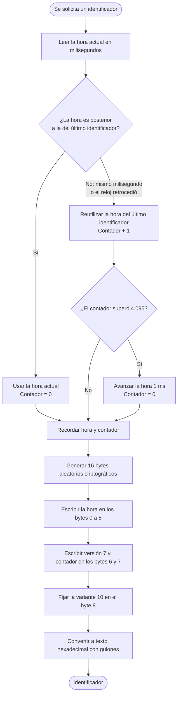

# 01 · Identificador de los registros: UUID versión 7

| | |
|---|---|
| **Componente** | Generador de identificadores · [`src/datos/uuidv7.ts`](../../src/datos/uuidv7.ts) |
| **Capa** | Acceso a datos (Figura 10) |
| **Origen en el documento** | Apartado 3.7.1 · restricción RD-02 · Tabla 18 (fila «Identificador de los registros») · Tabla 19 (UUID v7, RFC 9562) |
| **Lo usan** | El repositorio local (paso 1.4), al crear cualquier registro; el motor de sincronización (paso 1.10), para deduplicar |
| **Pruebas** | PU-03 |

---

## 1. El problema

Cada registro de la aplicación necesita un identificador que lo distinga de todos los demás: un
pesaje, un evento sanitario o un animal deben poder señalarse sin ambigüedad desde cualquier
otra parte del sistema.

La forma habitual de resolverlo en una base de datos es que **el servidor numere los registros**
a medida que llegan: 1, 2, 3… Esa solución no sirve en la Ganadería JR, por la restricción RD-02:

> Dos usuarios registran información desde dispositivos distintos, sin comunicación entre ellos
> mientras no hay señal.

Un escenario concreto del predio:

```
            Potrero de arriba (sin señal)        Potrero de abajo (sin señal)
            ─────────────────────────────        ────────────────────────────
 05:40      Trabajador registra un tratamiento   Propietario registra un pesaje
            al animal 027                        al animal 027
```

- **Si numerara el servidor**, ninguno de los dos podría registrar: no hay señal para pedirle un
  número. El registro dejaría de funcionar sin conexión, que es justamente lo que el prototipo
  debe resolver (RD-01).
- **Si cada teléfono llevara su propio contador**, los dos asignarían el número siguiente a su
  último registro, y podrían coincidir. Al sincronizar, el segundo registro en llegar
  sobrescribiría al primero y **un hecho real se perdería sin que nadie lo notara**.

Se necesita entonces un identificador que **cada teléfono pueda generar por su cuenta, sin
consultar a nadie, con la garantía práctica de que nunca coincidirá con el de otro teléfono**.

## 2. Alternativas consideradas

| Alternativa | ¿Funciona sin red? | ¿Evita coincidencias entre teléfonos? | ¿Ordena por fecha de creación? | Decisión |
|---|---|---|---|---|
| Entero autoincremental asignado por el servidor | ❌ No | ✅ Sí | ✅ Sí | Descartada: viola RD-01 y RD-02 |
| Contador propio en cada teléfono | ✅ Sí | ❌ No | ⚠️ Solo dentro del mismo teléfono | Descartada: produce coincidencias |
| UUID versión 4 (totalmente aleatorio) | ✅ Sí | ✅ Sí | ❌ No | Descartada: desordena el historial y los índices |
| **UUID versión 7** (marca temporal + aleatorio) | ✅ Sí | ✅ Sí | ✅ Sí | **Adoptada** |

La diferencia entre las versiones 4 y 7 es lo que inclina la decisión. Ambas son
prácticamente imposibles de repetir, pero la versión 4 es aleatoria de principio a fin, así que
dos registros creados uno después del otro reciben identificadores sin ninguna relación de orden.
La versión 7 coloca la hora de creación **al principio** del identificador, de modo que ordenar
los identificadores equivale a ordenar los registros por el momento en que se crearon. El
apartado 3.7.1 destaca las dos ventajas que eso trae:

1. **El historial de un animal sale ordenado** cronológicamente sin cálculos adicionales.
2. **Los índices de la base de datos se comportan mejor**, porque cada registro nuevo se agrega
   al final del índice en lugar de insertarse en una posición al azar.

## 3. Estructura del identificador

Un UUID es un número de 128 bits que se escribe como 32 caracteres hexadecimales separados por
guiones en grupos de 8-4-4-4-12. La especificación vigente es la RFC 9562 (2024).

### 3.1 Distribución de los 128 bits

```
 0                   1                   2                   3
 0 1 2 3 4 5 6 7 8 9 0 1 2 3 4 5 6 7 8 9 0 1 2 3 4 5 6 7 8 9 0 1
├─────────────────────────────────────────────────────────────────┤
│                 marca temporal (32 bits más altos)              │
├────────────────────────────────┬───────┬────────────────────────┤
│  marca temporal (16 bits bajos)│versión│  contador (rand_a)     │
│                                │ 0111  │      12 bits           │
├───┬────────────────────────────┴───────┴────────────────────────┤
│var│                  aleatorio (rand_b), 62 bits                │
│10 │                                                             │
├───┴─────────────────────────────────────────────────────────────┤
│                  aleatorio (rand_b), continuación               │
└─────────────────────────────────────────────────────────────────┘
```

| Campo | Bits | Contenido | Función |
|---|---|---|---|
| Marca temporal | 48 | Milisegundos transcurridos desde el 1 de enero de 1970 (UTC) | Ordena los identificadores por fecha de creación |
| Versión | 4 | Siempre `0111` (el número 7) | Indica que es un UUID de versión 7 |
| Contador (`rand_a`) | 12 | Número entre 0 y 4.095 | Ordena los identificadores creados en el mismo milisegundo por el mismo teléfono |
| Variante | 2 | Siempre `10` | Indica que sigue la RFC 9562 |
| Aleatorio (`rand_b`) | 62 | Bits aleatorios criptográficos | Distingue los identificadores generados por teléfonos distintos |

**Alcance de la marca temporal.** 48 bits alcanzan para representar milisegundos hasta el año
10889, así que el formato no tiene un límite práctico de vigencia.

### 3.2 Ejemplo resuelto

El trabajador registra un ordeño el 6 de octubre de 2026 a las **2:15:00 a. m.** (hora de
Colombia), que equivale a las 07:15:00 UTC:

| Paso | Valor |
|---|---|
| Instante en milisegundos desde 1970 | 1.791.270.900.000 |
| Ese número en hexadecimal (12 cifras = 48 bits) | `01a11010d120` |
| Versión `7` y contador `000` (primer identificador de ese milisegundo) | `7000` |
| Variante y 62 bits aleatorios (los aleatorios cambian en cada generación) | `9e3f5b8c2d1a4e7f` |
| **Identificador resultante** | **`01a11010-d120-7000-9e3f-5b8c2d1a4e7f`** |

Si en ese mismo milisegundo el mismo teléfono generara un segundo identificador, el contador
pasaría a `001` y el resultado sería `01a11010-d120-7001-…`, que se ordena inmediatamente
después del primero.

El primer carácter del cuarto grupo (`9` en el ejemplo) siempre es `8`, `9`, `a` o `b`, porque
sus dos primeros bits son la variante `10`.

### 3.3 Lectura inversa

Como la marca temporal ocupa los primeros 12 caracteres, cualquier identificador revela cuándo se
creó. La función `marcaTemporalDeUuidv7` hace esa lectura: toma `01a11010d120`, lo convierte a
decimal (1.791.270.900.000) y obtiene el instante de creación. Se usa en las pruebas y queda
disponible para depurar.

## 4. Algoritmo

### 4.1 Flujo de generación



### 4.2 Por qué un contador y no solo aleatorio

La RFC 9562 permite llenar los 12 bits de `rand_a` con valores aleatorios o con un contador
(sección 6.2, método 1). Se eligió el contador porque un teléfono puede crear varios registros en
el mismo milisegundo, por ejemplo al registrar un animal junto con sus fotografías, o al guardar
un registro y su entrada en la cola de operaciones. Con valores aleatorios, dos identificadores
del mismo milisegundo quedarían en un orden al azar. Con el contador, el orden coincide siempre
con el orden de creación dentro del mismo teléfono.

### 4.3 Casos límite

| Situación | Qué haría un generador ingenuo | Qué hace este generador |
|---|---|---|
| Dos identificadores en el mismo milisegundo | Ordenarlos al azar | Incrementa el contador: el segundo queda después del primero |
| El reloj del teléfono retrocede (corrección manual de la hora o sincronización con la red) | Generar un identificador «más viejo» que el anterior y romper el orden | Ignora la hora retrasada, reutiliza la última marca e incrementa el contador |
| Más de 4.096 identificadores en un mismo milisegundo | Desbordar el contador y volver a 0, rompiendo el orden | Avanza la marca un milisegundo y reinicia el contador. En el predio no ocurrirá, pero el generador no puede fallar si ocurre |

### 4.4 Origen de la aleatoriedad

Los bits aleatorios provienen de `crypto.getRandomValues`, el generador criptográfico del
navegador, y no de `Math.random`. La diferencia importa: `Math.random` no garantiza calidad
estadística ni imprevisibilidad, mientras que el generador criptográfico sí, y es el que la RFC
9562 recomienda.

## 5. Garantía de unicidad

Dos identificadores generados en **el mismo teléfono** nunca coinciden: o tienen marcas
temporales distintas o, si comparten el milisegundo, tienen contadores distintos.

Dos identificadores generados en **teléfonos distintos** solo podrían coincidir si se cumplen tres
condiciones a la vez:

1. Que se generen en **el mismo milisegundo**.
2. Que ambos teléfonos tengan **el mismo valor de contador** en ese milisegundo.
3. Que los **62 bits aleatorios** resulten idénticos.

La probabilidad de la tercera condición es de 1 entre 2⁶², es decir, **1 entre
4.611.686.018.427.387.904** (4,6 × 10¹⁸), aun suponiendo que las dos primeras ya se cumplieron.
Para dimensionarlo: el predio genera unos 6.400 registros al año (Tabla 26) entre tres usuarios,
de modo que la coincidencia en el mismo milisegundo ya es rara, y sobre ella habría que acertar
además esa probabilidad. En la práctica la coincidencia es imposible.

Aun así, el diseño no depende ciegamente de esta garantía: la columna `id` del servicio remoto es
clave primaria, de modo que una coincidencia, por improbable que sea, sería rechazada por la base
de datos y no podría sobrescribir un registro existente (apartado 3.7.8).

## 6. Uso del identificador en el resto del diseño

| Dónde | Para qué |
|---|---|
| **Creación de registros** (repositorio local, paso 1.4) | Todo registro nace con su identificador asignado en el dispositivo, antes de cualquier contacto con el servidor |
| **Cola de operaciones** (3.7.2) | Cada operación pendiente apunta al registro por su identificador |
| **Subida** (3.7.8) | El envío es una inserción que ignora un identificador ya existente. Si una transmisión se repite tras un corte, el servidor reconoce el identificador y no duplica el registro |
| **Bajada** (3.7.8) | Un registro recibido cuyo identificador ya existe en el teléfono se ignora. Esto cubre tanto un lote repetido como el registro que el propio teléfono había enviado y vuelve dentro de los cambios del servidor |
| **Historial** (CU-05, CU-09) | Los eventos de un animal se ordenan por la fecha del hecho que declara el usuario; cuando dos eventos comparten esa fecha, el identificador los desempata según el orden en que se registraron |

El apartado 3.7.8 lo resume así: la decisión se tomó para evitar colisiones entre dispositivos
sin señal y resultó ser también la que sostiene la deduplicación, porque el identificador es el
mismo valor en los dos lados desde el instante de la creación.

## 7. Limitaciones conocidas

| Limitación | Efecto | Cómo la atiende el diseño |
|---|---|---|
| El orden entre identificadores de **teléfonos distintos** depende de que sus relojes estén sincronizados | Si un teléfono va adelantado, sus registros aparecerían «después» de los de otro aunque se hayan creado antes | El orden **entre versiones de un mismo dato** no se decide por el identificador sino por la marca `recibido_en` que asigna el servidor (3.7.3, segunda regla). Para mostrar el historial se usa la fecha del hecho que declara el usuario |
| El identificador **revela el instante de creación** | Quien vea un identificador puede saber cuándo se creó el registro | No es información sensible en este contexto: la fecha de creación ya se conserva y se muestra en cada registro por RNF-08 |
| El contador vive en la memoria de la aplicación | Al cerrar y abrir la aplicación el contador se reinicia | No afecta al orden: los identificadores creados después de reabrir tienen una marca temporal posterior |

## 8. Relación con los requerimientos

| Requerimiento | Cómo lo atiende el identificador |
|---|---|
| **RD-02** | Cada teléfono genera identificadores sin coordinación con el servidor ni con otros teléfonos |
| **RD-01 · RF-28** | Crear un registro no exige conexión: el identificador se obtiene en el propio dispositivo |
| **RNF-04** | El registro queda identificado desde el instante de su creación, antes de entrar a la cola |
| **RF-29** | La sincronización puede repetirse sin duplicar, porque el identificador es el criterio de identidad |

## 9. Pruebas (PU-03)

| # | Qué verifica | Criterio de aprobación |
|---|---|---|
| 1 | Formato | Cumple el patrón 8-4-4-4-12 hexadecimal, con versión `7` y variante `8`, `9`, `a` o `b` |
| 2 | Marca temporal | La marca codificada coincide con la hora de creación y se recupera con `marcaTemporalDeUuidv7` |
| 3 | Unicidad | 100.000 identificadores generados sin ninguna repetición |
| 4 | Orden | Generados uno tras otro, su orden alfabético coincide con el de creación, también dentro de un mismo milisegundo |
| 5 | Reloj que retrocede | Al retroceder la hora, el identificador siguiente sigue quedando después del anterior |
| 6 | Contador lleno | Con más de 4.096 identificadores en el mismo milisegundo, el orden se conserva |
| 7 | Dos dispositivos (RD-02) | Dos generadores independientes, en el mismo milisegundo exacto, no producen ningún identificador en común |

Los resultados se registran en [`docs/pruebas/iteracion-1.md`](../pruebas/iteracion-1.md).

## Referencias

- K. Davis, B. Peabody y P. Leach, «Universally Unique IDentifiers (UUIDs)», RFC 9562, IETF, mayo de 2024. Secciones 5.7 (UUID versión 7) y 6.2 (monotonía y contadores).
- Documento de trabajo de grado: apartados 3.7.1, 3.7.3 y 3.7.8; Tablas 15, 18, 19, 21 y 26.
