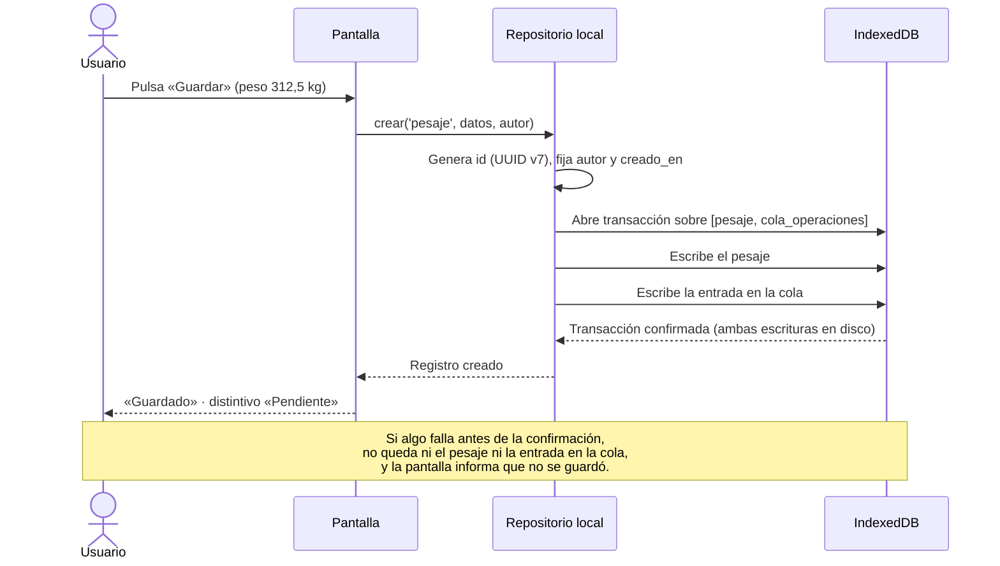

# 03 · Repositorio local y cola de operaciones

| | |
|---|---|
| **Componentes** | Repositorio local y cola de operaciones · [`src/datos/repositorio.ts`](../../src/datos/repositorio.ts) |
| **Capa** | Acceso a datos (Figura 10) |
| **Origen en el documento** | Apartados 3.6.2 (Tabla 20), 3.7.2, 3.9.4 · RD-04 · RNF-04 · Tabla 21 (fila «El dispositivo se apaga durante el registro») · Tabla 31 (fila «La aplicación se cierra antes de terminar un registro») |
| **Depende de** | [01 · UUID v7](01-identificador-uuidv7.md) · [02 · Esquema local](02-esquema-local.md) |
| **Lo usan** | Todos los módulos de dominio para guardar información; el motor de sincronización (paso 1.10) para leer la cola; el indicador de sincronización (paso 1.11) para contar los pendientes |
| **Pruebas** | PU-05 |

---

## 1. El problema

El propietario de la Ganadería JR ha perdido información durante años: cuadernos extraviados,
datos que nunca se anotaron. El prototipo existe para que eso no vuelva a pasar, y el requerimiento
RNF-04 lo pone en términos verificables:

> La información registrada sin conexión no debe perderse ante el cierre inesperado de la
> aplicación o el apagado del dispositivo.

Guardar un registro en el teléfono no basta. Para que ese registro llegue algún día al servicio
remoto, el teléfono tiene que **recordar que está pendiente de enviarse**. Ese recuerdo es la
**cola de operaciones** (apartado 3.7.2). Entonces cada vez que alguien guarda algo hay **dos
escrituras**:

1. El registro en sí, por ejemplo un pesaje en la tabla `pesaje`.
2. Una entrada en `cola_operaciones` que dice «el pesaje con este identificador está pendiente».

El riesgo está en el instante entre una escritura y la otra. Si el teléfono se apaga justo ahí:

| Si se guarda… | …y el teléfono se apaga antes de… | Resultado |
|---|---|---|
| El registro | Escribir en la cola | **El pesaje queda en el teléfono pero nunca se envía.** El propietario lo ve en su teléfono, cree que está a salvo, y el día que pierda el teléfono lo pierde |
| La entrada de la cola | Escribir el registro | **La cola apunta a un registro que no existe.** El motor de sincronización intentaría enviar algo inexistente y se atascaría |

Las dos situaciones son pérdida o corrupción silenciosa de información: exactamente lo que el
proyecto debe evitar.

## 2. La solución: una transacción

Una **transacción** es un grupo de escrituras que la base de datos trata como una sola unidad:
**o se completan todas o no se completa ninguna**. IndexedDB lo garantiza por especificación. Si
la transacción se interrumpe por cualquier causa (un error, un cierre de la aplicación, un apagado
del teléfono), la base de datos descarta todo lo que la transacción alcanzó a escribir.

El apartado 3.7.2 lo establece así:

> Cada operación que modifica información se escribe en el almacenamiento local dentro de una sola
> transacción que abarca dos escrituras, la del registro en sí y la de una entrada en la cola de
> operaciones pendientes. Al ocurrir juntas, nunca queda un registro sin su operación asociada ni
> una operación sin su registro, ni siquiera cuando la aplicación se cierra de golpe.



Las tres situaciones posibles quedan así:

| Momento del cierre inesperado | Qué queda en el teléfono | Qué ve el usuario al reabrir |
|---|---|---|
| Antes de pulsar «Guardar» | Nada | El formulario vacío (Tabla 31): lo no confirmado no se guarda |
| Durante la transacción | **Nada**: la base de datos descarta la transacción incompleta | El formulario vacío. El dato no se guardó y el usuario lo sabe, porque nunca vio «Guardado» |
| Después de la confirmación | El registro **y** su entrada en la cola | El registro, marcado como pendiente. Se enviará cuando haya señal |

La regla que se desprende es simple y es la que la Tabla 21 enuncia: **la operación se da por
hecha únicamente cuando la transacción local ha terminado**. La pantalla solo muestra «Guardado»
después de esa confirmación. No existe un estado intermedio en el que el usuario crea que algo
quedó guardado sin que haya quedado.

## 3. El repositorio: la única vía de escritura

La Tabla 20 asigna al repositorio local esta responsabilidad:

> Ser la única vía de lectura y escritura sobre el almacenamiento del dispositivo.

La razón es que la garantía de la sección 2 solo vale si **todas** las escrituras pasan por el
mismo camino. Si un módulo escribiera directamente en la tabla `pesaje` sin pasar por el
repositorio, ese pesaje nunca entraría a la cola y nunca se enviaría. Concentrar la escritura en un
solo componente hace que la regla se cumpla en un solo lugar y no dependa de que cada módulo la
recuerde.

### 3.1 Qué fija el repositorio en cada registro

Quien registra solo aporta los datos del hecho: el animal, el peso, la fecha, el método. El
repositorio agrega lo demás, de modo que ningún módulo pueda omitirlo ni falsearlo:

| Campo | Valor | Por qué lo fija el repositorio | Origen |
|---|---|---|---|
| `id` | UUID v7 generado en el momento | Identifica el registro sin consultar a nadie | RD-02, documento 01 |
| `autor_id` | Usuario que registra | Autoría fijada en la creación, en el dispositivo | RD-04, RNF-08 |
| `creado_en` | Instante de la creación, según el reloj del teléfono | Marca temporal fijada en la creación; no se recalcula al sincronizar | RD-04, RNF-08 |
| `estado_sync` | `pendiente` | Todo registro nace pendiente de transmitir | Tabla 22 |

El tipo `DatosNuevos<T>` del paso 1.1 ya impide en tiempo de compilación que un módulo intente
aportar `id`, `autor_id` o `creado_en` por su cuenta (PU-02).

### 3.2 La entrada de la cola

| Campo | Contenido |
|---|---|
| `seq` | Número autoincremental que asigna la base de datos: conserva el orden de las operaciones |
| `entidad` | Tabla del registro, por ejemplo `pesaje` |
| `registro_id` | Identificador del registro |
| `tipo` | `insertar` |
| `intentos` | `0`; el motor de sincronización lo incrementa con cada intento fallido |
| `ultimo_intento` | Vacío hasta el primer intento |
| `creado_en` | Instante en que se encoló |

La entrada **no copia los datos del registro**, solo apunta a él. Al transmitir, el motor de
sincronización lee el registro vigente desde su tabla. Así no hay dos copias del mismo dato que
puedan diferir.

## 4. Varias escrituras como una sola: la unidad de trabajo

Algunos hechos del predio producen más de un registro, y esos registros deben guardarse juntos o
no guardarse. El caso más claro está en el propio documento: registrar un parto con cría viva
**incluye** registrar a la cría como animal nuevo (CU-10 incluye a CU-02, apartado 2.8.6.5).

| Si se guarda… | …y falla lo siguiente | Resultado |
|---|---|---|
| La cría como animal | El parto | Un animal sin madre ni parto: el control reproductivo de la vaca pierde un parto y su intervalo entre partos queda alterado (3.8.8) |
| El parto | La cría | Un parto que apunta a un animal que no existe |

Por eso el repositorio ofrece, además de `crear`, una **unidad de trabajo**: un bloque en el que se
pueden crear varios registros y que se confirma como una sola transacción.

```ts
// Registrar un parto con cría viva: todo o nada.
await repositorio.unidadDeTrabajo(autor, async (tx) => {
  const cria = await tx.crear('animal', datosDeLaCria);
  await tx.crear('parto', { ...datosDelParto, cria_id: cria.id });
});
// Si cualquiera de las dos escrituras falla, no queda ni la cría, ni el parto,
// ni ninguna de sus dos entradas en la cola.
```

`crear` por sí solo es simplemente una unidad de trabajo con un único registro.

Otros casos que usarán la unidad de trabajo en las iteraciones siguientes:

| Hecho | Registros que se guardan juntos |
|---|---|
| Registrar un animal con su destino inicial (CU-02, CU-12) | `animal` + `destino_productivo` |
| Registrar un parto con cría viva (CU-10) | `animal` + `parto` |
| Incorporar un medicamento nuevo sin abandonar el evento sanitario (Tabla 31) | `medicamento` + `evento_sanitario` |

## 5. Lectura

Las pantallas y los módulos necesitan consultar mucho: la ficha, los historiales, la ronda de
ordeño. Para que la lectura también pase por el repositorio sin obligar a escribir una función por
cada consulta posible, el repositorio expone las tablas **en modo de solo lectura**: un módulo
puede usar los índices del [documento 02](02-esquema-local.md) para buscar, filtrar y ordenar, pero
el tipo que recibe **no tiene** los métodos de escritura (`add`, `put`, `update`, `delete`). Si un
módulo intentara escribir por esa vía, el compilador lo rechazaría.

```ts
// Permitido: consulta por índice.
const historial = await consulta.evento_sanitario.where('animal_id').equals(id).toArray();

// Rechazado por el compilador: la tabla de consulta no tiene el método add.
await consulta.pesaje.add(pesaje);  // ✗ error de tipos
```

### 5.1 Cómo se hace cumplir

| Regla | Mecanismo |
|---|---|
| Solo el repositorio escribe | Las tablas de consulta son de solo lectura por su tipo (verificado por el compilador) |
| Nadie esquiva al repositorio | Ningún archivo fuera de `src/datos/` importa directamente la base de datos (`db.ts`). Lo verifica una **prueba de arquitectura** que revisa las importaciones de todo el código fuente |

## 6. Operaciones sobre la cola

El repositorio ofrece además las consultas que la cola necesita en este paso. Las operaciones de
transmisión (marcar intentos, retirar entradas aceptadas, marcar estados) pertenecen al motor de
sincronización y se especifican en su propio documento (paso 1.10).

| Operación | Para qué | Quién la usa |
|---|---|---|
| `contarPendientes()` | Número de operaciones que esperan conexión | Contador de la barra inferior (paso 1.11, 3.10.4.5) |
| `operacionesPendientes()` | Las operaciones en el orden en que se produjeron | Motor de sincronización (paso 1.10) |

## 7. Lo que el repositorio todavía no hace

Para que el alcance del paso quede claro:

| Capacidad | Dónde se incorpora |
|---|---|
| Verificar que el perfil del usuario permite la operación | Gestor de sesión y permisos, paso 1.9. El repositorio recibe el autor ya autorizado |
| Transmitir la cola al servicio remoto | Motor de sincronización, paso 1.10 |
| Corregir o anular registros | Paso 4.3. No requiere nada nuevo del repositorio: una corrección es un registro más de la tabla `correccion` que se crea con `crear` (3.9.5) |
| Cambiar el estado de un animal a retirado al registrar su salida | Paso 5.2. Se definirá entonces si el estado se actualiza en el dispositivo o se deriva de la existencia de la salida |

Que el repositorio **solo sepa crear** no es una omisión sino una consecuencia del diseño: el
apartado 3.7.3 establece que los eventos no se modifican ni se eliminan, y el 3.9.5 que las
correcciones se agregan como registros nuevos.

## 8. Relación con los requerimientos

| Requerimiento | Cómo lo atiende |
|---|---|
| **RNF-04** | Registro y entrada de la cola en una sola transacción: un cierre inesperado nunca deja un registro sin enviar ni una entrada huérfana |
| **RF-28** | Guardar no requiere conexión: todo ocurre en la base de datos del teléfono |
| **RF-27 · RNF-08 · RD-04** | El autor y la fecha de creación los fija el repositorio en el dispositivo, en el momento de la creación |
| **RF-29** | La cola conserva lo pendiente en orden hasta que el motor de sincronización pueda transmitirlo |
| **RF-30** | Todo registro nace con estado `pendiente`, que la interfaz mostrará |
| **RNF-13** | Una sola vía de escritura, verificada por una prueba de arquitectura |

## 9. Pruebas (PU-05)

| # | Qué verifica | Criterio de aprobación |
|---|---|---|
| 1 | Campos que fija el repositorio | El registro creado tiene `id` UUID v7, el `autor_id` recibido, `creado_en` con la hora de creación y estado `pendiente`, además de los datos aportados |
| 2 | Registro y cola juntos | Tras `crear`, existen el registro y exactamente una entrada en la cola que apunta a él, con tipo `insertar` y cero intentos |
| 3 | Atomicidad ante una falla | Si la transacción falla después de escribir el registro y antes de terminar, no queda ni el registro ni la entrada en la cola |
| 4 | Unidad de trabajo | Una cría y su parto creados juntos generan dos registros y dos entradas en la cola, en ese orden; si el parto falla, no queda la cría |
| 5 | Confirmación después de la escritura | Cuando `crear` termina, el registro ya es legible desde una conexión nueva a la base de datos |
| 6 | Persistencia ante el cierre | Tras cerrar y reabrir la base de datos, el registro y su entrada en la cola siguen ahí |
| 7 | Orden de la cola | Varias operaciones se leen en el orden en que se crearon, y `contarPendientes` las cuenta |
| 8 | Solo lectura | Las tablas de consulta no tienen métodos de escritura (verificado por el compilador) |
| 9 | Arquitectura | Ningún archivo fuera de `src/datos/` importa `db.ts` |

Los resultados se registrarán en [`docs/pruebas/iteracion-1.md`](../pruebas/iteracion-1.md).

## Referencias

- World Wide Web Consortium, «Indexed Database API 3.0», sección *Transactions* (atomicidad y durabilidad).
- D. Fahlander, «Dexie.js — Documentación oficial», sección *Dexie.transaction()*.
- Documento de trabajo de grado: apartados 2.8.6.5, 3.6.2, 3.7.2, 3.7.3, 3.8.8, 3.9.4 y 3.9.5; Tablas 20, 21, 22 y 31.
