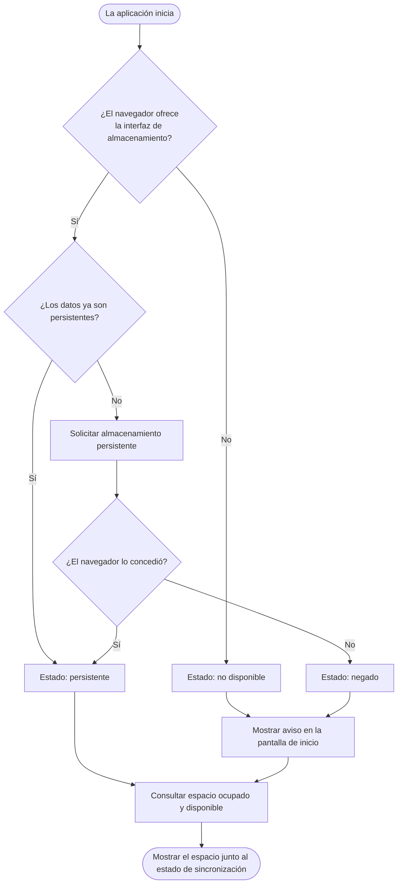

# 04 · Almacenamiento persistente

| | |
|---|---|
| **Componente** | Servicio de almacenamiento persistente · [`src/datos/almacenamiento.ts`](../../src/datos/almacenamiento.ts) |
| **Capa** | Acceso a datos (Figura 10) |
| **Origen en el documento** | RNF-15 · apartados 3.8.7 (párrafos finales) y 3.9.1 (última consecuencia declarada) · Tabla 33 (RNF-15 → repositorio local, pantalla de inicio) |
| **Depende de** | Ningún otro componente del prototipo. Usa la interfaz *Storage* del navegador (WHATWG Storage Standard) |
| **Lo usan** | La estructura general de la aplicación, al iniciar; la pantalla de inicio, para el aviso; la barra de estado, para el espacio ocupado |
| **Pruebas** | PU-06 (automática) · PE-12 (manual, en el navegador) |

---

## 1. El problema

Los pasos 1.3 y 1.4 garantizan que un registro, una vez guardado, queda en la base de datos del
teléfono aunque la aplicación se cierre. Pero queda un riesgo que no depende de la aplicación sino
del navegador: **el navegador puede borrar por su cuenta todos los datos de un sitio**.

El apartado 3.8.7 lo describe con precisión:

> De manera predeterminada el navegador conserva los datos en la modalidad llamada de mejor
> esfuerzo, en la cual puede eliminarlos cuando el dispositivo se queda sin espacio, siguiendo un
> criterio de menor uso reciente. Safari elimina además, de forma proactiva, los datos de los
> orígenes sin interacción del usuario durante siete días. Y cuando esa eliminación ocurre se
> borra la totalidad de lo almacenado por el origen y no una parte, lo que incluiría la cola de
> operaciones pendientes.

Un escenario concreto en el predio:

```
Lunes      El trabajador registra 12 ordeños y 2 tratamientos sin señal. Quedan en la cola.
Martes     El teléfono se queda sin espacio al descargar videos.
           El navegador libera espacio borrando los datos de los sitios menos usados.
           Se borran la base de datos de la aplicación, la cola y la sesión.
Miércoles  Hay señal, pero ya no queda nada que enviar. Los 14 registros se perdieron.
```

Para un predio cuyo problema declarado es la pérdida de información, el apartado 3.8.7 concluye
que ese comportamiento «resulta inadmisible». El apartado 3.9.1 añade que la sesión también vive
en ese almacenamiento, de modo que la misma eliminación obligaría además a un ingreso nuevo con
conexión.

## 2. Las dos modalidades de almacenamiento

El estándar de almacenamiento del navegador define dos modalidades para los datos de un sitio:

| Modalidad | Quién puede borrar los datos | Cuándo |
|---|---|---|
| **De mejor esfuerzo** (*best-effort*), la predeterminada | El navegador, sin preguntar | Cuando falta espacio en el dispositivo; en Safari, además, tras siete días sin uso |
| **Persistente** (*persistent*) | Solo el usuario | Cuando lo decide desde la configuración del navegador |

Un sitio no puede declararse persistente por sí mismo: tiene que **solicitarlo**, y el navegador
decide si lo concede.

## 3. Cómo decide cada navegador

La decisión depende del navegador, y conviene conocerla porque condiciona lo que el usuario debe
hacer para que la solicitud se conceda.

| Navegador | Cómo responde a la solicitud |
|---|---|
| **Chrome y navegadores basados en Chromium** (incluido Chrome en Android) | No pregunta al usuario. Concede o niega automáticamente con criterios internos que no publica de forma exacta; entre los que se mencionan están el uso del sitio, que esté en marcadores, que tenga permiso de notificaciones o que la aplicación esté instalada. Si al principio lo niega, puede concederlo en una solicitud posterior, cuando el uso cambia. **En la prueba PE-12, con Chrome en Windows, lo negó tanto en una pestaña normal como con la aplicación instalada y con el sitio en marcadores** |
| **Firefox** | Muestra una ventana al usuario preguntando si permite el almacenamiento persistente |
| **Safari** | Aplica sus propios criterios. Las aplicaciones agregadas a la pantalla de inicio reciben un trato distinto al de un sitio visitado en el navegador |

Las políticas de los navegadores cambian con el tiempo, así que el comportamiento real del
dispositivo del predio se verificará en la prueba con un teléfono real del paso 6.4. Lo que la
aplicación no puede hacer es **suponer** que el permiso fue concedido: debe preguntarlo y actuar
según la respuesta.

*Corrección tras PE-12 (2026-10-06).* La primera versión de este documento afirmaba que en Chrome
la forma más directa de obtener el permiso era instalar la aplicación. La prueba en Chrome para
Windows no lo confirmó: con la aplicación instalada, y también con el sitio en marcadores, el
navegador siguió negando la persistencia. La instalación sigue siendo la recomendación razonable
en un teléfono Android, donde agregar la aplicación a la pantalla de inicio es uno de los criterios
mencionados, pero no puede darse por garantizada y se verificará en el teléfono real (paso 6.4).
En consecuencia, el aviso al usuario se adapta según la aplicación esté instalada o no
(sección 4.3).

## 4. Comportamiento de la aplicación

### 4.1 Al iniciar



El apartado 3.8.7 dice que la aplicación «solicita ese permiso en la primera ejecución». La
implementación lo solicita **en cada inicio mientras no esté concedido**, y no solo en el primero,
por la forma en que decide Chrome (sección 3): un permiso negado el primer día, cuando la
aplicación aún no estaba instalada, puede concederse después de instalarla. Una vez concedido, ya
no se vuelve a solicitar. En Chrome la solicitud no muestra nada al usuario, así que repetirla no
lo molesta.

### 4.2 Los tres estados posibles

| Estado | Significado | Qué ve el usuario |
|---|---|---|
| `persistente` | El navegador garantiza que solo el usuario puede borrar los datos | Nada especial. El espacio ocupado aparece junto al estado de sincronización |
| `negado` | El navegador puede borrar los datos si falta espacio | **Aviso** en la pantalla de inicio que explica el riesgo y cómo resolverlo |
| `no_disponible` | El navegador no ofrece la interfaz (navegadores antiguos, o la página servida sin HTTPS fuera de `localhost`) | El mismo aviso: no puede garantizarse la conservación |

### 4.3 El aviso

RNF-15 exige que la aplicación advierta al usuario «cuando el navegador niegue esa condición» en
lugar de continuar en silencio. El aviso sigue el sistema visual del apartado 3.10.4: tono
amarillo de «requiere revisión», porque es un riesgo para la información y no un riesgo sanitario
inmediato; texto e ícono además del color; y lenguaje directo que describe la consecuencia y la
acción.

El texto depende de si la aplicación está abierta en una pestaña del navegador o como aplicación
instalada. La aplicación lo detecta con la consulta de medios `display-mode: standalone`, y en iOS
con `navigator.standalone`.

**Sin instalar:**

> ⚠ **Los datos de este teléfono no están protegidos.** Si el teléfono se queda sin espacio, el
> navegador podría borrar la información que aún no se ha enviado. Para protegerla, instale la
> aplicación en el teléfono.

**Ya instalada** (el navegador negó el permiso de todas formas):

> ⚠ **Los datos de este teléfono no están protegidos.** Si el teléfono se queda sin espacio, el
> navegador podría borrar la información que aún no se ha enviado. Mantenga espacio libre en el
> teléfono y abra la aplicación con señal con frecuencia para que la información se envíe.

La segunda variante se agregó tras PE-12: pedir que instale la aplicación a quien ya la instaló
confunde al usuario, que es lo que el apartado 3.10 busca evitar. Abrir la aplicación con señal
con frecuencia reduce el riesgo, porque la información sincronizada ya no depende del teléfono.

El aviso no impide usar la aplicación: registrar sigue siendo posible y la información se envía
en cuanto hay señal. Advierte el riesgo, pero la decisión de instalar es del usuario.

### 4.4 Espacio ocupado y disponible

La misma interfaz permite consultar cuánto ocupa la aplicación y cuánto le permite usar el
navegador. El apartado 3.8.7 establece que la aplicación «presenta ese dato junto al estado de
sincronización». Se muestra en unidades legibles, por ejemplo «4,2 MB de 6,1 GB».

Ambas cifras son **estimaciones** del navegador, no medidas exactas, y así se denominan en la
interfaz. Su valor está en mostrar el orden de magnitud: la estimación del apartado 3.8.7 sitúa el
contenido completo del predio por debajo de 25 MB tras diez años, frente a cuotas de varios
gigabytes.

## 5. Interfaz del componente

| Función | Qué hace | Devuelve |
|---|---|---|
| `asegurarPersistencia()` | Consulta si los datos ya son persistentes y, si no lo son, lo solicita | El estado: `persistente`, `negado` o `no_disponible` |
| `consultarEspacio()` | Pide al navegador la estimación de espacio | Bytes ocupados y cuota, o vacío si el navegador no lo informa |
| `formatearBytes(bytes)` | Convierte bytes a una cifra legible en español | Por ejemplo `4,2 MB` |

El componente no guarda nada: el navegador recuerda el permiso concedido. Por eso no usa la base de
datos local ni depende del repositorio.

## 6. Relación con los requerimientos

| Requerimiento | Cómo lo atiende |
|---|---|
| **RNF-15** | Solicita el almacenamiento persistente y advierte cuando se niega |
| **RNF-04** | Completa la garantía de los pasos 1.3 y 1.4: además de sobrevivir a un cierre de la aplicación, los datos quedan protegidos frente a la limpieza del navegador |
| **3.9.1** | La sesión conservada en el dispositivo queda protegida por el mismo permiso |
| **RNF-11** | El aviso conduce a la instalación, que en Chrome es la vía más directa para obtener el permiso |

## 7. Limitación declarada

El almacenamiento persistente protege los datos frente al **navegador**, no frente a la **pérdida o
el daño del teléfono**. Si el teléfono se pierde, lo que no alcanzó a sincronizarse se pierde con
él. Esa situación la atiende otro mecanismo: la sincronización con el servicio remoto (RNF-05,
paso 1.10), que conserva una copia fuera del dispositivo. La Tabla 34 ya lo declara: «se pierde
únicamente lo que no alcanzó a transmitirse».

## 8. Pruebas

### PU-06 (automática)

La interfaz de almacenamiento del navegador no existe en el entorno de pruebas, así que se
**simula** con cada respuesta posible, lo que permite verificar los cuatro caminos del diagrama
sin depender de un navegador real.

| # | Situación simulada | Criterio de aprobación |
|---|---|---|
| 1 | Los datos ya son persistentes | Estado `persistente`, y **no** se vuelve a solicitar |
| 2 | No son persistentes y el navegador concede la solicitud | Se solicita una vez; estado `persistente` |
| 3 | No son persistentes y el navegador niega la solicitud | Estado `negado` |
| 4 | El navegador no ofrece la interfaz | Estado `no_disponible`, sin errores |
| 5 | La solicitud falla con un error | Estado `negado`, sin errores |
| 6 | Estimación de espacio disponible | Devuelve los bytes ocupados y la cuota |
| 7 | Estimación no disponible | Devuelve vacío, sin errores |
| 8 | Formato de los bytes | 0 B, 512 B, 1,5 KB, 4,2 MB, 6,1 GB, con coma decimal |
| 9 | Texto del aviso (agregado tras PE-12) | Sin aviso si es persistente; sin instalar recomienda instalar; instalada no lo pide y recomienda espacio libre y sincronizar |
| 10 | Detección de la aplicación instalada (agregado tras PE-12) | Pestaña normal: no instalada; `display-mode: standalone` o `navigator.standalone`: instalada |

### PE-12 (manual, en el navegador)

Verifica el comportamiento real con la aplicación instalada y sin instalar, observando el estado
en la pantalla y en las herramientas de desarrollador. Sus resultados motivaron la corrección de
la sección 3 y la segunda variante del aviso (sección 4.3). Detalle en
[docs/pruebas/iteracion-1.md](../pruebas/iteracion-1.md).

## Referencias

- WHATWG, «Storage Standard», secciones *Persistence permission* y *Usage and quota*.
- Mozilla, «Storage quotas and eviction criteria», MDN Web Docs.
- Mozilla, «StorageManager: persist() method», MDN Web Docs.
- Documento de trabajo de grado: apartados 3.8.7 y 3.9.1; RNF-04, RNF-05, RNF-15; Tablas 33 y 34.
