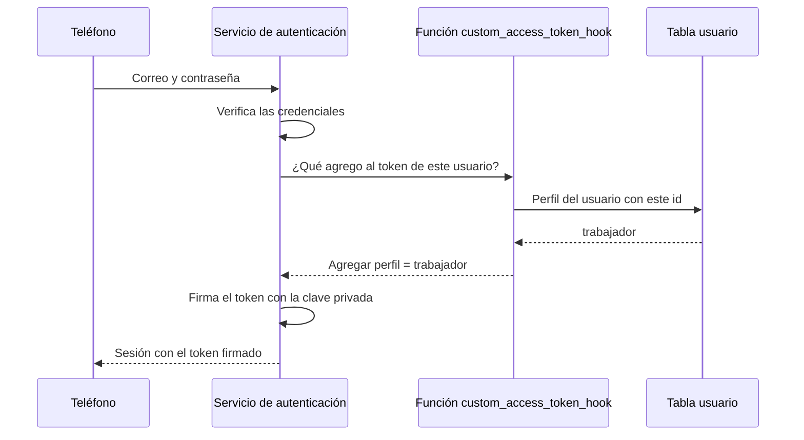
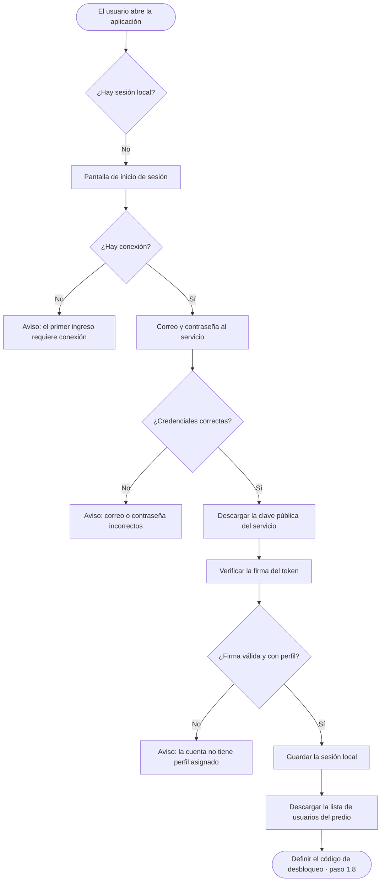
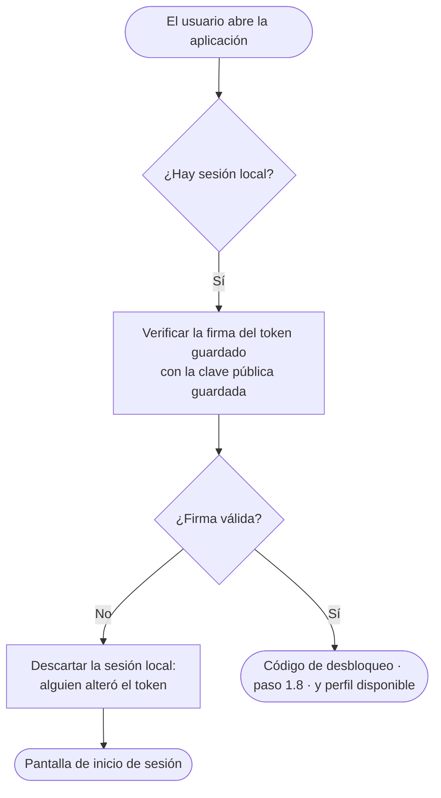

# 06 · Autenticación con conexión y sin ella

| | |
|---|---|
| **Componente** | Gestor de sesión (parte de autenticación) · [`src/sesion/`](../../src/sesion/) · función del servicio `custom_access_token_hook` |
| **Capa** | Lógica (gestor de sesión y permisos, Tabla 20) y servicio remoto |
| **Origen en el documento** | Apartado 3.9.1 · RF-24 · RF-25 · RNF-07 · RD-03 · Tabla 21 (filas del token vencido y del token de refresco inválido) · Tabla 31 (fila «El usuario abre la aplicación en un dispositivo que ya tiene sesión») · CU-01 |
| **Depende de** | [02 · Esquema local](02-esquema-local.md) (tabla `meta`, copia local de `usuario`) · [05 · Esquema remoto](05-esquema-remoto.md) (tabla `usuario`) |
| **Lo usan** | El código de desbloqueo (paso 1.8), el gestor de permisos (paso 1.9), el motor de sincronización (paso 1.10) |
| **Pruebas** | PU-07 · PI-02 · PE-13 |

---

## 1. El problema: dos requerimientos en tensión

| Requerimiento | Exige |
|---|---|
| **RF-24 · RNF-07** | Que nadie acceda a la información sin autenticarse |
| **RD-03** | Que el acceso funcione **sin conexión**, porque en el predio la falta de señal es la regla y no la excepción |

Una autenticación tradicional pregunta al servidor en cada ingreso «¿esta persona es quien dice
ser?». Sin señal no hay a quién preguntar, y la aplicación quedaría inutilizable en el potrero.

El apartado 3.9.1 resuelve la tensión **separando dos cosas** que suelen tratarse como una:

| | Autenticar | Autorizar localmente |
|---|---|---|
| Qué es | Probar la identidad ante el servicio remoto | Decidir qué puede hacerse en el dispositivo |
| ¿Necesita red? | **Sí** | **No** |
| Con qué frecuencia | Una vez por dispositivo | En cada uso |

## 2. El diseño en tres capas

El apartado 3.9.1 organiza la solución en tres capas. Este documento especifica la primera y la
forma en que el dispositivo conserva su resultado; las otras dos tienen sus propios pasos.

| Capa | Qué hace | ¿Red? | Paso |
|---|---|---|---|
| **1. Identidad ante el servicio** | Correo y contraseña verificados por el servicio de autenticación. Devuelve una sesión con un **token firmado** que dice quién es el usuario y cuál es su perfil | Sí, una vez | **1.7 (este documento)** |
| 2. Cerradura del dispositivo | Código de 4 a 6 dígitos en cada apertura | No | 1.8 |
| 3. Decisión del servicio | Las reglas a nivel de fila vuelven a evaluar cada operación cuando la información sube | Sí, al sincronizar | 1.9 |

## 3. Qué es un token firmado y por qué sirve sin red

Al iniciar sesión, el servicio entrega un **token de acceso** (JWT, *JSON Web Token*). Es un texto
de tres partes separadas por puntos:

```
eyJhbGciOiJFUzI1NiIs…  .  eyJzdWIiOiI0ZjNh…  .  MEUCIQDx3k…
└──── encabezado ────┘    └─── contenido ───┘    └── firma ──┘
```

| Parte | Contenido |
|---|---|
| Encabezado | El algoritmo de firma (`ES256`) y el identificador de la clave (`kid`) |
| Contenido (*claims*) | Quién es el usuario (`sub`), cuándo vence el token (`exp`), quién lo emitió (`iss`) y, en este prototipo, **su perfil** (`perfil`) |
| Firma | Un valor que solo pudo calcular quien tiene la **clave privada** del servicio |

### 3.1 Firma asimétrica

El servicio firma con un par de claves de **curva elíptica P-256** (algoritmo ES256):

- La **clave privada** solo la tiene el servicio. Con ella firma.
- La **clave pública** la publica el servicio en una dirección conocida (`/auth/v1/.well-known/jwks.json`).
  Con ella **cualquiera puede verificar** una firma, pero nadie puede producir una.

Se comprobó el 2026-10-06 que el proyecto de Supabase ya firma así:

```
kty: EC · alg: ES256 · crv: P-256 · kid: ac3c037d-bcca-48de-ac2d-ff826a0c3c63
```

### 3.2 Por qué esto resuelve el problema

El teléfono descarga la clave pública **una vez**, en el primer ingreso con conexión, y la guarda.
Desde entonces puede verificar la firma del token **sin preguntarle a nadie**:

- Si la firma es válida, el contenido del token lo escribió el servicio. El perfil «trabajador» o
  «propietario» **no es algo que el teléfono se atribuya a sí mismo, sino algo que el servidor firmó**
  (apartado 3.9.1).
- Si alguien modificara el token guardado en el teléfono para cambiarse el perfil, la firma dejaría
  de coincidir y el teléfono lo rechazaría.

## 4. El perfil dentro del token

El token que emite Supabase trae por defecto el identificador del usuario, pero **no su perfil**, que
vive en la tabla `usuario` del esquema propio. Para incluirlo se usa un **gancho de token de acceso**
(*Custom Access Token Hook*): una función de la base de datos que el servicio de autenticación llama
cada vez que emite un token, y que puede agregarle datos.



### 4.1 Reglas de la función

| Regla | Motivo |
|---|---|
| Lee el perfil y el nombre de la tabla `usuario` y los agrega como `perfil` y `nombre` | Es la fuente de verdad del perfil (Tabla 23). El nombre viaja en el token para que el teléfono pueda mostrarlo desde el primer ingreso, antes de que las reglas del paso 1.9 permitan consultar la tabla `usuario` |
| Si el usuario **no tiene fila** en `usuario`, el token sale **sin perfil** | Una cuenta de autenticación sin perfil asignado no debe poder operar. El teléfono rechaza un token sin perfil y las reglas del paso 1.9 lo tratarán como sin permisos |
| Solo la ejecuta el servicio de autenticación (rol `supabase_auth_admin`) | Ningún usuario de la aplicación debe poder invocarla. Se le retira el privilegio de ejecución a `anon` y `authenticated`, coherente con la verificación 11 de PI-01 |
| El rol del servicio de autenticación recibe permiso de **leer** `usuario`, y una política a nivel de fila que se lo permite | Lo mínimo para consultar el perfil. La tabla tiene RLS activada y el rol del servicio de autenticación no la omite |

### 4.2 Activación

La función se crea con una migración. Activarla como gancho del servicio de autenticación es una
configuración del proyecto: se hace una vez desde el panel de Supabase, en *Authentication → Hooks*.

## 5. La sesión local: lo que el teléfono conserva

Hay dos cosas distintas que conviene no confundir:

| | Sesión de `supabase-js` | **Sesión local del prototipo** |
|---|---|---|
| Qué es | La sesión que la biblioteca cliente guarda para hablar con el servicio | Un registro propio en la tabla `meta` con la identidad ya verificada |
| Para qué se usa | Para transmitir datos (sincronización) | Para saber **quién es el usuario y qué perfil tiene**, con o sin red |
| Qué pasa si el token de refresco deja de ser válido | La biblioteca **borra** su sesión | **No se borra.** El usuario sigue identificado en el teléfono; solo queda suspendida la sincronización |

La separación responde a una regla del apartado 3.9.1 y de la Tabla 21:

> En ese caso la aplicación no borra nada, suspende únicamente la sincronización y solicita un
> ingreso con credenciales cuando haya conexión.

Si la identidad del usuario dependiera de la sesión de la biblioteca, un token de refresco inválido
dejaría al trabajador sin poder registrar en el potrero hasta tener señal. Con la sesión local
separada, puede seguir trabajando y su información queda en la cola.

### 5.1 Contenido de la sesión local

| Campo | Contenido | Origen |
|---|---|---|
| `usuario_id` | Identificador del usuario | `sub` del token |
| `perfil` | `propietario` o `trabajador` | Declaración `perfil` del token, verificada |
| `nombre` | Nombre para mostrar | Declaración `nombre` del token, que la función del gancho toma de la tabla `usuario` |
| `token` | El último token de acceso recibido | Sesión del servicio |
| `clave_publica` | La clave pública del servicio en formato JWK | `/auth/v1/.well-known/jwks.json` |
| `verificada_en` | Cuándo se verificó por última vez con el servicio | Reloj del dispositivo |

**El dispositivo no guarda la contraseña ni ningún verificador de ella** (apartado 3.9.1). Hacerlo
crearía un almacén de credenciales paralelo que se desincronizaría al cambiar la contraseña, y
convertiría un teléfono extraviado en un objetivo de ataques por fuerza bruta sin límite de intentos.

## 6. Flujos

### 6.1 Primer ingreso en un dispositivo (requiere conexión)



### 6.2 Aperturas siguientes (sin conexión)



La verificación **no rechaza un token vencido**. El token de acceso caduca a la hora (apartado
3.9.1), y el diseño establece que un token vencido «conserva intacto lo único que hace falta en
campo, que es decir quién es el usuario y cuál es su perfil». La caducidad sí importa al transmitir,
y por eso la sincronización renueva el token antes de enviar (paso 1.10).

### 6.3 Con conexión

Cuando hay señal, la biblioteca cliente renueva el token con el token de refresco. Cada token nuevo
se verifica y reemplaza al guardado en la sesión local. Si el perfil del usuario cambió en el
servicio, el cambio llega en el token nuevo.

## 7. Casos límite

| Situación | Respuesta | Origen |
|---|---|---|
| Primer ingreso sin conexión | Se informa que el primer ingreso requiere conexión | CU-01, precondición |
| Credenciales incorrectas | Mensaje genérico «correo o contraseña incorrectos», sin revelar cuál de los dos falló | Buena práctica: no ayudar a adivinar cuentas |
| Cuenta sin fila en `usuario` | Token sin perfil: se rechaza el ingreso con un aviso | Sección 4.1 |
| Token guardado alterado | La firma no coincide: se descarta la sesión local y se pide ingreso | Sección 3.2 |
| Token vencido sin conexión | Se acepta; el usuario sigue operando | 3.9.1, Tabla 21 |
| Token de refresco inválido (contraseña cambiada, reutilización detectada) | La sesión local se conserva; la sincronización queda suspendida hasta un nuevo ingreso con credenciales | 3.9.1, Tabla 21 |
| El servicio rota su clave de firma | El token nuevo trae un `kid` que no coincide con la clave guardada: con conexión se descarga de nuevo la clave pública | Rotación de claves de Supabase |
| Revocación de acceso sin conexión | No surte efecto hasta que el teléfono tenga señal | Limitación declarada en 3.9.1 y 3.13.2 |

## 8. Los tres usuarios del predio

Las cuentas se crean desde el panel de Supabase (*Authentication → Users → Add user*), con correo,
contraseña y la confirmación del correo marcada, porque el registro abierto está deshabilitado
(PE-04). Después, una fila en `usuario` le asigna a cada cuenta su nombre y perfil.

| Perfil | Cantidad |
|---|---|
| Propietario | 1 |
| Trabajador | 2 |

Las contraseñas las define el propietario del proyecto directamente en el panel. No se escriben en
el código, en los documentos ni en la conversación.

## 9. Tecnología: la biblioteca `jose`

La verificación de la firma se hace con **`jose`**. El nombre no guarda relación con el propietario del
predio: viene de **JOSE** (*JSON Object Signing and Encryption*), el conjunto de estándares de la IETF
para firmar y cifrar datos en formato JSON al que pertenecen los JWT (RFC 7515 a 7519). Es una biblioteca de JavaScript especializada en
tokens JWT que usa la interfaz criptográfica del navegador (*Web Crypto*). Se prefirió a escribir la
verificación a mano porque en criptografía los detalles importan (formato de la firma, validación
del algoritmo, comparación de claves) y una biblioteca extendida y auditada reduce el riesgo de un
error sutil. No tiene dependencias propias. Se agrega a los pendientes de la Tabla 19.

## 10. Relación con los requerimientos

| Requerimiento | Cómo lo atiende |
|---|---|
| **RF-24 · RNF-07** | Sin sesión local verificada no se accede; el primer ingreso exige credenciales ante el servicio |
| **RD-03** | Tras el primer ingreso, la identidad y el perfil se verifican sin red con la clave pública |
| **RF-25** | El perfil viaja firmado por el servicio en el token |
| **3.9.1** | Sin contraseña en el dispositivo; token vencido aceptado sin red; token de refresco inválido no borra nada |

## 11. Pruebas

### PU-07 (automática)

Con un par de claves ES256 generado en la propia prueba, que hace el papel del servicio:

| # | Qué verifica | Criterio de aprobación |
|---|---|---|
| 1 | Token válido | Se aceptan el usuario y el perfil |
| 2 | Token vencido | Se acepta igual (sin red el perfil sigue siendo válido) |
| 3 | Contenido alterado | Un token al que se le cambió el perfil de trabajador a propietario se rechaza |
| 4 | Firmado con otra clave | Se rechaza |
| 5 | Sin perfil | Se rechaza |
| 6 | Perfil inválido | Un perfil distinto de propietario o trabajador se rechaza |
| 7 | Algoritmo inesperado | Un token con otro algoritmo se rechaza |
| 8 | Sesión local | Se guarda, se recupera sin red y se descarta si el token guardado fue alterado |

### PI-02 (contra el servicio real)

| # | Qué verifica | Criterio de aprobación |
|---|---|---|
| 1 | La función del gancho | Agrega el perfil para un usuario con fila en `usuario` y no lo agrega para uno sin fila |
| 2 | Privilegios de la función | Solo `supabase_auth_admin` puede ejecutarla |

### PE-13 (manual)

Iniciar sesión con cada uno de los tres usuarios desde la aplicación, verificar que el perfil
mostrado es el correcto, cerrar la aplicación, desconectar la red y comprobar que al abrirla el
usuario sigue identificado.

## Referencias

- M. Jones, J. Bradley y N. Sakimura, «JSON Web Token (JWT)», RFC 7519, IETF, 2015.
- M. Jones, «JSON Web Algorithms (JWA)», RFC 7518, IETF, 2015, sección 3.4 (ES256).
- Supabase, «JWT Signing Keys», «Sessions» y «Custom Access Token Hook», Supabase Documentation.
- F. Panva, «jose — Documentación oficial».
- Documento de trabajo de grado: apartado 3.9.1; RF-24, RF-25, RNF-07, RD-03; Tablas 21 y 31; CU-01.
