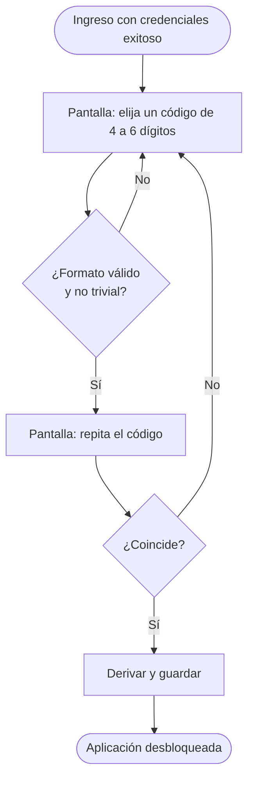
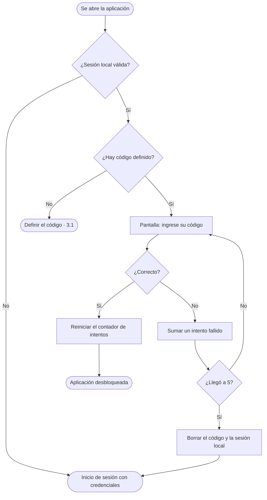

# 07 · Código de desbloqueo

| | |
|---|---|
| **Componente** | Gestor de sesión (cerradura del dispositivo) · [`src/sesion/desbloqueo.ts`](../../src/sesion/desbloqueo.ts) |
| **Capa** | Lógica (gestor de sesión y permisos, Tabla 20) |
| **Origen en el documento** | Apartado 3.9.1 (segunda capa) · RD-05 · Tabla 28 (pantalla de inicio de sesión) · Tabla 31 (fila «El usuario abre la aplicación en un dispositivo que ya tiene sesión») · referencia [42] (*SubtleCrypto: deriveKey*) |
| **Depende de** | [06 · Autenticación](06-autenticacion.md) (sesión local) · [02 · Esquema local](02-esquema-local.md) (tabla `meta`) |
| **Lo usan** | La estructura general de la aplicación, al abrir |
| **Pruebas** | PU-08 · PE-14 |

---

## 1. El problema

Después del paso 1.7, la aplicación recuerda al usuario aunque se cierre: al abrirla, lo reconoce sin
pedir nada. Es lo que permite trabajar sin señal, pero tiene una consecuencia que el apartado 3.9.1
señala con precisión:

> Si la sesión quedara abierta de manera indefinida, cualquiera que tomara el teléfono actuaría con
> la identidad de quien la abrió, y la restricción RD-05, que impide al trabajador intervenir los
> registros del propietario, quedaría sin efecto práctico.

Todo el modelo de permisos se apoya en **quién es el autor** de cada registro. Si un trabajador toma el
teléfono del propietario y lo encuentra abierto, cada registro que haga quedará firmado como del
propietario, con sus permisos. La autoría dejaría de ser cierta y con ella la trazabilidad.

## 2. La solución: una cerradura del dispositivo

El apartado 3.9.1 define la segunda capa del diseño:

> Un código de desbloqueo que la aplicación solicita cada vez que se abre. No es una credencial del
> servicio remoto sino una cerradura del dispositivo, se define en el primer ingreso, admite entre
> cuatro y seis dígitos y se conserva derivado mediante la interfaz criptográfica del navegador,
> nunca en claro.

| Característica | Valor | Por qué |
|---|---|---|
| Cuándo se define | En el primer ingreso, justo después de iniciar sesión con conexión | Es el único momento en que se sabe con certeza quién es el usuario |
| Cuándo se pide | Cada vez que se abre la aplicación | Es el momento en que el teléfono puede haber cambiado de manos |
| Formato | 4 a 6 dígitos | Rápido de escribir con una mano en el potrero (3.10.1) |
| Dónde se verifica | En el teléfono, sin red | Debe funcionar en el potrero (RD-03) |
| Cómo se guarda | Derivado criptográficamente, nunca en claro | Sección 4 |
| Qué pasa tras 5 errores | Se exige un ingreso completo, que requiere conexión | Tabla 31 |

**No es la contraseña de la cuenta.** La contraseña prueba la identidad ante el servicio y nunca se
guarda en el teléfono (documento 06, sección 5). El código solo abre la aplicación en **este**
teléfono y no sirve en ningún otro lugar.

## 3. Flujos

### 3.1 Definir el código (primer ingreso)



### 3.2 Abrir la aplicación



### 3.3 Olvidé mi código

La pantalla ofrece **«Olvidé mi código»**, que lleva al mismo lugar que cinco intentos fallidos: un
ingreso completo con credenciales, que requiere conexión, y la definición de un código nuevo.

## 4. Cómo se guarda el código: derivación con PBKDF2

### 4.1 Por qué no guardarlo tal cual

Si el código se guardara en claro, cualquiera que leyera la base de datos del teléfono (por ejemplo,
con las herramientas de desarrollador, como se hizo en PE-13) lo vería. Tampoco basta con aplicarle
una función resumen simple: con solo 10.000 a 1.000.000 de códigos posibles, se calcularía el resumen
de todos en una fracción de segundo y se compararía.

### 4.2 Derivación lenta con sal

Se usa **PBKDF2** (*Password-Based Key Derivation Function 2*), disponible en la interfaz
criptográfica del navegador (*Web Crypto*), la misma que cita la referencia [42] del documento:

```
derivado = PBKDF2(código, sal, iteraciones, SHA-256) → 256 bits
```

| Elemento | Valor | Para qué |
|---|---|---|
| **Sal** | 16 bytes aleatorios, generados al definir el código | Dos usuarios con el mismo código obtienen derivados distintos, y no sirven tablas precalculadas |
| **Iteraciones** | 600.000 | Hace que cada intento cueste tiempo de cálculo. Es el valor que recomienda la guía de OWASP para PBKDF2 con SHA-256 |
| **Función** | HMAC-SHA-256 | Estándar, implementada de forma nativa por el navegador |

En el teléfono se guarda solo `{ sal, iteraciones, derivado, intentos_fallidos }`. Para verificar un
código, se vuelve a derivar con la misma sal y las mismas iteraciones y se compara el resultado.

Las 600.000 iteraciones hacen que cada verificación tarde una fracción de segundo en un teléfono de
gama media. Para quien abre la aplicación es imperceptible; para quien intenta adivinar, multiplica
el costo de cada intento. El valor queda guardado junto al derivado, de modo que podrá ajustarse en
el futuro sin invalidar los códigos ya definidos.

### 4.3 Comparación

La comparación del derivado calculado con el guardado recorre siempre todos los bytes, sin detenerse
en el primero distinto, para que el tiempo de respuesta no dé pistas sobre cuántos dígitos se
acertaron.

## 5. Códigos triviales

Se rechazan al definir el código los que cualquiera intentaría primero:

| Tipo | Ejemplos |
|---|---|
| Todos los dígitos iguales | `0000`, `11111`, `999999` |
| Secuencias ascendentes o descendentes | `1234`, `23456`, `654321` |

## 6. El reingreso tras el bloqueo y la cola

Hay un caso que el documento no contempla y que este diseño debe resolver. Tras cinco intentos
fallidos se borra la sesión local y se pide un ingreso completo. Pero **la cola puede tener registros
pendientes** del usuario anterior.

Si en ese momento ingresa **otro** usuario, su sesión transmitiría registros cuyo autor es el usuario
anterior. Las reglas del paso 1.9 exigirán que el autor de cada registro coincida con quien lo envía,
así que el servicio los rechazaría y esos registros quedarían atascados en la cola. Además se
rompería el supuesto de un usuario por dispositivo (3.9.1).

Por eso:

> Mientras la cola tenga registros pendientes, el reingreso solo se admite **para el mismo usuario**
> que era dueño de la sesión. Si ingresa otro, se rechaza con un aviso.

El aviso explica el motivo y qué hacer, para que el rechazo no parezca una falla de la aplicación
(decisión del 2026-10-07):

> ⚠ **Este teléfono tiene 3 registros de Daniel Ramos que aún no se han enviado.** Solo Daniel Ramos
> puede ingresar hasta que se envíen, para que no se pierdan. Pídale que ingrese con su cuenta y
> sincronice.

Para poder nombrarlo, al borrar la sesión local por bloqueo se conservan el identificador y el
nombre del usuario anterior, y solo mientras haya pendientes. En cuanto la cola queda vacía, ese
dato se descarta y cualquier usuario puede ingresar.

La misma regla aplica a «Olvidé mi código». El cierre de sesión normal ya exige la cola vacía
(documento 06), de modo que no deja pendientes de otro usuario.

## 7. Lo que este código protege y lo que no

El apartado 3.9.1 lo dice sin rodeos: la razón de ser del código es «de diseño antes que de
seguridad». Conviene dejar explícito su alcance:

| Protege contra | No protege contra |
|---|---|
| Que otra persona del predio tome el teléfono abierto y registre con la identidad del dueño | Que alguien con conocimientos técnicos extraiga la base de datos del teléfono y pruebe todos los códigos posibles fuera de la aplicación. Con un millón de combinaciones como máximo, la derivación lenta lo encarece pero no lo impide |
| Intentos de adivinar desde la aplicación: a los 5 errores se exige la contraseña de la cuenta | La lectura de los datos del predio guardados en el teléfono: el código no cifra la base de datos |

Ninguna de las dos limitaciones compromete la información del servicio remoto: para transmitir o
consultar hace falta un token válido, y las reglas del paso 1.9 deciden en el servidor. La protección
completa del teléfono frente a un atacante con acceso físico corresponde al bloqueo de pantalla y al
cifrado del sistema operativo. Se declaran como limitaciones del prototipo.

## 8. Relación con los requerimientos

| Requerimiento | Cómo lo atiende |
|---|---|
| **RD-05** | La identidad del autor de cada registro se confirma en cada apertura |
| **RNF-07** | El acceso a la información del teléfono queda condicionado al código, además de la sesión |
| **RD-03** | El código se verifica sin red |
| **Tabla 31** | En aperturas posteriores solo se pide el código, no las credenciales; a los 5 errores se exige el ingreso completo |

## 9. Pruebas

### PU-08 (automática)

Para que las pruebas sean rápidas, usan pocas iteraciones; la cantidad es un parámetro y la
aplicación usa 600.000.

| # | Qué verifica | Criterio de aprobación |
|---|---|---|
| 1 | Formato | Se aceptan 4, 5 y 6 dígitos; se rechazan 3, 7, letras y espacios |
| 2 | Códigos triviales | Se rechazan dígitos iguales y secuencias; se acepta un código ordinario |
| 3 | Guardado | Lo guardado no contiene el código, y dos definiciones del mismo código producen sales y derivados distintos |
| 4 | Verificación correcta | El código correcto desbloquea y reinicia el contador |
| 5 | Verificación incorrecta | Cada error suma un intento e informa cuántos quedan |
| 6 | Bloqueo | Al quinto error se borran el código y la sesión local, y se conserva el usuario anterior si hay pendientes |
| 7 | Reingreso | Con pendientes, solo el mismo usuario puede volver a ingresar, y el rechazo informa el nombre del usuario anterior y la cantidad de pendientes; sin pendientes, cualquiera |
| 8 | Iteraciones en uso | Al definir un código, se guarda con 600.000 iteraciones |

### PE-14 (manual)

Definir un código en el primer ingreso, cerrar y abrir la aplicación y desbloquearla, equivocarse
para ver el contador, y comprobar el bloqueo al quinto intento.

## Referencias

- K. Moriarty, B. Kaliski y A. Rusch, «PKCS #5: Password-Based Cryptography Specification Version 2.1», RFC 8018, IETF, 2017 (PBKDF2).
- OWASP, «Password Storage Cheat Sheet», sección *PBKDF2*.
- Mozilla, «SubtleCrypto: deriveKey() method» y «deriveBits() method», MDN Web Docs.
- Documento de trabajo de grado: apartado 3.9.1; RD-05; Tablas 28 y 31; referencia [42].
