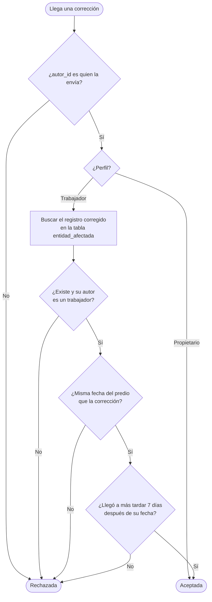

# 08 · Permisos por perfil

| | |
|---|---|
| **Componente** | Gestor de permisos · [`src/sesion/permisos.ts`](../../src/sesion/permisos.ts) · políticas de seguridad a nivel de fila del servicio |
| **Capa** | Lógica (gestor de sesión y permisos, Tabla 20) y servicio remoto |
| **Origen en el documento** | Apartados 3.9.2 (Tabla 27), 3.9.3, 3.9.5 y 2.8.10 · RF-25 · RF-26 · RF-27 · RD-05 · RNF-06 · Tabla 31 (filas del perfil de trabajador) |
| **Depende de** | [05 · Esquema remoto](05-esquema-remoto.md) · [06 · Autenticación](06-autenticacion.md) · [07 · Código de desbloqueo](07-codigo-de-desbloqueo.md) |
| **Lo usan** | Todas las pantallas (qué opciones mostrar) y todos los módulos (qué pueden escribir); el motor de sincronización (paso 1.10), cuyos envíos evalúa el servicio |
| **Pruebas** | PU-09 · PI-03 |

---

## 1. El problema

Los pasos 1.7 y 1.8 garantizan **quién** está usando el teléfono. Falta decidir **qué puede hacer**
cada uno. El propietario pidió en la primera entrevista que los trabajadores pudieran agregar y
consultar información pero no intervenir sus registros, y el refinamiento del 27 de septiembre de 2026
(apartado 2.8.10) precisó la regla de corrección. La Tabla 27 traduce eso a los dieciocho casos de uso.

El apartado 3.9.3 exige aplicar el mismo modelo en dos lugares:

| Dónde | Para qué | ¿Es confiable? |
|---|---|---|
| **En el teléfono** | Ocultar lo que el perfil no tiene habilitado y rechazar la operación antes de escribirla, para que la experiencia sea coherente | **No.** La aplicación corre en el dispositivo del usuario; quien sepa manipularla puede saltarse cualquier verificación local |
| **En el servicio** | Volver a decidir cada operación cuando la información sube, con las reglas a nivel de fila (RLS) | **Sí.** Es la garantía real de la restricción |

## 2. Una distinción necesaria: funciones y datos

Al llevar la Tabla 27 a las tablas de la base de datos aparece algo que el documento no hace
explícito. Algunas funciones están reservadas al propietario, **pero los datos que esas funciones
muestran los necesita el teléfono del trabajador para operar sin conexión**:

| Función reservada al propietario (Tabla 27) | Datos que usa | Por qué el teléfono del trabajador también los necesita |
|---|---|---|
| CU-07 Comparar producción | `produccion_leche` | La ronda de ordeño del trabajador (CU-06) muestra el promedio reciente de cada vaca y advierte un ordeño ya registrado ese día (3.8.6) |
| CU-11 Control reproductivo | `parto` | La genealogía forma parte de la ficha del animal (CU-03), que el trabajador consulta |
| CU-12 Destino productivo | `destino_productivo` | La ficha muestra el destino vigente (RF-05), y la ronda de ordeño lista las vacas con destino de leche (CU-06) |
| CU-13 Salida y venta | `salida` | Sin las salidas, el teléfono no sabe qué animales siguen activos (documento 02, sección 6.1) |
| CU-18 Consultar correcciones | `correccion` | Sin las correcciones, el teléfono no puede calcular el valor vigente de ningún registro (3.9.5) |

Si el servicio le negara al trabajador la lectura de esas tablas, su teléfono mostraría promedios
equivocados, animales vendidos como activos y valores ya corregidos. Por eso el modelo distingue
**dos niveles**:

| Nivel | Qué controla | Dónde se aplica |
|---|---|---|
| **Funciones** | Qué pantallas y acciones ve cada perfil: la Tabla 27 tal cual | En el teléfono, con el gestor de permisos |
| **Datos** | Qué filas puede leer y escribir cada perfil en el servicio | En el servicio, con las políticas RLS |

La única información que el trabajador **no necesita** para su trabajo y que el documento reserva
expresamente al propietario es la **económica** (apartados 2.8.6 y 3.8.12). Esa sí se le niega en el
servicio: el trabajador no recibe ni puede escribir `movimiento_economico`.

Se declara como limitación: los datos de producción, partos, destinos, salidas y correcciones están
en el teléfono del trabajador aunque las pantallas que los resumen le estén ocultas. No es
información confidencial frente a él, porque la registra él mismo en su mayoría; la restricción de
esas funciones es de organización del trabajo, no de confidencialidad.

## 3. Permisos de escritura por tabla

Escribir es siempre insertar (documento 05, sección 2). La regla común a todas las inserciones:

> **El autor de la fila debe ser el usuario autenticado que la envía** (`autor_id = auth.uid()`), y ese
> usuario debe tener un perfil en `usuario`.

Así nadie puede subir registros a nombre de otro: ni un trabajador a nombre del propietario ni
viceversa. Es lo que hace cierta la autoría que exigen RF-27 y RNF-08.

| Tabla | Propietario | Trabajador | Caso de uso de origen |
|---|---|---|---|
| `animal`, `fotografia` | Inserta | Inserta | CU-02 |
| `evento_sanitario` | Inserta | Inserta | CU-04 |
| `medicamento` | Inserta | Inserta | CU-04, Tabla 31 («permite incorporarlo sin abandonar el registro») |
| `produccion_leche` | Inserta | Inserta | CU-06 |
| `pesaje` | Inserta | Inserta | CU-08 |
| `parto` | Inserta | Inserta | CU-10 |
| `destino_productivo` | Inserta | — | CU-12 |
| `salida` | Inserta | — | CU-13 |
| `movimiento_economico` | Inserta | — | CU-13, CU-14 |
| `recordatorio` (posponer) | Inserta | — | CU-15 («solo consulta» para el trabajador) |
| `correccion` | Inserta sobre cualquier registro | Inserta solo con las condiciones de la sección 4 | CU-17 |

## 4. La regla de corrección del trabajador

El apartado 3.9.5 establece que el trabajador puede corregir o anular registros **creados por
trabajadores**, incluidos los suyos, **dentro del mismo día** en que se produjo el registro, y nunca
los del propietario. Para aplicarla, la política no puede mirar solo la fila que llega: tiene que
**consultar el registro corregido** para saber quién lo creó y cuándo (3.9.3).

### 4.1 La condición «mismo día» sin conexión

La Tabla 21 contempla que las correcciones se hagan sin conexión. Eso obliga a decidir qué reloj
define «el mismo día»:

| Opción | Problema |
|---|---|
| El reloj del servicio al recibir la corrección | Un trabajador que corrige a las 11 de la noche sin señal y sincroniza a la mañana siguiente vería su corrección **rechazada** por haber llegado «otro día», y quedaría atascada en la cola |
| Solo el reloj del teléfono | Un trabajador que atrase el reloj de su teléfono podría corregir un registro de hace meses, justo lo que la regla quiere impedir |

La regla adoptada combina los dos relojes:

> Un trabajador puede corregir un registro creado por un trabajador si **(a)** la corrección y el
> registro tienen la misma fecha calendario del predio según el teléfono, y **(b)** la corrección llega
> al servicio a más tardar 7 días después de la fecha que declara.

La condición (a) es la del documento. La (b) cierra la puerta del reloj atrasado: una corrección que
dice haberse hecho hace meses, pero llega hoy, se rechaza. Siete días es holgado frente a los periodos
sin señal del predio (3 a 4 horas de señal al día, apartado 3.7.6) y queda como parámetro ajustable
(`dias_maximos_correccion_sin_conexion`).

### 4.2 Qué consulta la política

Como la cola transmite en el orden en que se crearon las operaciones (3.7.2), un registro creado y
corregido sin conexión el mismo día llega al servicio **antes** que su corrección, de modo que la
política siempre lo encuentra.

## 5. Permisos de lectura

| Tabla | Propietario | Trabajador |
|---|---|---|
| Las del predio, excepto `movimiento_economico` | Lee todo | Lee todo (sección 2) |
| `movimiento_economico` | Lee todo | — |
| `usuario` | Lee los tres usuarios | Lee los tres usuarios: el teléfono necesita el perfil del autor de cada registro para aplicar la regla de corrección sin conexión (Tabla 25) |

La política de lectura de `usuario` no puede condicionarse al perfil del que consulta, porque
ese perfil se lee de la misma tabla y la política se invocaría a sí misma sin fin (recursión). Se abre
a cualquier usuario autenticado. No hay riesgo práctico: el registro abierto está deshabilitado (PE-04)
y las únicas cuentas son las que crea el propietario.
| `parametro` | Lee | Lee |

## 6. El perfil que deciden las políticas

Las políticas leen el perfil de la **tabla `usuario`** y no del token. El token también lo trae
firmado, pero la tabla es la fuente de verdad: si el propietario cambia el perfil de alguien, la
política lo aplica de inmediato, sin esperar a que esa persona renueve su token.

## 7. El gestor de permisos del teléfono

Expone la Tabla 27 en forma de consultas sencillas para las pantallas y los módulos:

| Función | Responde |
|---|---|
| `puedeUsar(perfil, casoDeUso)` | ¿Se muestra esta pantalla o acción? (CU-01 a CU-18) |
| `puedeCrear(perfil, tabla)` | ¿Puede este perfil insertar en esta tabla? (sección 3) |
| `puedeCorregir(usuario, registro, perfilDelAutor, ahora)` | ¿Se muestra «corregir» en este registro? (sección 4) |

Una función de escritura autorizada, `crearAutorizado`, verifica `puedeCrear` antes de llamar al
repositorio. Si el perfil no tiene el permiso, la operación se rechaza antes de escribirse, como
exige la Tabla 31: «si la operación llegara a intentarse, es rechazada antes de escribirse y también
en el servicio remoto».

## 8. Lo que el servicio rechaza aunque el teléfono lo permitiera

La verificación del teléfono es una cortesía; la del servicio, la garantía. Las pruebas PI-03
verifican directamente contra el servicio, simulando un teléfono manipulado, que:

- un trabajador no puede insertar una salida, un destino, un movimiento económico ni posponer un recordatorio;
- nadie puede insertar una fila con el autor de otra persona;
- un trabajador no puede corregir un registro del propietario ni uno de otro día;
- un trabajador no puede leer los movimientos económicos.

## 9. Relación con los requerimientos

| Requerimiento | Cómo lo atiende |
|---|---|
| **RF-25** | Dos perfiles con permisos distintos, en el teléfono y en el servicio |
| **RF-26 · RD-05** | El trabajador no corrige registros del propietario y solo corrige los de trabajadores del mismo día |
| **RF-27 · RNF-08** | El servicio exige que el autor de cada fila sea quien la envía |
| **3.9.3** | Doble aplicación: el teléfono oculta y rechaza; el servicio decide |

## 10. Pruebas

### PU-09 (automática)

| # | Qué verifica | Criterio de aprobación |
|---|---|---|
| 1 | Funciones | `puedeUsar` coincide con la Tabla 27 en los 18 casos de uso para ambos perfiles |
| 2 | Escritura | `puedeCrear` coincide con la sección 3 en las 12 tablas para ambos perfiles |
| 3 | Corrección del propietario | Puede corregir cualquier registro, de cualquier autor y fecha |
| 4 | Corrección del trabajador | Puede corregir uno de un trabajador del mismo día; no uno del propietario; no uno de otro día |
| 5 | Escritura autorizada | `crearAutorizado` rechaza sin escribir lo que el perfil no permite |

### PI-03 (contra el servicio real)

Simula sesiones de un propietario y de un trabajador dentro de la base de datos y verifica cada
permiso de las secciones 3 a 5, incluidos los intentos de un teléfono manipulado de la sección 8.

## Referencias

- Supabase, «Row Level Security» y «RLS performance recommendations», Supabase Documentation.
- PostgreSQL Global Development Group, «Row Security Policies».
- Documento de trabajo de grado: apartados 2.8.6, 2.8.10, 3.7.2, 3.8.12, 3.9.2, 3.9.3 y 3.9.5; Tablas 21, 25, 27 y 31.
