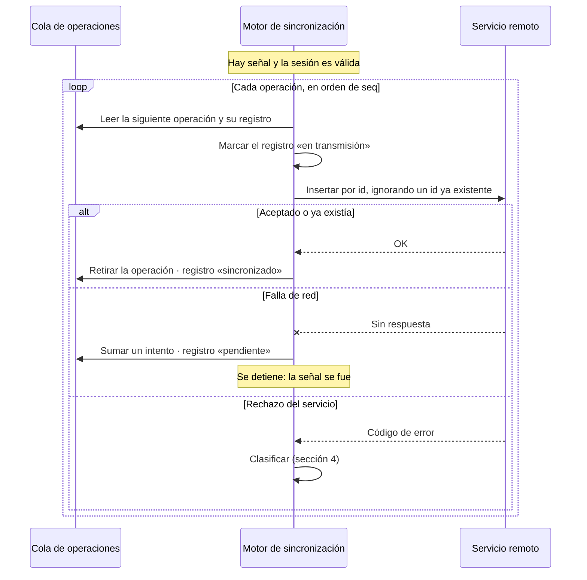
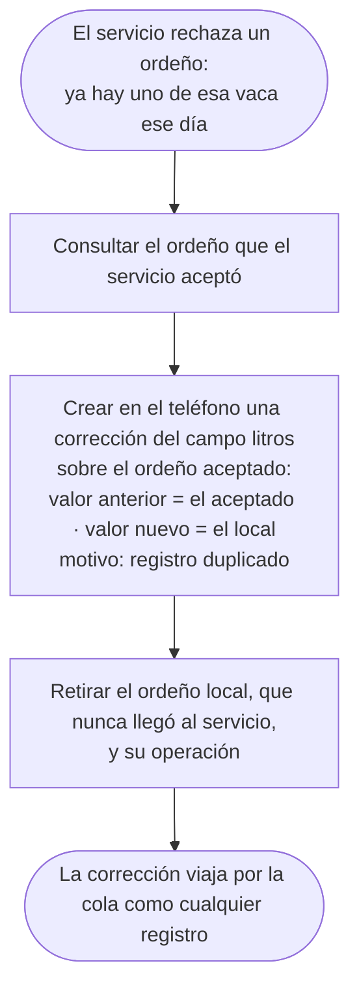
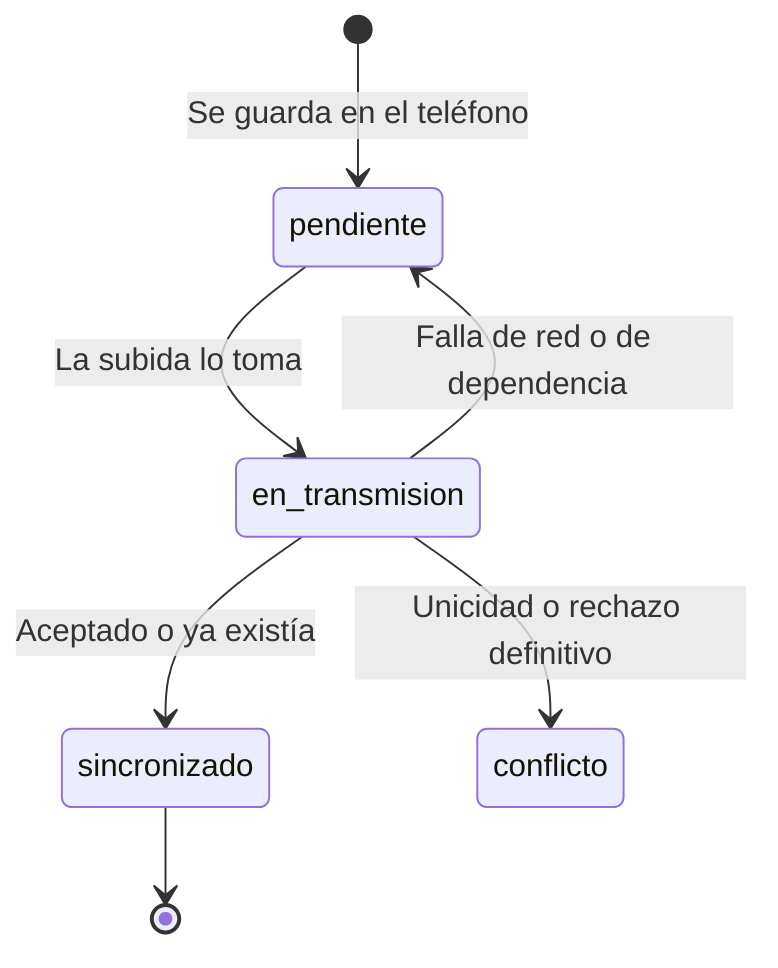

# 09 · Sincronización (parte 1): subida y conflictos

| | |
|---|---|
| **Componente** | Motor de sincronización, subida · [`src/sync/subida.ts`](../../src/sync/subida.ts) |
| **Capa** | Acceso a datos (Figura 10, Tabla 20) |
| **Origen en el documento** | Apartados 3.7.2 a 3.7.5 y 3.7.8 · 3.8.6 (último párrafo) · Tablas 21 y 22 · RF-29 · RF-30 · RNF-04 · CU-16 |
| **Depende de** | [03 · Repositorio y cola](03-repositorio-y-cola.md) · [05 · Esquema remoto](05-esquema-remoto.md) · [06 · Autenticación](06-autenticacion.md) · [08 · Permisos](08-permisos.md) |
| **Continúa en** | [10 · Sincronización (parte 2): bajada y carga inicial](10-sincronizacion-bajada.md) |
| **Pruebas** | PU-10 · PI-04 |

---

## 1. Qué hace la subida

Los pasos anteriores dejaron lista la mitad del camino: cada registro queda en el teléfono junto con
una entrada en la cola (documento 03). La subida recorre esa cola y envía cada registro al servicio,
**en el orden en que se creó**, hasta vaciarla o hasta que se acabe la señal.

## 2. Cuándo se ejecuta

El apartado 3.7.7 establece dos momentos: la apertura de la aplicación y el aviso de que la conexión
se restableció. El diseño agrega dos más, que no cambian el mecanismo y reducen el tiempo que la
información pasa solo en el teléfono:

| Momento | Origen |
|---|---|
| Al abrir y desbloquear la aplicación | 3.7.7 |
| Cuando el navegador avisa que volvió la conexión (evento `online`) | 3.7.7 |
| Pocos segundos después de guardar un registro, si hay señal | Agregado: el registro sale cuanto antes |
| Cada 5 minutos mientras la aplicación esté abierta y con señal | Agregado: red de seguridad si un aviso no llegó |

Después de cada subida se ejecuta la bajada (documento 10): primero se envía lo pendiente y después
se pregunta qué hay de nuevo, de modo que una sola conversación deja los dos lados al día (3.7.7).

### 2.1 Una sola sincronización a la vez

Si dos sincronizaciones corrieran al tiempo, por ejemplo con la aplicación abierta en dos pestañas,
podrían enviar la misma operación dos veces o retirarla de la cola mientras la otra la usa. El motor
toma un **candado** del navegador (*Web Locks API*) antes de empezar; si ya hay una sincronización en
curso, la nueva se omite.

## 3. Cómo se envía un registro

### 3.1 Inserción que ignora un identificador existente

El apartado 3.7.8 fija la regla:

> El envío es una inserción que ignore el identificador ya presente.

En SQL equivale a `INSERT … ON CONFLICT (id) DO NOTHING`, y la biblioteca cliente lo expresa como
`upsert(registro, { onConflict: 'id', ignoreDuplicates: true })`. Tres propiedades:

| Propiedad | Consecuencia |
|---|---|
| Basta el privilegio de **insertar** | Coherente con el servidor de solo inserciones (documento 05) |
| Si el identificador ya existe, **no hace nada** y no da error | Reintentar una operación que sí llegó, pero cuya confirmación se perdió con la señal, no duplica nada (Tabla 21) |
| Solo ignora el conflicto de **identificador** | Las demás reglas de unicidad (chapeta, ordeño diario, compra única) siguen rechazando, y esos rechazos son conflictos reales (sección 5) |

### 3.2 Qué viaja

El registro tal como está en el teléfono, **sin los atributos locales** (`estado_sync`, `recibido_en`,
`detalle_conflicto`), que solo describen la relación entre el teléfono y el servicio (3.8.2). El autor
y la fecha de creación viajan sin recalcularse (RD-04): el servicio los guarda tal como llegan, y su
política exige que el autor sea quien envía (documento 08).

### 3.3 Sesión vigente

El token de acceso caduca a la hora (documento 06). Antes de enviar, el motor pide a la biblioteca
cliente una sesión vigente, lo que renueva el token si hace falta. Si la renovación falla porque el
token de refresco ya no es válido, la subida **se suspende sin tocar la cola** y la aplicación pide un
ingreso con credenciales (3.9.1, Tabla 21). Nada se pierde: los registros siguen pendientes.

## 4. Clasificación de las respuestas

Cada respuesta del servicio cae en una de cinco clases, y cada clase tiene una acción distinta:

| Clase | Respuestas | Qué significa | Acción sobre la operación | Estado del registro | ¿Sigue la subida? |
|---|---|---|---|---|---|
| **Aceptada** | Inserción correcta, o identificador ya existente | El servicio tiene el dato | Se retira de la cola | `sincronizado` | Sí |
| **Transitoria** | Sin red, tiempo agotado, error 5xx del servicio, límite de peticiones | La conexión falló, no el dato | Se queda; se suma un intento | `pendiente` | **No**: se detiene hasta el siguiente momento de sincronización |
| **De dependencia** | Clave foránea inexistente (`23503`) | El registro apunta a otro que el servicio aún no tiene, por ejemplo un evento de un animal en conflicto | Se queda; se suma un intento | `pendiente` | Sí, con la siguiente operación |
| **Conflicto** | Unicidad distinta del identificador (`23505`) | Otro dispositivo ya registró lo mismo | Ver sección 5 | `conflicto` o resuelta | Sí |
| **Rechazo definitivo** | Política de seguridad (`42501`), restricción de valores (`23514`), datos inválidos (`22…`) | El servicio no aceptará este registro por más que se reintente | Se retira de la cola | `conflicto`, con la causa | Sí |

Un rechazo definitivo no debería ocurrir en uso normal, porque el teléfono valida antes de guardar
y el gestor de permisos impide lo que el perfil no tiene. Puede darse, por ejemplo, si una corrección
de un trabajador llega más de 7 días después de hecha (documento 08, sección 4.1) o si el propietario
cambió el perfil de un usuario mientras su teléfono tenía pendientes. Retirarlo de la cola evita que
bloquee la subida para siempre; marcarlo en conflicto, con la causa, evita que se pierda en silencio.

## 5. Conflictos

### 5.1 Chapeta repetida

Es la tercera regla del apartado 3.7.3. Si el servicio rechaza un animal porque su código ya está
asignado, el teléfono **no lo descarta**: lo marca `conflicto`, con la causa «el código de chapeta ya
está asignado a otro animal», y retira la operación de la cola. El animal sigue visible en ese teléfono
señalado como conflicto, y los eventos que se le registren allí quedan pendientes por dependencia
(sección 4) hasta que el propietario resuelva.

Cómo lo resuelve el propietario es un pendiente de diseño acordado para el paso 2.1 (corregir el
código o anular el duplicado).

### 5.2 Ordeño duplicado: de rechazo a corrección

El apartado 3.8.6 y la Tabla 21 establecen que, si dos dispositivos registran la producción de la
misma vaca en la misma fecha, «el segundo no se descarta, sino que se convierte en una corrección
sobre el registro aceptado». La subida lo hace así:

Así ninguno de los dos valores se pierde y el propietario puede ver cuál prevaleció y quién registró
cada uno.

Retirar el ordeño local no contradice la inmutabilidad: ese registro **nunca llegó al servicio** y su
valor queda conservado en la corrección. Lo que no se borra nunca es un registro que el servicio ya
aceptó.

**Un caso que hereda las reglas de permiso.** Si el ordeño aceptado lo creó el propietario y el
duplicado es de un trabajador, la corrección será rechazada por el servicio, porque un trabajador no
puede corregir registros del propietario (3.8.6, último párrafo). En ese caso la corrección queda en
`conflicto` con la causa, y el valor del trabajador se conserva en ella para que el propietario
decida.

### 5.3 Otras unicidades

| Unicidad | Ejemplo | Tratamiento |
|---|---|---|
| Nombre de medicamento sin distinguir mayúsculas | Dos teléfonos incorporan «Ivermectina» sin señal | `conflicto`; los eventos que lo usan quedan pendientes por dependencia |
| Una compra por animal | Dos teléfonos registran la compra del mismo animal | `conflicto` |
| Una salida por animal | Dos teléfonos registran la salida del mismo animal | `conflicto` |

Las dos últimas solo pueden darse con el propietario registrando desde dos dispositivos, porque son
operaciones exclusivas de su perfil. Su resolución se diseñará con las pantallas correspondientes
(pasos 3.1 y 5.2).

## 6. Estados del registro

Los cuatro estados de la Tabla 22 y sus transiciones:

El estado `en_transmision` dura lo que tarda una petición. Si la aplicación se cierra justo en ese
momento, el registro quedaría marcado así sin que nadie lo esté enviando; por eso, al empezar cada
subida, el motor devuelve a `pendiente` todo registro que haya quedado en transmisión. Como la
operación sigue en la cola y el envío es idempotente, reenviarlo no duplica nada.

## 7. Lo que la subida todavía no hace

| Capacidad | Dónde se incorpora |
|---|---|
| Enviar las imágenes de las fotografías por su propia cola | Paso 2.2 |
| Mostrar el contador de pendientes y la marca por registro | Paso 1.11 |
| Agrupar varias operaciones en una sola petición | Mejora de rendimiento posible; la cola del predio es pequeña (Tabla 26) |
| Sincronizar con la aplicación cerrada (*Background Sync*) | Fuera del alcance: solo lo soportan los navegadores basados en Chromium y no es necesario para el flujo diseñado |

## 8. Relación con los requerimientos

| Requerimiento | Cómo lo atiende |
|---|---|
| **RF-29** | Lo registrado sin conexión se envía al restablecerse la señal |
| **RF-30** | Cada registro cambia de estado según la respuesta del servicio |
| **RNF-04** | Una operación sale de la cola solo cuando el servicio confirmó que tiene el dato |
| **3.7.8** | Reenviar no duplica: inserción que ignora el identificador existente |
| **3.7.3, tercera regla · 3.8.6** | Chapeta repetida en conflicto; ordeño duplicado convertido en corrección |

## 9. Pruebas

### PU-10 (automática)

Con un servicio simulado que responde lo que cada prueba necesite:

| # | Qué verifica | Criterio de aprobación |
|---|---|---|
| 1 | Envío en orden | Las operaciones se envían en el orden de la cola y salen de ella al ser aceptadas; el registro queda `sincronizado` |
| 2 | Atributos locales | Lo que viaja no incluye `estado_sync`, `recibido_en` ni `detalle_conflicto` |
| 3 | Idempotencia | Un identificador que el servicio ya tenía se trata como aceptado |
| 4 | Falla de red | La subida se detiene, la operación se queda con un intento más y el registro vuelve a `pendiente` |
| 5 | Dependencia | Una clave foránea inexistente deja la operación en la cola y la subida continúa con la siguiente |
| 6 | Rechazo definitivo | Un rechazo de política retira la operación y deja el registro en `conflicto` con la causa |
| 7 | Chapeta repetida | El animal queda en `conflicto` con la causa y la operación sale de la cola |
| 8 | Ordeño duplicado | Se crea una corrección del campo litros sobre el ordeño aceptado, con los dos valores y el motivo «registro duplicado», y el ordeño local se retira |
| 9 | Registros en transmisión | Al empezar, los registros que quedaron en transmisión vuelven a `pendiente` |
| 10 | Una a la vez | Una segunda sincronización simultánea se omite |
| 11 | Sesión vencida | Si no hay sesión vigente, la subida se suspende sin tocar la cola |

### PI-04 (contra el servicio real)

Con la sesión de un usuario real del predio, subir desde el teléfono un animal y un pesaje, verificar
que llegan al servicio con su autor, repetir el envío y verificar que no se duplican. Se ejecuta al
terminar el paso, junto con la parte 2.

## Referencias

- Supabase, «JavaScript Client Library: upsert» (opción `ignoreDuplicates`).
- PostgreSQL Global Development Group, «INSERT: ON CONFLICT Clause» y «Appendix A. PostgreSQL Error Codes».
- Mozilla, «Web Locks API», MDN Web Docs.
- Documento de trabajo de grado: apartados 3.7.2 a 3.7.8, 3.8.6 y 3.9.1; Tablas 21 y 22.
