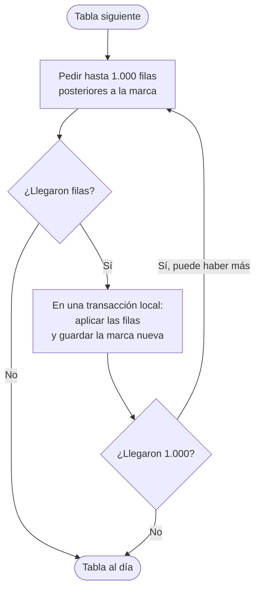

# 10 · Sincronización (parte 2): bajada y carga inicial

| | |
|---|---|
| **Componente** | Motor de sincronización, bajada · [`src/sync/bajada.ts`](../../src/sync/bajada.ts) |
| **Capa** | Acceso a datos (Figura 10, Tabla 20) |
| **Origen en el documento** | Apartados 3.7.5 a 3.7.8 · Tabla 21 (filas de la descarga interrumpida y del registro que vuelve) · Tabla 25 · RF-29 · RNF-05 · CU-16 |
| **Depende de** | [09 · Sincronización (parte 1)](09-sincronizacion-subida.md) · [02 · Esquema local](02-esquema-local.md) · [08 · Permisos](08-permisos.md) |
| **Pruebas** | PU-11 · PI-04 |

---

## 1. Qué hace la bajada

La subida lleva al servicio lo que registró este teléfono. La bajada trae lo que registraron **los
otros**: el ordeño que hizo el trabajador en su teléfono debe aparecer en el del propietario, y el
pesaje del propietario en el del trabajador. Se ejecuta siempre **después** de la subida (3.7.7).

Hay dos situaciones que usan el mismo mecanismo (3.7.6):

| Situación | Qué se descarga |
|---|---|
| **Carga inicial**: un teléfono nuevo, o uno que perdió sus datos | Todo el estado del predio |
| **Descarga incremental**: cualquier sincronización posterior | Solo lo que el servicio recibió desde la última vez |

## 2. La marca de avance

El apartado 3.7.7 la define así:

> El dispositivo conserva una marca de avance, que es el momento hasta el cual tiene incorporada la
> información del servicio remoto, y en cada sincronización pide los cambios posteriores a esa marca.

La marca es la columna `recibido_en`, que fija **el reloj del servicio** al recibir cada fila
(documento 05, sección 4). Si fuera el reloj del teléfono, un teléfono atrasado pediría cambios que ya
tiene y uno adelantado se saltaría cambios que le faltan.

El teléfono guarda **una marca por tabla** en la tabla `meta`. La descarga recorre las tablas en el
orden de sus dependencias (medicamentos, animales, fotografías, destinos, eventos…), el mismo orden
de la carga inicial del apartado 3.7.6, y en cada una pide:

```
filas de la tabla con recibido_en posterior a la marca, ordenadas por recibido_en
```

### 2.1 Por páginas, con la marca dentro de la misma transacción

La descarga pide las filas en páginas de hasta 1.000. Cada página se aplica en una sola transacción
local que incluye **la actualización de la marca**:



El apartado 3.7.7 establece que la marca se guarda solo cuando el lote terminó de aplicarse. Al
guardarla **en la misma transacción** que las filas, eso queda garantizado por la base de datos: o
quedan aplicadas las filas y avanzada la marca, o no queda ninguna de las dos cosas. Si la señal se va
a mitad de una descarga, se pierde a lo sumo la página en curso, que se repite completa en el intento
siguiente. Las páginas anteriores ya quedaron firmes, así que una carga inicial interrumpida se
**reanuda** donde iba (3.7.6) en lugar de empezar de nuevo.

## 3. Un problema de la marca y su solución: la ventana de solapamiento

### 3.1 El problema

Al leer el documento al inicio del desarrollo se identificó un riesgo de la marca de avance cuando dos
teléfonos envían casi al mismo tiempo. `recibido_en` se asigna cuando la fila **entra** a la base de
datos, pero la fila solo es visible para los demás cuando su transacción **termina**. Esos dos
momentos no siempre ocurren en el mismo orden para dos filas distintas:

```
Tiempo del servicio →     10:00:00.100            10:00:00.300          10:00:00.500
Envío del trabajador      entra (recibido 0.100) ·························· termina
Envío del propietario                             entra y termina (0.300)
Descarga de un tercero                                                 lee: solo ve la fila de 0.300
                                                                       guarda la marca 0.300
Siguiente descarga        pide filas posteriores a 0.300 → la del trabajador (0.100) nunca llega
```

La fila del trabajador quedaría **fuera para siempre** de ese teléfono: es anterior a la marca, pero no
existía para los demás cuando se leyó. En el predio la ventana es pequeña, porque cada envío es una
inserción de milisegundos, pero el problema es real y su efecto, un registro que nunca aparece, es
justamente la clase de pérdida silenciosa que el proyecto quiere evitar.

### 3.2 La solución

Cada descarga pide las filas posteriores a la marca **menos un margen de 2 minutos**:

```
filas con recibido_en posterior a (marca − 2 minutos)
```

Las filas del margen ya estaban en el teléfono en su mayoría y se descartan por su identificador
(sección 4). Las que se habían saltado por el problema anterior llegan en la descarga siguiente. Dos
minutos es mucho más que lo que dura cualquier inserción del predio, y el costo es mínimo: unas pocas
filas repetidas por tabla que se descartan sin escribirse.

Esto funciona porque la deduplicación por identificador hace que **repetir no cueste nada**, que es la
propiedad que el apartado 3.7.8 pone en el centro del diseño.

### 3.3 El margen se aplica al inicio, no en cada página

*Precisión agregada al diseñar la implementación (2026-10-08).* Si el margen se restara en cada página,
una tabla con más de 1.000 filas recibidas dentro de 2 minutos (por ejemplo, al cargar de una vez los
datos simulados del paso 6.1) pediría las mismas filas una y otra vez sin terminar nunca. Por eso:

| Momento | Desde dónde se pide |
|---|---|
| Primera página de la descarga | Marca guardada menos 2 minutos |
| Páginas siguientes de la misma descarga | Justo después de la última fila recibida, ordenando por `recibido_en` y desempatando por `id` |

El desempate por identificador evita saltarse filas que comparten exactamente la misma marca de
recepción. La marca se conserva con la precisión completa que devuelve el servicio (microsegundos),
sin convertirla a una fecha del navegador, que solo llega a milisegundos.

## 4. Cómo se aplica cada fila recibida

| Si la fila… | Qué hace el teléfono | Por qué |
|---|---|---|
| **No existe** en el teléfono | La agrega con estado `sincronizado` y su `recibido_en` | Es un registro de otro dispositivo |
| **Ya existe** en el teléfono | No cambia sus datos; solo se asegura de que esté `sincronizado` y con su `recibido_en` | Es un registro que este teléfono envió y vuelve dentro de los cambios del servicio, o una fila repetida por el margen o por una página interrumpida (3.7.8, Tabla 21) |

Los datos de un registro que ya existe no se reemplazan nunca, porque nunca cambian: el servicio no
admite modificaciones (documento 05). Lo único que se actualiza en el teléfono son los atributos
locales que describen su sincronización.

### 4.1 Datos de referencia

`usuario` y `parametro` no tienen marca de avance: se descargan completas en cada sincronización y
reemplazan la copia local. Son unas pocas filas (Tabla 25), y así un cambio de perfil o de un umbral
llega siempre, sin depender de marcas.

### 4.2 Lo que cada perfil recibe

La descarga recibe exactamente lo que las políticas de lectura le permiten al usuario (documento 08,
sección 5). El teléfono del trabajador no recibe `movimiento_economico`; la petición simplemente
devuelve cero filas, sin error.

## 5. Carga inicial

La carga inicial es la descarga incremental con todas las marcas vacías: pide todas las filas de
cada tabla, página por página. El volumen es conocido: menos de 25 MB tras diez años (3.8.7), que caben
holgadamente en las horas de señal del predio, y si se interrumpe se reanuda por las marcas (sección
2.1).

| Aspecto | Comportamiento |
|---|---|
| Cuándo ocurre | Tras el primer ingreso con credenciales en el teléfono, que ya exige conexión (CU-01) |
| Mientras ocurre | La aplicación muestra el avance («Preparando este teléfono»). **Se puede consultar lo que ya llegó, pero no registrar** hasta que terminen de llegar los datos: la verificación de la chapeta necesita el inventario completo. *Corregido el 2026-10-13; la primera versión permitía registrar. Ver el [documento 17](17-carga-inicial.md), sección 2* |
| Orden | Primero los usuarios y los parámetros (datos de referencia, 3.7.6), después las tablas del predio en el orden de sus dependencias. *Hasta el paso 2.5 los usuarios y los parámetros se descargaban al final* |
| Advertencia por dosis repetida | Hasta que la carga termine, la advertencia del RF-09 puede no conocer aplicaciones previas. La nota que el apartado 3.10.4.4 prevé al pie del registro sanitario («la verificación se realiza contra los registros disponibles en el dispositivo») cubre este caso |
| Fotografías | Las imágenes reducidas se descargan por su propia cola, después de los datos (3.7.6): documento 15, sección 6. No bloquean el registro |

## 6. Datos que se borran del teléfono al cerrar sesión

Ninguno. La información descargada es del predio y no de un usuario, de modo que si en el mismo
teléfono ingresa después otro usuario (con la cola vacía, documento 07), encuentra la información
ya descargada y solo baja lo nuevo. Coincide con el supuesto de un usuario por dispositivo del
apartado 3.9.1 sin depender de él.

## 7. Relación con los requerimientos

| Requerimiento | Cómo lo atiende |
|---|---|
| **RF-29** | Lo que registran los demás dispositivos llega a este |
| **RNF-05** | Un teléfono nuevo recupera todo el historial del predio con la carga inicial |
| **3.7.7** | Marca de avance del reloj del servicio, guardada solo con el lote aplicado |
| **3.7.8** | Una fila repetida o que vuelve se descarta por su identificador |

## 8. Pruebas

### PU-11 (automática)

Con un servicio simulado:

| # | Qué verifica | Criterio de aprobación |
|---|---|---|
| 1 | Filas nuevas | Se agregan con estado `sincronizado` y su `recibido_en` |
| 2 | Filas existentes | No se duplican ni cambian sus datos; solo pasan a `sincronizado` |
| 3 | Marca de avance | Tras aplicar una página, la marca es el mayor `recibido_en` recibido |
| 4 | Ventana de solapamiento | La petición usa la marca menos 2 minutos |
| 5 | Fila saltada | Una fila con `recibido_en` anterior a la marca, que no estaba en el teléfono, llega en la descarga siguiente gracias al margen |
| 6 | Páginas | Con más de 1.000 filas se piden varias páginas hasta vaciar la tabla, y con 2.500 filas recibidas en el mismo instante la descarga termina sin repetir páginas |
| 7 | Interrupción | Si la descarga falla a mitad de una tabla, las páginas anteriores quedan aplicadas con su marca y la página fallida no deja nada |
| 8 | Orden | Las tablas se descargan en el orden de sus dependencias |
| 9 | Referencia | `usuario` y `parametro` reemplazan la copia local |
| 10 | Carga inicial | Con el teléfono vacío se descargan todas las filas |

### PI-04 (de extremo a extremo, contra el servicio real)

Las pantallas para registrar animales llegan en la Iteración 2, así que la prueba de extremo a extremo
de esta iteración se hace con un programa de prueba que usa los mismos módulos de la aplicación:

1. Ingresa con una **cuenta de prueba** de perfil trabajador, creada para este fin.
2. Crea en un teléfono simulado un animal y un pesaje, y sincroniza: verifica que llegan al servicio
   con su autor.
3. Repite el envío: verifica que no se duplican.
4. Vacía el teléfono simulado y ejecuta la carga inicial: verifica que el animal y el pesaje vuelven.
5. Al terminar, borra del servicio los registros de la cuenta de prueba con una sentencia de
   administración, porque ningún usuario de la aplicación puede borrarlos (documento 05).

La cuenta de prueba aparecerá en la tabla `usuario` como un cuarto usuario («Usuario de pruebas»).
Se propone conservarla hasta el cierre de la evaluación del prototipo y eliminarla después.

## Referencias

- PostgreSQL Global Development Group, «Transaction Isolation» (visibilidad de las filas al confirmar).
- Supabase, «JavaScript Client Library: select, gt, order, range».
- Documento de trabajo de grado: apartados 3.7.5 a 3.7.8, 3.8.7 y 3.9.1; Tablas 21 y 25.
